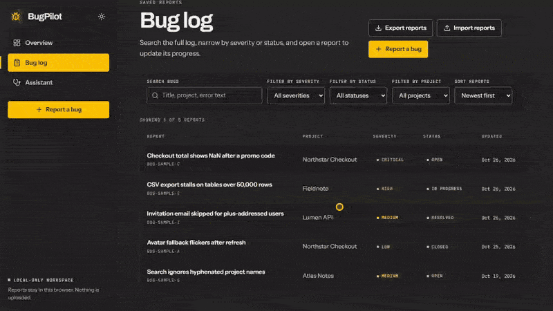
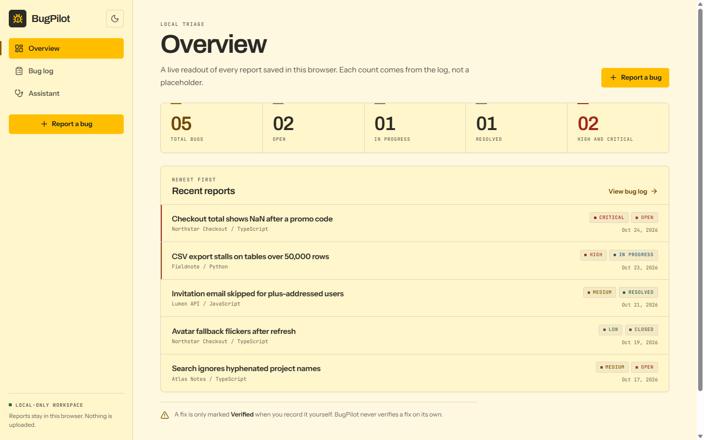
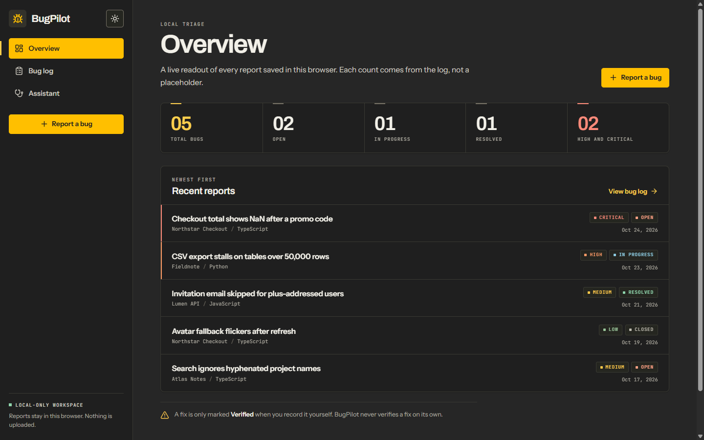
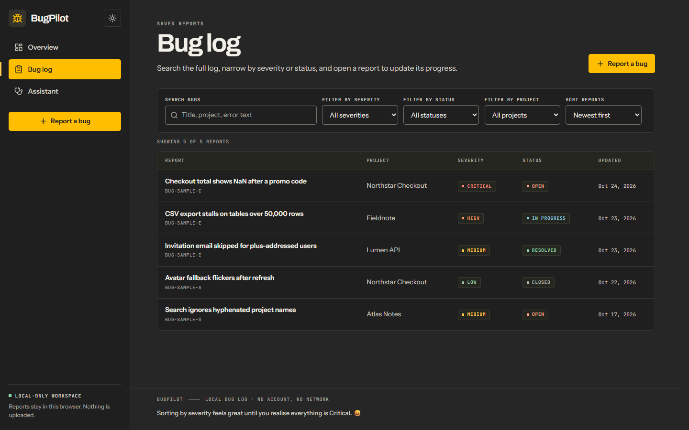
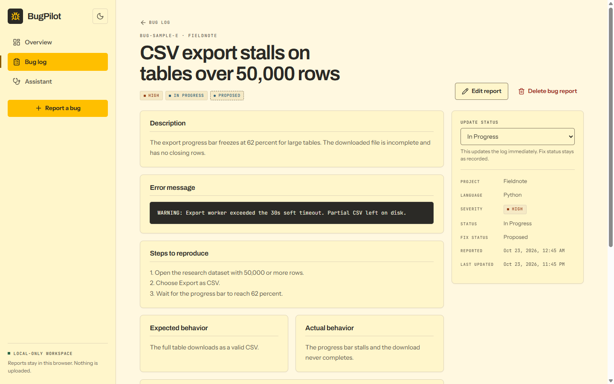
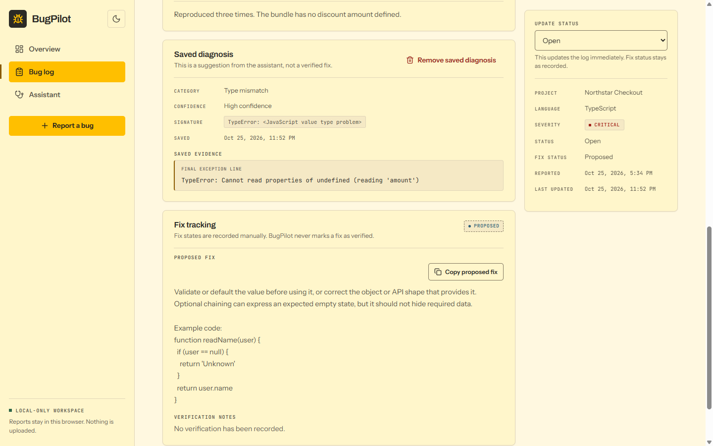
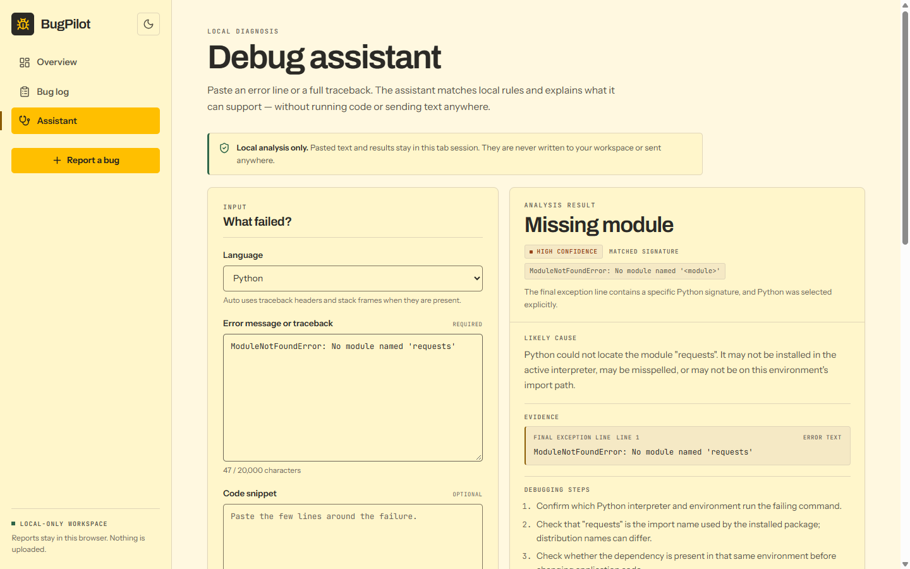
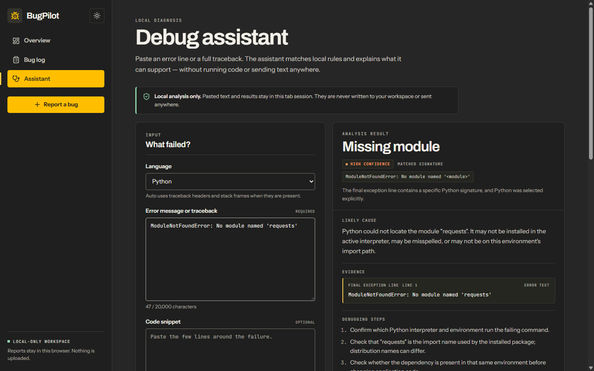
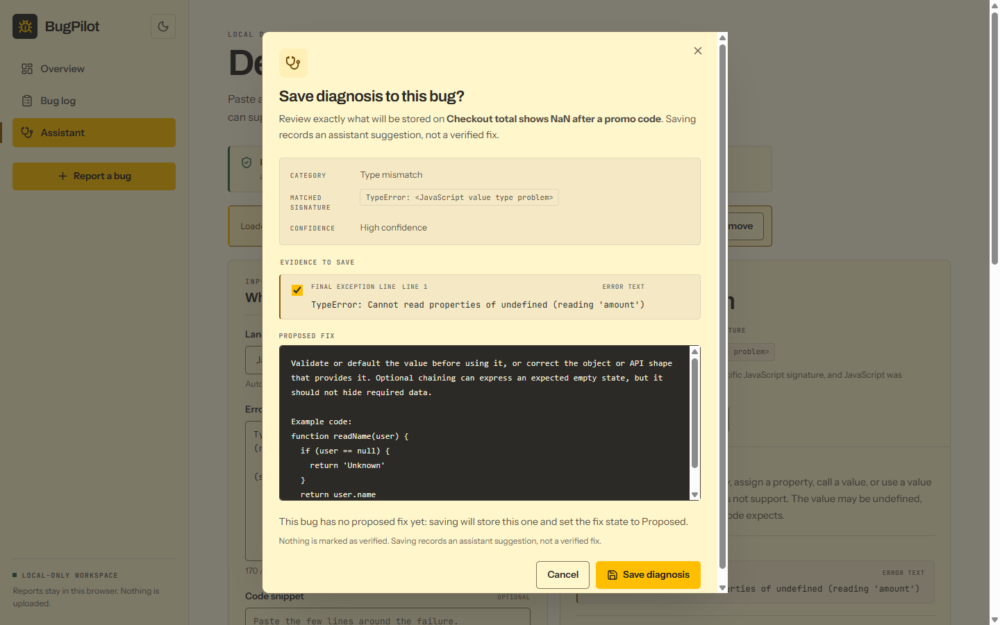
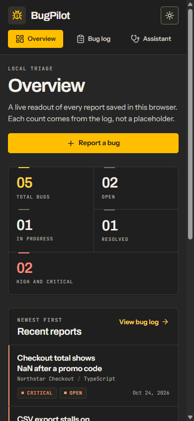

# BugPilot

[](https://github.com/john-nelsongreat/bugpilot/actions/workflows/ci.yml) [](https://github.com/john-nelsongreat/bugpilot/actions/workflows/live-check.yml)

**Live demo:** [bugpilot-lac.vercel.app](https://bugpilot-lac.vercel.app)

## Demo



A 34-second walkthrough: open the bug log, open the checkout report, choose **Analyse with Assistant**, run **Analyze**, save the diagnosis with its evidence item left unticked, and finish on the saved bug with a **Diagnosis saved** toast and a **View bug** link.

Sharper version: [watch the MP4](docs/demo/bugpilot-demo.mp4).

BugPilot is a local-first bug tracker and debugging assistant that runs entirely in the browser. It is built for capturing a reproducible bug report, keeping a searchable triage log, recording a fix through manual states, and getting rule-based hints from pasted Python or JavaScript error text. There is no account, backend, cloud database, telemetry, or AI API: saved reports and the theme preference stay in this browser, and the assistant analyses pasted text in the page without sending it. Assistant text is stored only when you explicitly save a diagnosis to a report.

This repository contains a working MVP, not a hosted product. See [Limitations](#limitations) for what is intentionally out of scope.

## What works today

- **Overview dashboard** with live counts for total reports, open reports, in-progress reports, resolved reports, and high/critical reports, plus the five most recent reports.
- **Bug log** with full-text search, severity/status/project filters, five sort orders, a live result count, and a clear-filters control.
- **Report workflow**: create, view, edit, and delete reports, with a permanent-delete confirmation dialog and copy controls for a report's error message and proposed fix.
- **JSON export and validated import** for bug reports, with a preview, merge or replace modes, and a backup of the previous raw log before any import write.
- **Validation**: title, project, language, and description are required; each field has a length limit; a fix status requires a proposed fix; `Verified` additionally requires verification notes.
- **Fix tracking**: `Proposed`, `Accepted`, `Rejected`, and `Verified` are manual states. BugPilot never verifies a fix automatically. A bug's workflow status (`Open`, `In Progress`, `Resolved`, `Closed`) is separate from its fix status.
- **Local persistence** in `localStorage`, including first-run sample reports and a recovery copy when stored JSON is unreadable. The original stored value is not overwritten when it cannot be read.
- **Debug Assistant** at `/assistant`, backed by a local rule engine with 16 Python rules and 12 JavaScript rules. It returns a category, confidence, evidence, debugging steps, a possible fix, verification steps, limitations, and alternatives. A report with an error message can open the Assistant with **Analyse with Assistant**; the report's error text, language, steps, and actual behavior are prefilled, and analysis still requires **Analyze**.
- **Saved diagnoses**: after a recognised analysis loaded from a report, the Assistant previews every field and writes one diagnosis to that report when confirmed. The bug detail shows the category, signature, confidence, selected evidence, and saved date, and can remove the diagnosis without touching the proposed fix, fix state, status, or verification notes.
- **Light and dark themes**, seeded from the system preference on first visit and saved after the user toggles.
- **Accessibility and interaction details**: skip link, labelled controls, focus-visible styling, focus-trapped delete, import, remove-diagnosis, and save-diagnosis dialogs with focus return to their triggers, status announcements, a document title per route, auto-dismissing toast, a WCAG contrast test for the theme tokens, and axe-core checks over every page and dialog state. See [Accessibility](#accessibility).
- **Rotating footer joke**: one joke per page, changing every 60 seconds and after a reload or return to the page.

## Screenshots

Dashboard, light theme:



Dashboard, dark theme:



Bug log, dark theme:



Bug detail, light theme:



Saved diagnosis on a bug detail, light theme:



Debug Assistant with a Python result, light theme:



Debug Assistant with a Python result, dark theme:



Save-diagnosis preview, light theme:



Dashboard at 390px, dark theme:



The screenshots show the five fictional sample reports created on a first run; the saved diagnosis was saved to one of those samples while checking the documented flow. They are not real user data.

## Engineering notes

### Why local-first

Developers paste real error messages and code into debugging tools, so BugPilot never sends them anywhere. There is no backend, account, or analytics. Reports live in the browser, the assistant's input is session-only, and a Content Security Policy restricts the page to its own origin.

### Rule-based, not a black box

The assistant is a set of small, separately testable rules. Each rule matches a documented exception signature, shows the evidence it matched, states its confidence and limits, and says plainly when it does not recognise an error. Every rule has positive, lookalike, and prose-mention tests, so naming an exception in a sentence without its exception line does not produce a confident diagnosis.

### A suggestion is never "verified"

A recommended fix is only a suggestion. A fix becomes Verified when the user records it themselves, and verification notes are required. Saving a diagnosis is a deliberate step with a preview of exactly what will be stored, and the user can untick evidence lines before saving.

### Quality gates

CI runs on every push to `main` and every pull request: lint fails on warnings, the Vitest suite includes the axe-core accessibility checks, and the production build must pass. A daily workflow also checks the live site's routes and security headers.

### How it was built

I built BugPilot with an AI coding assistant and planned its prompts with another AI model. I did not accept claims at face value: each phase required real test output and browser checks, and the finished build got a read-only live audit. That audit caught a 15 px sideways scroll at 320 px, caused by a `min-width: 320px` floor colliding with the classic scrollbar, and a route change that left the document title unchanged; both were fixed and re-audited.

### Known limits

- Tested in Chromium on Windows only; Firefox, Safari, and physical mobile devices are not covered.
- No screen-reader pass yet; NVDA, Narrator, JAWS, and VoiceOver remain untested. See [Accessibility](#accessibility) for the full list.
- The assistant recognises only the 28 documented rules: 16 Python and 12 JavaScript.

## Tech stack

| Layer | Choice |
| --- | --- |
| UI | React 19.3.1 and React DOM 19.3.1 |
| Language | TypeScript 6.0.3 |
| Build tool | Vite 8.3.5 |
| Routing | React Router DOM 7.18.4 |
| Icons | Lucide React 1.61.0 |
| Fonts | Fontsource variable packages for Archivo, Instrument Sans, and JetBrains Mono |
| Styling | Hand-written CSS with custom properties; no CSS framework |
| Tests | Vitest 5.0.5, Testing Library, jsdom 30.1.3, axe-core 4.14.0 (dev only) |
| Linting | oxlint 1.88.0 |
| Storage | Browser `localStorage` and `sessionStorage` only |

## Requirements

- **Node.js** `^20.19.0` or `>=22.12.0`. That range comes from Vite 8.3.5, which this project uses.
- **npm**, included with Node.js.
- A modern Chromium-based browser (Chrome or Edge). The app has been tested on Windows with Chromium; it has not been tested in Firefox, Safari, or on physical mobile devices.

The documentation and test run reported here used Node.js `v24.21.0` and npm `11.19.0` on Windows. No API keys, accounts, databases, or external services are needed.

## Install and run

```bash
npm install
npm run dev
```

Vite prints the local URL, normally `http://localhost:5173`. To use the fixed port used for the documentation checks:

```bash
npm run dev -- --port 5180 --strictPort
```

Then open `http://localhost:5180`. `--strictPort` makes the command fail instead of silently choosing another port.

`npm install` is only needed the first time, or after dependencies change. It reads the committed `package-lock.json` versions.

## Commands

| Command | What it does |
| --- | --- |
| `npm run dev` | Starts the Vite development server with hot module replacement. |
| `npm run dev -- --port 5180 --strictPort` | Starts the development server on the fixed port used in this documentation. |
| `npm test` | Runs the Vitest suite once. The project is configured to run test files serially on this Windows machine; see [Windows notes](#windows-notes). |
| `npm run lint` | Runs oxlint with `--deny-warnings`, so a warning fails the command the same way an error does. |
| `npm run build` | Runs the TypeScript project build, then creates the production bundle in `dist/`. |
| `npm run preview` | Serves an existing `dist/` build. Run `npm run build` first. |
| `npm run preview -- --port 4173 --strictPort` | Serves the production build on the fixed preview port used in this documentation. |

All commands above, except `npm install` (dependencies were already installed) and the bare `npm run preview` (verified through the same preview server with explicit port flags), were run while preparing this README.

### Continuous integration

`.github/workflows/ci.yml` runs on every push to `main` and on every pull request. One Ubuntu runner sets up Node 24 and then runs `npm ci`, `npm run lint`, `npm test`, and `npm run build` as four separately named steps, so a failed run names the exact stage that broke. The workflow requests `contents: read` permission only, cancels superseded runs of the same branch, times out after 20 minutes, and does not deploy anything.

## Production preview

```bash
npm run build
npm run preview -- --port 4173 --strictPort
```

Open `http://localhost:4173`. A preview server is a separate browser origin from the development server, so `localhost:4173` and `localhost:5180` have separate `localStorage` data and separate sample reports. Refresh a deep route such as `/bugs` to confirm the preview server serves the single-page app for client-side routes.

## Deployment

BugPilot is a static single-page app. A Vercel deployment uses `npm run build` as the build command and `dist` as the output directory. The committed `vercel.json` rewrites requests that do not match an existing file to `/index.html`, so direct visits to client-side routes such as `/bugs` and `/assistant` load the app instead of a server 404.

No environment variables or backend are required. Bug reports are stored in each visitor's own browser, so a deployed copy does not share data between visitors. The app is deployed on Vercel at [bugpilot-lac.vercel.app](https://bugpilot-lac.vercel.app).

### Content Security Policy

`vercel.json` sends this policy on every route, in the same global `/(.*)` header rule as the other security headers:

```text
default-src 'self'; script-src 'self'; style-src 'self'; img-src 'self' data:; font-src 'self' data:; connect-src 'self'; object-src 'none'; base-uri 'self'; form-action 'self'; frame-ancestors 'none'
```

| Directive | Why it is set |
| --- | --- |
| `default-src 'self'` | Fallback for any fetch directive not listed below; only this origin is allowed. |
| `script-src 'self'` | The build loads one same-origin module script. There are no inline scripts, inline event-handler attributes, `eval`, or `new Function`; neither `'unsafe-inline'` nor `'unsafe-eval'` is allowed. |
| `style-src 'self'` | The build loads one same-origin stylesheet. There are no `<style>` blocks and the app writes no inline styles at runtime. The light and dark `color-scheme` values live in `src/index.css` under `:root` and `:root[data-theme='dark']`; the theme code only sets `data-theme`, and a unit test asserts that toggling leaves no `style` attribute on `<html>`. |
| `img-src 'self' data:` | Allows the self-hosted favicon and inert data-URI images, and blocks every external image. No data-URI image is in the current build; `data:` is retained from the requested baseline. |
| `font-src 'self' data:` | Ten of the eleven `@font-face` files are self-hosted `.woff2` files. Vite inlines one Cyrillic-extended JetBrains Mono subset as `data:font/woff2` in the built CSS, so this allowance is required for that face. Rendering `Ѡ` (U+0460) confirmed the face loaded under this policy. |
| `connect-src 'self'` | The app makes no `fetch`, XHR, or WebSocket requests after loading. Nothing can send reports, assistant text, or anything else to another host. |
| `object-src 'none'` | Blocks plugins, `<object>`, and `<embed>` content. |
| `base-uri 'self'` | Stops an injected `<base>` element from changing how relative URLs resolve. |
| `form-action 'self'` | Restricts form submissions to this origin. The app's forms are handled by React and never post to a server. |
| `frame-ancestors 'none'` | Prevents the app from being framed. `X-Frame-Options: DENY` is also kept for browsers that do not support this directive. |

No `'unsafe-inline'` is used for scripts or styles, and no `style-src-attr` exception is needed. `blob:` was not added: a real export download was exercised under this policy, produced and revoked its object URL, and downloaded the JSON without a violation. The only allowance added to the requested baseline is `data:` in `font-src`, and it is required by the built font above.

**Browser coverage (2026-10-29).** The production build was served by a temporary stdlib-only Node server outside the repository with the exact `vercel.json` headers and SPA fallback. Fresh Chromium, Firefox, and Playwright WebKit contexts walked every route, the theme toggle, the Assistant (CORS triple, Python, JavaScript, and all eight bare JSON forms), the seeded checkout save flow, export, import, and toasts. Chromium and Firefox reported **0 CSP violations, 0 console errors, and 0 page errors**. Playwright WebKit reported no app-written inline style, but it emits one `style-src-attr` message for every `<select>` that JavaScript creates (4 on `/bugs`, 3 on `/bugs/new`, 1 on a report detail or `/assistant`). A minimal page that only calls `document.createElement('select')` reproduces that message, so it is WebKit's own form-control handling rather than an application style. Playwright WebKit approximates Safari; physical Safari was not tested. Light and dark screenshots of Overview, Bug log, and the bug form were pixel-identical before and after `color-scheme` moved from JavaScript to CSS in all three engines.

**How it was checked locally.** On 2026-10-25 the production build was served by a temporary stdlib-only Node server outside the repository. It read the headers from `vercel.json` at startup, applied all of them, and used the same SPA fallback. Fresh Chromium contexts at 1440x700 with real 15px scrollbars loaded every route directly and exercised first-run seeding, create/edit/delete, search/filter/sort, fix states, both themes, the Debug Assistant (Python, JavaScript, unrecognised, empty, over-limit, copy, checklist, clear), export, import preview/merge and the replace gate, toasts, the joke rotation, keyboard focus, and the then-existing delete and import dialogs: **216 assertions, 0 CSP violations, 0 console errors, 0 page errors**, with requests only to the local server. A throwaway page then confirmed that an inline script, an external image, and an external `fetch` were each blocked and reported as a violation (exactly three expected violations). `src/csp.test.ts` also reads this file during `npm test` and fails if the global rule loses the policy, the required directives change, or an unsafe source appears.

**What this does not prove.** `npm run dev` and `npm run preview` do **not** apply `vercel.json`; they serve no CSP. The policy reaches users only after a Vercel deployment, and the live response had not yet been inspected when this section was written. Re-run the header command in [Security headers](docs/MANUAL_TEST_CHECKLIST.md#16-security-headers) after deploying and confirm the policy string before treating the production site as protected. A local emulator proves the policy is compatible with the build, not that the host is sending it.

**Adding a new source later.** Add the narrowest origin or path to the specific directive it needs, not to `default-src`, and avoid broad `https:` entries. A new image host belongs in `img-src`; a new API belongs in `connect-src`; a new font belongs in `font-src`. Never add `'unsafe-inline'` to `script-src`; use a separate same-origin script, or a build-time hash if an inline script is unavoidable. If a style attribute becomes unavoidable, prefer `style-src-attr 'unsafe-inline'` over opening up `style-src`. Add `blob:` only if a feature is proven to need it, and only on the directive that needs it. Then rebuild, update `src/csp.test.ts` if an asserted directive changed, run `npm test`, and repeat the live header and console checks.

## Live site monitoring

`.github/workflows/live-check.yml` runs `scripts/check-live.mjs` once a day at 06:17 UTC, and it can be run by hand from the repository's **Actions** tab (**Live site check** → **Run workflow**). The optional `url` input sends the same checks to another address; leaving it empty uses [bugpilot-lac.vercel.app](https://bugpilot-lac.vercel.app).

The script is a dependency-free Node 24 ES module. It GETs `/`, `/bugs`, `/bugs/new`, `/assistant` and a nonsense path; each must return HTTP 200 with an HTML body that contains the app root and script and no Vercel 404 marker. It compares all five security headers with the values in `vercel.json`, fetches the script and stylesheet referenced by `/`, checks that every script, stylesheet, image and font URL is same-origin, reports each request time, and fails a request that stays above 8 seconds after retries. Network errors are retried twice; redirects are reported and not followed.

Run it locally with:

```bash
node scripts/check-live.mjs
```

A red run means at least one route, header, asset or timing check failed. It is a basic health check, not an uptime guarantee, and it does not exercise any interactive feature.

GitHub can delay or skip scheduled runs. Scheduled workflows in a public repository are disabled automatically after 60 days without repository activity; if that happens, re-enable the workflow in the Actions tab. The workflow had not run on GitHub when this section was written; the badge will show its first completed run only after it is pushed and run.

## Routes

| Route | Page |
| --- | --- |
| `/` | Overview dashboard with live stats and recent reports |
| `/bugs` | Bug log with search, filters, sorting, and report links |
| `/bugs/new` | New bug report form |
| `/bugs/:bugId` | Bug detail with quick status changes, edit, and delete |
| `/bugs/:bugId/edit` | Edit form for an existing report |
| `/assistant` | Local Debug Assistant. `?bugId=<id>` prefills it from a saved report; the query carries only the id. |
| `*` | Page-not-found screen with a link back to the overview |

Routes are declared in `src/App.tsx`.

## Export and import

The **Bug log** header has **Export reports** and **Import reports** actions. Both work entirely in the browser and handle bug reports only.

### Export

**Export reports** downloads a file named `bugpilot-export-YYYY-MM-DD.json`. The date is taken from `exportedAt` in UTC, so it always matches the date in the envelope. The file is pretty-printed JSON:

```json
{
  "app": "bugpilot",
  "schemaVersion": 1,
  "exportedAt": "2026-10-24T20:40:31.220Z",
  "bugs": [
    {
      "id": "sample-checkout-nan",
      "title": "Checkout total shows NaN after a promo code",
      "description": "…",
      "projectName": "Northstar Checkout",
      "language": "TypeScript",
      "errorMessage": "…",
      "stepsToReproduce": "…",
      "expectedBehavior": "…",
      "actualBehavior": "…",
      "severity": "Critical",
      "status": "Open",
      "notes": "…",
      "proposedFix": "",
      "fixStatus": null,
      "verificationNotes": "",
      "createdAt": "2026-10-24T18:35:07.721Z",
      "updatedAt": "2026-10-24T18:35:07.721Z"
    }
  ]
}
```

The array contains every saved report with all of its fields, including fix state, verification notes, a saved diagnosis and its composed fix, and original timestamps. Theme preference, unsaved assistant input or results, footer joke indices, and every other storage key are never exported. With an empty log, the app says there is nothing to export and does not download a file. The download is built with a `Blob` and an object URL, which is revoked after the click; nothing is uploaded.

### Saved diagnoses

A report may carry one optional `diagnosis` object, added after `updatedAt`. It is created from the Assistant and is displayed on the bug detail; it is not a form field.

#### Saving from the Assistant

- On a bug detail with a non-empty error message, **Analyse with Assistant** links to `/assistant?bugId=<id>`. The query carries only the id.
- The Assistant prefills the report's error text, maps `Python` to Python and `JavaScript`, `TypeScript`, `JS`, `TS`, or `Node` to JavaScript (anything else to Auto), and composes reproduction details from the report's steps and actual behavior as `Steps to reproduce:` then `Actual behavior:`, with each source field trimmed and capped at its form limit. It does not analyze until **Analyze** is clicked.
- A **Loaded from bug: <title>** chip identifies the context. Its **Remove** action clears the `bugId` query and the chip but keeps text already typed. An unknown id shows a non-blocking notice and leaves the Assistant unchanged. Opening the context writes nothing to storage.
- After a recognised result with a possible fix, **Save diagnosis to this bug** appears only while that bug context is loaded.
- The preview dialog is focus-trapped, starts on **Cancel**, closes on Escape, Cancel, the close button, or a backdrop click without writing, and returns focus to the trigger. It lists the category, matched signature (or **No specific signature**), confidence, every evidence item (checked by default and independently untickable), and the exact proposed fix. The scrollable fix preview is keyboard-focusable so it can be scrolled without a pointer.
- The composed fix is the explanation, a blank line, `Example code:`, then the example code. If that exceeds 20,000 characters, the example code is left out and the dialog says so; if the explanation alone exceeds the limit, Save is disabled with an explanation. The text is never silently truncated.
- With no existing fix, Save writes the composed fix and sets fix status to `Proposed`. With an existing fix, the fix and its recorded state are kept unless **Replace the existing proposed fix with this one** is ticked; ticking it replaces only the fix text, not the recorded state. Saving never marks a fix `Verified`, and it replaces an existing diagnosis with a new `savedAt`.
- Success shows **Diagnosis saved to this bug.** with a **View bug** link. A storage failure shows the dialog error and a persistent error toast, and writes nothing.

#### Stored shape

```json
"diagnosis": {
  "category": "missing-module",
  "matchedSignature": "ModuleNotFoundError: No module named '<module>'",
  "confidence": "high",
  "evidence": [
    {
      "label": "Final exception line",
      "quote": "ModuleNotFoundError: No module named 'pandas'"
    }
  ],
  "savedAt": "2026-10-25T12:00:00.000Z"
}
```

| Field | Rule |
| --- | --- |
| `category` | Text, 1–80 characters. It is not restricted to the diagnostic engine's current categories, so a future category does not invalidate existing saved data. |
| `ruleId` | Optional text, up to 80 characters. Imported files may carry it and it is preserved, but the current interface does not add it. |
| `matchedSignature` | Text up to 300 characters, or `null`. |
| `confidence` | `low`, `medium`, or `high`. |
| `evidence` | Up to 5 items. Each item is `{ label, quote }`, with `label` up to 80 characters and `quote` up to 500. Only evidence ticked in the preview is written; line numbers and source labels are not stored. |
| `savedAt` | A valid ISO timestamp. |

The current interface writes exactly `category`, `matchedSignature`, `confidence`, `evidence`, and `savedAt`. The composed fix goes into the report's ordinary `proposedFix`, outside the `diagnosis` object. The raw error text, code snippet, reproduction details, and unticked evidence are not stored. A ticked evidence quote can itself contain the final exception line, as in the example above.

The field is optional and additive. Both browser storage and the export envelope stay at `schemaVersion: 1`. A report without a diagnosis serialises exactly as before: there is no `diagnosis: null` key. Old export files without the field import unchanged. An older BugPilot build will import the report but drop the diagnosis, so diagnosis data is lossy across downgrades; the core report is never rejected for it.

Saved diagnoses are preserved through reload, ordinary edits, quick status changes, fix-state changes, export, and import. On the bug detail, **Remove saved diagnosis** opens a focus-trapped confirmation dialog; Escape, Cancel, the close button, or a backdrop click cancel without writing, and focus returns to the button. Confirming removes only the `diagnosis` field, keeps `proposedFix`, `fixStatus`, `verificationNotes`, and `status`, and shows **Saved diagnosis removed.** Removal cannot be undone.

### Import

The import dialog accepts a `.json` file up to **5 MB** and **5,000 reports**. It validates the envelope (`app` must be `bugpilot`; `schemaVersion` must be `1`) and every report with the same rules as the form:

- required id, title, description, project, language, severity, status, and valid `createdAt`/`updatedAt` timestamps;
- valid severity, status, and fix-status values;
- unique ids within the file and the same per-field length limits as the form;
- a proposed fix whenever a fix status is set, and verification notes when the fix status is `Verified`.

A newer `schemaVersion` is rejected with an explanation, as are a different `app`, a missing `bugs` array, and malformed JSON. Unknown fields are dropped. Invalid reports are listed with their positions and reasons; they are never repaired or silently accepted, and only the valid records in a mixed file can be imported. Prototype-related keys such as `__proto__`, `constructor`, and `prototype` are ignored. Import never uses `eval` or dynamic code, and imported text is rendered only as plain text.

Before writing, the dialog shows the filename; valid, invalid, and already-existing counts; and a preview of what will happen. The default **Add new reports only** mode keeps the current log and skips imported reports whose ids already exist. **Replace all reports** deletes the whole current log and becomes available only after a second, explicit acknowledgement; the confirm button is disabled when the file contains zero valid reports.

Immediately before any import write, the current raw stored value is copied to `bugpilot.bugs.preimport.v1`. If the backup write or the main write fails, the existing log is left unchanged and a persistent error toast explains the failure. This is a single recovery slot, not a version history: every import overwrites it, so export a file before a replace if you may need an independent copy.

A successful import preserves the imported timestamps, updates the dashboard and log immediately, reports added/skipped/replaced counts in a toast, and does not bring back the first-run sample notice. Cancel, Escape, the close button, or a backdrop click change nothing. The dialog traps focus while open and returns focus to **Import reports** when it closes.

## Architecture

### Source tree

```text
src/
├─ app/            Workspace context: loads state, exposes bug actions, and owns toast notifications
├─ components/     Shared layout, badges, delete/import/remove/save dialogs, toast, and footer joke
├─ content/        Static joke sets for each page key
├─ diagnostics/    Diagnostic types, matching engine, rule tests
│  └─ rules/       Python and JavaScript diagnostic rules
├─ features/
│  ├─ assistant/   Bug-to-Assistant prefill and save-diagnosis composition
│  ├─ bugs/        Bug types, samples, validation, storage, querying, saved diagnoses, export/import, and the workspace hook
│  ├─ footer/      Joke selection, 60-second rotation, and sessionStorage handling
│  └─ theme/       Theme resolution, persistence, and the WCAG contrast test
├─ pages/          Route-level pages for the dashboard, log, form, detail, assistant, and 404
├─ test/           Vitest setup and shared test factories
├─ App.tsx         Route table and optional footer-joke interval configuration
├─ App.css         Amber & Charcoal theme, layout, and component styles
├─ index.css       Theme tokens, fonts, and global base styles
└─ main.tsx        React entry point
```

Test files live beside the module they test. For example, the Python rules live in `src/diagnostics/rules/python.ts` and are tested in `src/diagnostics/python-rules.test.ts`.

### How the main pieces are organised

**Bug storage.** `src/features/bugs/storage.ts` owns the `bugpilot.bugs.v1` key. The stored value is a JSON object with a `schemaVersion` and a `bugs` array. On load, every record is validated again; invalid records are skipped. If the whole value is unreadable JSON or has the wrong shape, the app shows a "Saved data needs attention" notice, leaves the original key untouched, and writes a best-effort copy to `bugpilot.bugs.recovery.v1`. When the key is absent, five fictional sample reports are created and saved. Saves write the complete array; there is no server copy.

**Validation.** `src/features/bugs/validation.ts` is the single source of truth for field rules. It checks the four required fields, enforces per-field character limits, requires a proposed fix whenever a fix status is set, and requires verification notes for `Verified`. The form uses these errors for inline messages and a summary; storage parsing also calls the same validation so malformed saved records are not displayed.

**Export and import.** `src/features/bugs/exportImport.ts` is a pure module with no React imports. It builds and serialises the export envelope, parses and validates an import file, counts existing ids, and applies a merge or replace while writing the backup key. It maps each allowed report field explicitly, so unknown or prototype-related keys cannot reach the log. `src/components/ImportBugDialog.tsx` owns only the dialog interaction and file reading; `src/pages/BugListPage.tsx` triggers the download and reports the result.

**Fix states.** Fix status is an optional field on a bug, not a derived value. `src/pages/BugFormPage.tsx` edits it; `src/pages/BugDetailPage.tsx` displays it and allows quick changes to the separate workflow status. Marking a fix `Verified` is always a manual action, and the selected fix status is never inferred from the fix text or from the assistant. `Accepted` means the proposed fix was accepted; `Verified` means the user also recorded how it was checked.

**Saved diagnoses.** `src/features/bugs/diagnosis.ts` validates and attaches or removes a diagnosis while leaving the report's fix fields alone. `src/features/assistant/prefill.ts` turns a report into Assistant fields without storing anything, and `src/features/assistant/savePreview.ts` composes the proposed fix and decides whether a save is possible. `src/components/SaveDiagnosisDialog.tsx` and `src/components/RemoveDiagnosisDialog.tsx` own only the dialog interaction; `src/pages/AssistantPage.tsx` calls the workspace's `attachDiagnosis`, and `src/pages/BugDetailPage.tsx` displays the saved fields and calls `removeDiagnosis`. The interface writes no `ruleId`.

**Copying report text.** The detail page shows **Copy error message** and **Copy proposed fix** only when the corresponding field has text. Each button copies that field unchanged through `src/lib/clipboard.ts` and reports success with `role="status"` or a manual-copy fallback with `role="alert"`. Copying does not write to storage, change the report, or mark a fix as verified.

**Themes.** `src/index.css` defines the light theme on `:root` and the dark overrides on `:root[data-theme='dark']`. `src/features/theme/theme.ts` resolves the initial theme from `bugpilot.theme.v1`, falling back to `prefers-color-scheme`. `src/features/theme/useTheme.ts` applies `data-theme` and `color-scheme` to the document root and saves later changes. `src/features/theme/contrast.test.ts` checks the text, badge, border, and focus-ring token pairs against WCAG AA contrast ratios.

**Footer jokes.** `src/content/footerJokes.ts` holds four jokes for each of six page keys. `src/features/footer/footerJoke.ts` maps a pathname to a page key, avoids choosing the same joke twice in a row when alternatives exist, and stores the last index in `sessionStorage` under `bugpilot.footerJoke.<pageKey>` (with an in-memory fallback when storage is blocked). `src/components/FooterJoke.tsx` rotates the joke every 60 seconds. `src/App.tsx` accepts an optional `VITE_FOOTER_JOKE_INTERVAL_MS` environment override for development, but the default is 60 seconds.

**Diagnostics.** `src/diagnostics/types.ts` defines the rule contract and result shape. `src/diagnostics/engine.ts` selects the final exception line, infers a language when needed, runs the registered rules, chooses the most specific match, and builds confidence, evidence, and fallback output. `src/diagnostics/rules/python.ts` and `src/diagnostics/rules/javascript.ts` contain the 28 rules (16 Python and 12 JavaScript) and register them in the exported `pythonRules` and `javascriptRules` arrays. `src/pages/AssistantPage.tsx` is only the UI: it holds pasted text in component state and calls `diagnose()` in the browser.

## How the diagnostic engine works

### Input

The assistant calls `diagnose()` with:

| Field | Required | Purpose |
| --- | --- | --- |
| `language` | Yes | `auto`, `python`, or `javascript`. `auto` infers a runtime from traceback or stack-frame clues. |
| `errorText` | Yes | The error line or full traceback. This is the only field used to select the exception line. |
| `codeSnippet` | No | Used only to add at most one line to the evidence list. A line is eligible only when a captured value appears in it as a whole identifier. The snippet never changes which rule matches and is never executed or parsed. |
| `reproductionDetails` | No | Used as additional language clues. When `language` is `auto`, those clues help select the runtime; they also feed the confidence level and reason, including conflict detection. They are not quoted as evidence and never match rules themselves. |

The engine looks for the last exception-shaped line in `errorText`, then falls back to the last non-empty line. A leading `Uncaught` or `Uncaught (in promise)` prefix is stripped before rule matching.

### Output

`DiagnosticResult` contains:

| Field | Meaning |
| --- | --- |
| `category` | One of the supported categories below, or `unrecognized`. |
| `matchedSignature` | The rule's human-readable signature, or `null` when nothing matched. |
| `likelyCause` | A plain-language explanation written by the matched rule. |
| `evidence` | The selected exception line with its line number, plus at most one line from the supplied code snippet when a captured value appears in it as a whole identifier. |
| `debuggingSteps` | Ordered next steps. |
| `possibleFix` | `{ explanation, whereItMayApply, exampleCode }`, or `null` for an unrecognised input. |
| `verificationSteps` | A checklist the user can tick in the current session. The checkboxes do not verify a fix. |
| `confidence` | `{ level: 'low' \| 'medium' \| 'high', reason }`. |
| `limitations` | What the rule and engine cannot see. Every result also states that the guidance is local and rule-based. |
| `alternativeExplanations` | Other plausible causes for the same signature. |

Supported categories are `missing-module`, `import-failure`, `undefined-name`, `type-mismatch`, `missing-attribute`, `missing-key`, `index-out-of-range`, `missing-file`, `permission-denied`, `syntax-error`, `indentation-error`, `division-by-zero`, `invalid-value`, `recursion-error`, `unicode-error`, `json-decode-error`, `port-in-use`, `network-request-failed`, `cors-blocked`, and `react-error`.

### Supported Python rules

Each rule matches only the selected exception line. When a line is not an exact match, the rule returns `null` and the engine tries the other rules or the unrecognised fallback. The table lists what each rule deliberately leaves to another rule or to that fallback.

| Rule | Recognises | Deliberately does not claim |
| --- | --- | --- |
| `ModuleNotFoundError` | `No module named '<module>'` | `ImportError: cannot import name ...`, relative-import failures, or a bare module name in prose |
| `ImportError` | `cannot import name '<name>' from '<module>'`, `attempted relative import with no known parent package`, and other `ImportError` lines as generic | `ModuleNotFoundError` lines |
| `NameError` | `name '<name>' is not defined`, and other `NameError` lines as generic | JavaScript `ReferenceError`, `AttributeError`, or a prose mention of a name |
| `TypeError` | Python type shapes such as unsupported operands, failed concatenation, non-subscriptable or non-callable objects, positional-argument errors, `len()` failures, and failed comparisons; other Python `TypeError` lines as generic | JavaScript `TypeError` shapes such as reading properties of `undefined`, `is not a function`, and `is not iterable` |
| `AttributeError` | object and module `has no attribute` messages, and other `AttributeError` lines as generic | `TypeError` lines with similar wording, or `KeyError` |
| `KeyError` | a quoted key and other `KeyError` lines as generic | `IndexError`, missing attributes, or a key name in prose |
| `IndexError` | known list, string, tuple, and range index failures, and other `IndexError` lines as generic | `KeyError`, off-by-one advice without an `IndexError` line |
| `FileNotFoundError` | `No such file or directory` with a path, and other `FileNotFoundError` lines as generic | `PermissionError` lines |
| `PermissionError` | `Permission denied` with a path, and other `PermissionError` lines as generic | `FileNotFoundError` lines |
| `SyntaxError` | known Python parser messages such as `invalid syntax` and unclosed delimiters, and other Python `SyntaxError` lines as generic | JavaScript parser messages such as `Unexpected token` |
| `IndentationError` | known indentation messages such as `unexpected indent`, and other `IndentationError` lines as generic | `SyntaxError` lines with similar wording |
| `ZeroDivisionError` | `division by zero`, `integer division or modulo by zero`, `float division by zero`, `float modulo`, and `integer modulo by zero` | `ArithmeticError`, unknown `ZeroDivisionError` messages, and mentions in logs, comments, strings, or prose |
| `ValueError` | `invalid literal for int() with base N`, `could not convert string to float`, `not enough values to unpack`, `too many values to unpack`, `math domain error`, and `<value> is not in list`; every other `ValueError` line gets a lower-confidence generic result | `json.decoder.JSONDecodeError` and `requests.exceptions.JSONDecodeError` lines, and `UnicodeDecodeError` or `UnicodeEncodeError` lines, which have their own rules |
| `RecursionError` | `maximum recursion depth exceeded`, optionally followed by `while calling a Python object` or `in comparison` | `RuntimeError`, other `RecursionError` messages, and prose mentions |
| `UnicodeDecodeError` and `UnicodeEncodeError` | `'<codec>' codec can't decode` or `can't encode` a byte, bytes, character, or characters | `ValueError` or `TypeError` lines that contain the same words, and unknown codec-message shapes |
| `JSONDecodeError` | `JSONDecodeError`, `json.JSONDecodeError`, `json.decoder.JSONDecodeError`, and `requests.exceptions.JSONDecodeError` with `Expecting value`, `Expecting property name`, `Extra data`, `Unterminated string`, or `Invalid control character` | `ValueError` carrying the same words, unknown `JSONDecodeError` messages, and JavaScript `SyntaxError` |

### Supported JavaScript rules

These rules cover browser and Node.js runtime errors. The five Node.js rules and the four browser, network, JSON, and React rules are registered after the three original rules, and the JSON and network rules supersede the generic `SyntaxError` and `TypeError` fallbacks only when they match the same final exception line. The `TypeError` rule also recognises the modern, legacy, and Firefox property, call, iteration, constant, and constructor shapes listed below. The engine also recognises `Error:` and `Error [CODE]:` lines as Node-style error lines when no other exception line is present.

| Rule | Recognises | Deliberately does not claim |
| --- | --- | --- |
| `ReferenceError` | `name is not defined`, `Cannot access <name> before initialization`, and other `ReferenceError` lines as generic | Python `NameError`, `AttributeError`, or a prose mention of a name |
| `TypeError` | JavaScript sub-signatures for modern and legacy property reads on `undefined` or `null`, modern property writes, `is not a function`, `is not iterable`, `Assignment to constant variable.`, `is not a constructor`, and Firefox `can't access property` wording (see [TypeError sub-signatures](#typeerror-sub-signatures)); other `TypeError` lines as generic | Python `TypeError` shapes such as unsupported operands or failed concatenation, and messages that only resemble a subtype, such as a property-read target other than `undefined` or `null` |
| `SyntaxError` | JavaScript parser messages such as `Unexpected token`, `Unexpected end of JSON input`, and `Cannot use import statement outside a module` | Python parser messages such as `invalid syntax`, and JSON parser messages, which the JSON rule claims before this fallback |
| Node module not found | `Error: Cannot find module '<package>'`, `Error: Cannot find module '<path>'` (with or without a `Require stack:` list), and `Error [ERR_MODULE_NOT_FOUND]: Cannot find package or module '<package or path>' imported from <path>` | Python `ModuleNotFoundError`, `ERR_REQUIRE_ESM`, unquoted module names, and prose mentions |
| Port in use | `Error: listen EADDRINUSE: address already in use <address>` for `:::PORT`, `0.0.0.0:PORT`, `127.0.0.1:PORT`, and `localhost:PORT` | `EADDRINUSE` in a log line, comment, or prose, and listen errors without the address |
| Node file error | `Error: ENOENT: no such file or directory` with `open`, `stat`, `scandir`, `mkdir`, or `readFile` and a quoted path, and `Error: spawn <command> ENOENT` | Other ENOENT operations such as `lstat`, Python `FileNotFoundError`, and bare `ENOENT` mentions |
| Permission error | `Error: EACCES: permission denied` with `open`, `mkdir`, or `scandir` and a quoted path, `Error: listen EACCES: permission denied <address>`, and `Error: EPERM: operation not permitted` | Python `PermissionError`, other error codes, and log or prose mentions |
| Call stack | `RangeError: Maximum call stack size exceeded` | Other `RangeError` messages such as `Invalid array length`, and log or prose mentions |
| JSON parse | V8 `Unexpected token < in JSON at position 0`, `Unexpected token '<', ... is not valid JSON`, `Unexpected token u in JSON at position 0`, `"undefined" is not valid JSON`, and `Unexpected end of JSON input`; Firefox `JSON.parse: unexpected character` and `JSON.parse: unexpected end of data`; Safari `JSON Parse error: Unrecognized token '<'` and `JSON Parse error: Unexpected EOF`; the same distinctive messages pasted without a `SyntaxError:` prefix, matched to the same signature but capped at **Medium** confidence | Python `JSONDecodeError`, ordinary `SyntaxError` lines without JSON wording, bare `Unexpected token }` (which stays unrecognised without the `SyntaxError:` class), and a JSON message inside a timestamped or prose line. This rule supersedes the generic `SyntaxError` fallback. |
| Network request failed | `TypeError: Failed to fetch`, `TypeError: NetworkError when attempting to fetch resource.`, `TypeError: fetch failed` (with `[cause]` codes `ECONNREFUSED`, `ENOTFOUND`, `ETIMEDOUT`, or `ECONNRESET` used when present), Chrome console `net::ERR_CONNECTION_REFUSED`, `net::ERR_NAME_NOT_RESOLVED`, `net::ERR_INTERNET_DISCONNECTED`, and `net::ERR_CERT_*`; Safari `TypeError: Load failed` as a generic, low-confidence match | Other `TypeError` lines, Python connection errors, `net::ERR_*` codes other than the listed families, and a message embedded in a timestamped or prose line. This rule supersedes the generic `TypeError` fallback. |
| CORS blocked | `Access to fetch at '<url>' from origin '<origin>' has been blocked by CORS policy:` for a missing `Access-Control-Allow-Origin` header, a failed preflight, an origin mismatch, or credentials combined with a wildcard origin; the `XMLHttpRequest` variant is also recognised | A CORS phrase embedded in a timestamped log line or prose, and messages without the exact console wording |
| React error | `Invalid hook call. Hooks can only be called inside of the body of a function component.`, `Too many re-renders. React limits the number of renders to prevent an infinite loop.`, `Maximum update depth exceeded.`, and `Objects are not valid as a React child (found: ...)`, with or without an `Error:` or `Uncaught Error:` prefix | `Warning: Invalid hook call...`, an object-child message without the `(found: ...)` detail, and other React errors |

#### TypeError sub-signatures

The `TypeError` rule keeps one id, category, and confidence logic. Within that rule, these message shapes get their own matched signature and their own cause, debugging steps, fix, and verification guidance. The example line is the exact matched signature.

| Message shape | Example line |
| --- | --- |
| Modern property read on `undefined` | `TypeError: Cannot read properties of undefined (reading 'amount')` |
| Modern property read on `null` | `TypeError: Cannot read properties of null (reading 'length')` |
| Legacy property read on `undefined` | `TypeError: Cannot read property 'amount' of undefined` |
| Legacy property read on `null` | `TypeError: Cannot read property 'length' of null` |
| Modern property write on `undefined` | `TypeError: Cannot set properties of undefined (setting 'value')` |
| Modern property write on `null` | `TypeError: Cannot set properties of null (setting 'checked')` |
| Calling a value that is not a function | `TypeError: items.map is not a function` |
| Iterating a value that is not iterable | `TypeError: items is not iterable` and `TypeError: object null is not iterable` |
| Assigning to a constant binding | `TypeError: Assignment to constant variable.` |
| Using `new` on a value that is not a constructor | `TypeError: Cart is not a constructor` |
| Firefox property read on `undefined` or `null` | `TypeError: can't access property "name", user is undefined` and `TypeError: can't access property "length", items is null` |

Every other `TypeError` line keeps the existing behaviour: `Cannot convert undefined or null to object` returns `TypeError: <JavaScript value type problem>`, and unrecognised wording returns `TypeError: <JavaScript type mismatch>`. A subtype is claimed only when the full anchored shape matches, so `Cannot read property 'name' of object` and `can't access property "name", user is defined` stay generic. Each sub-signature, plus lookalike and prose lines that must stay generic, is covered in `src/diagnostics/javascript-type-error-subtypes-coverage.test.ts`. These are sub-signatures of one rule, not separate rules, so the rule count and rule IDs are unchanged. A diagnosis saved before this change keeps its stored signature and is displayed and exported as saved; stored data is not migrated.

Distinctive browser JSON messages (`JSON.parse:`, `JSON Parse error:`, `in JSON at position`, `is not valid JSON`, and `Unexpected end of JSON input`) are also recognised when pasted alone without the `SyntaxError:` prefix. The matched signature is the same except that it includes the added `SyntaxError:` prefix, and the confidence is capped at **Medium** because the error class was not present. A bare generic `Unexpected token }` is not claimed by the JSON rule and stays unrecognised; the `SyntaxError: Unexpected token }` form remains a generic `SyntaxError`; timestamped or prose lines are not treated as final exception lines. The bare forms are covered in `src/diagnostics/javascript-json-parse-bare.test.ts` and in the regression corpus.

### Matching, confidence, and evidence

- Rules use anchored regular expressions against the selected exception line. A rule returns `null` when the line is not an exact match, and returns a `signature`, a `specificity` of `specific` or `generic`, and any captured values.
- The engine evaluates rules for both languages. An explicit language wins when a rule in that language matches. With `auto`, weighted traceback and stack-frame clues choose the runtime; a more specific signature can override a weak clue, and conflicting evidence lowers confidence.
- Confidence is `high` for a specific signature with an explicit language or supporting trace evidence, `medium` for a generic signature with those clues or a specific signature without them, and `low` when the evidence conflicts or no rule matched. The exact reason is always shown next to the badge.
- For a matched result, evidence includes the selected exception line and its line number. If a code snippet is supplied, the first line containing a captured value (at least three characters, excluding free-text `detail` and `reason` fields) as a whole identifier is added as a second evidence item. Identifier characters are letters, digits, `_`, and `$`; every other character and the start or end of the line is a boundary. For example, a captured `total` is quoted from `total = 0` or `print(total)`, but not from `subtotal = 10` or `total_count = 1`. At most one snippet line is added. An unrecognised result has no evidence because no rule matched.
- A rule can declare `supersedes: ['<rule id>']`. When both it and the declared rule match the same final exception line in the same language, the declared rule is removed before the match is chosen. The JSON rule supersedes `javascript.syntax-error`, and the network rule supersedes `javascript.type-error`; no other rule declares a relation, so unrelated matches are unaffected. Precedence is applied before the specificity comparison below.
- If two matching rules have the same specificity, the earlier rule in the relevant rule array wins. New rules should therefore be specific enough to beat an existing generic fallback, or be placed deliberately.
- A match can set a `confidenceCeiling`. The ceiling can only lower the computed level, never raise it, and the reason says so. Safari `TypeError: Load failed` is capped at low because its wording does not identify what failed; the other browser and Node network messages keep the normal confidence rules.

#### Context lines and React trailers

- A rule can declare `contextSymptoms`: generic final lines that the rule can explain from another line in the paste. When the selected final line matches one of those symptoms, the engine also applies that rule to the other lines and lets a specific match represent the diagnosis. The evidence then shows the final exception line and the matched context line with its own line number. The CORS rule explains `TypeError: Failed to fetch`, `Uncaught (in promise) TypeError: Failed to fetch`, and bare `net::ERR_FAILED` console lines. The React rule explains a null-property `TypeError` that names a hook such as `useState`, `useEffect`, or `useContext`. A context match never replaces a rule that matched the final line itself unless the final line is one of the rule's declared symptoms, and the `supersedes` precedence above is unchanged.
- When the engine chooses the final exception line, it skips React's component trailer: the `The above error occurred in the <X> component:` line, the `Consider adding an error boundary to your tree to customize error handling behavior.` line, and the indented component or stack frame lines that belong to them. A render error above the trailer stays the primary line.
- The exact React `Invalid hook call. Hooks can only be called inside of the body of a function component.` sentence may also match when the line starts with `Warning:`. Any other prefix, including a timestamp, does not match, and the confidence for a warning-prefixed match is capped at medium.
- The network rule's browser wording names the first `net::ERR_*` code found in the paste when one is present, so a plain connection failure reports its specific browser code instead of a generic cause. The category and signature still come from the matched final line.

### Unrecognised input and limits

- Empty error text is rejected by the form before analysis.
- Input longer than **20,000 characters** is not analysed. The assistant shows the current character count and an over-limit error, and the engine itself also refuses oversized input instead of truncating it.
- If no readable exception line exists, no supported signature matches, or `auto` cannot resolve a signature shared by both languages, the result is `unrecognized` with `matchedSignature: null`, no possible fix, low confidence, general debugging and verification steps, and an explicit limitation. The assistant does not invent a cause.
- Malformed direct calls to `diagnose()` are handled without throwing and return an unrecognised result.

## How to add a new diagnostic rule

The rule contract is `DiagnosticRule` in `src/diagnostics/types.ts`. A rule belongs to exactly one language (`python` or `javascript`) and one supported category.

1. **Pick the language, category, and exact signature.** The category must already exist in `SupportedDiagnosticCategory`; adding a new category means updating the type, the assistant's category labels, and any category-specific presentation.
2. **Add the rule to the correct file.** Python rules go in `src/diagnostics/rules/python.ts`; JavaScript rules go in `src/diagnostics/rules/javascript.ts`.
3. **Implement `match(line)`.** Anchor the expression so prose mentions and lookalike lines do not match. Return `null` when the line is not a match. When it matches, return a stable `signature`, the correct `specificity`, and only the captures the explanation needs. If the new rule claims lines that an existing generic rule also matches, declare `supersedes` on the new rule and add a precedence test. If the wording cannot justify normal confidence, set a `confidenceCeiling` on the match. If the rule should explain a generic final line from another line in the paste, declare `contextSymptoms` with the generic final lines it explains; the CORS and React rules show the pattern.
4. **Implement `explain(match, context)`.** Return `likelyCause`, `debuggingSteps`, a complete `possibleFix` (`explanation`, `whereItMayApply`, `exampleCode`), `verificationSteps`, `limitations`, and `alternativeExplanations`. Keep the example code illustrative; the app never runs it.
5. **Register the rule.** Add the exported rule object to the `pythonRules` or `javascriptRules` array at the bottom of the file. That array is what the engine reads.
6. **Add tests beside the existing rule tests.** For Python, extend `src/diagnostics/python-rules.test.ts`; for JavaScript, extend `src/diagnostics/javascript-rules.test.ts`, or add a focused batch test file such as `src/diagnostics/javascript-rules-batch-b1.test.ts`. Add at least:
   - a direct match test: `expect(rule.match(line)).not.toBeNull()`;
   - an engine test: `diagnose({ language: 'python', errorText: line })` returns the expected category, a non-null signature, a possible fix, and non-low confidence;
   - a **false-positive test** for a nearby but different signature and for the same words inside a prose sentence, both of which must return `null`;
   - a check that the final text is not treated as a different language when the language is explicit.
   - a registry check in `src/diagnostics/registry.test.ts`: every registered rule has a unique id, a label for its category, and a readable detail-page label.
7. **Run the focused tests, then the full checks.**

```bash
npm test -- src/diagnostics/python-rules.test.ts
npm test
npm run lint
npm run build
```

### Example rule (illustrative only)

This rule is **not** part of the current app. It shows the shape of a complete, specific Python rule that would extend the existing generic `SyntaxError` fallback.

```ts
import type { DiagnosticRule, RuleMatch, RuleNarrative } from '../types'

const F_STRING_ERROR = /^SyntaxError:\s+f-string: expecting '([^']+)'/

export const pythonFStringSyntaxErrorRule: DiagnosticRule = {
  id: 'python.f-string-syntax-error',
  language: 'python',
  category: 'syntax-error',
  match(line: string): RuleMatch | null {
    const matched = F_STRING_ERROR.exec(line)
    if (!matched) {
      return null
    }

    return {
      signature: "SyntaxError: f-string: expecting '<token>'",
      specificity: 'specific',
      captures: { token: matched[1] },
    }
  },
  explain(match: RuleMatch): RuleNarrative {
    const token = match.captures.token

    return {
      likelyCause: `Python reached the end of an f-string before finding ${token}, so the string or expression is incomplete.`,
      debuggingSteps: [
        'Find the f-string on the line Python reports.',
        `Check that braces are balanced and that ${token} closes the expression.`,
        'Check nested quotes, because an early quote can end the string unexpectedly.',
      ],
      possibleFix: {
        explanation:
          'Complete the f-string expression, or move the expression into a named value before formatting it.',
        whereItMayApply:
          'Apply this to the reported f-string only; do not rewrite unrelated string formatting.',
        exampleCode: 'name = "Ada"\nprint(f"Hello, {name}")',
      },
      verificationSteps: [
        'Run the same file again with the same Python interpreter.',
        'Check that the syntax error is gone and the formatted value is correct.',
      ],
      limitations: [
        'The error can point at the opening brace rather than the missing token.',
        'This engine cannot parse the surrounding Python file.',
      ],
      alternativeExplanations: [
        'A nested quote ended the string early.',
        'A copy-paste left out part of the expression.',
      ],
    }
  },
}
```

After adding a rule like this to the `pythonRules` array, a false-positive test must prove that nearby input such as `SyntaxError: invalid syntax` and a prose sentence containing `f-string: expecting '}'` do **not** match. The generic Python `SyntaxError` rule may still handle the first line through the engine; the new rule must not claim it.

## Privacy and safety

- **Everything is local.** The app has no backend, login, cloud database, analytics, telemetry, service worker, or external AI call. Fonts and icons are bundled by the build; the app does not need a network request after the page and assets load.
- **Saved browser data.** `localStorage` uses these keys:
  - `bugpilot.bugs.v1` — the saved bug reports.
  - `bugpilot.bugs.recovery.v1` — a best-effort copy of raw stored text when the app cannot read it. It is not an automatic backup of healthy data.
  - `bugpilot.bugs.preimport.v1` — the complete raw bug value captured immediately before the most recent successful import write. It is overwritten by the next import and can contain the same report text as the main key.
  - `bugpilot.theme.v1` — the selected light or dark theme.
- **Session-only data.** Footer joke indices use `sessionStorage` keys named `bugpilot.footerJoke.<pageKey>`. They store an index, not page content.
- **Assistant text is session-only unless you save a diagnosis.** Pasted error text, code snippets, reproduction details, verification checkmarks, and unsaved results are held in React component state for the current tab session. Opening the Assistant from a bug, analyzing, copying code, and ticking checklist items write nothing; refreshing or closing the tab discards the text, and nothing is sent anywhere.
- **What saving a diagnosis stores.** Only an explicit **Save diagnosis** confirmation writes data: the structured fields `category`, `matchedSignature`, `confidence`, the evidence items you tick (`label` and `quote`), and `savedAt`, plus the composed proposed fix in the report's normal `proposedFix` field. It never stores the whole pasted error text, code snippet, reproduction details, or unticked evidence. A ticked evidence quote can itself contain the final exception line, so untick that item if you do not want that line saved. No assistant text is written to any other storage key.
- **No code execution.** BugPilot never executes submitted code, runs shell commands, installs packages, or modifies files on the user's computer. The diagnostic engine only pattern-matches text.
- **Suggestions are not proof.** Possible fixes, debugging steps, and verification checklists are displayed text. The app does not apply a suggested change or mark a fix as verified. The user must make and verify changes outside BugPilot and record the result manually.
- **Local does not mean encrypted.** Anyone with access to the browser profile can read the saved reports. Use a device and browser profile you trust, and do not treat this as secure storage for secrets.
- **Deletion is permanent.** Deleting a report removes it from the browser's stored array immediately; there is no undo. Export a JSON file first if you may need a copy. An import copies the previous raw log to `bugpilot.bugs.preimport.v1`, but that single slot is overwritten by the next import.
- **Imported text is treated as text.** Import never executes code, fetches URLs, or interprets markup. Every imported field is validated and displayed through the same React text rendering as a manually entered report.

## Accessibility

BugPilot is checked at three levels: automated tests in the repository, a live audit against the production build, and a manual pass that only a human or a screen reader can do. None of the three is a conformance statement.

### Automated

| Check | Where | Runs | Notes |
| --- | --- | --- | --- |
| axe-core rule engine | `src/App.accessibility.test.tsx` + `src/test/axe.ts` | `npm test` | 20 tests render every route and state through the real router and layout: overview (first run), bug log (seeded and empty), bug detail (with no copy buttons and with both copy buttons), a bug detail with a saved diagnosis, new form, the new form with its error summary after an empty submit, edit form, assistant (empty, loaded from a bug, Python result, validation error), not-found, delete dialog open, remove-diagnosis dialog open, save-diagnosis dialog open for a bug with and without an existing fix, import dialog open with a preview, and a visible toast. Each asserts an empty violations array. |
| Theme token contrast | `src/features/theme/contrast.test.ts` | `npm test` | 8 tests compute WCAG AA ratios for text, badge, border, and focus-ring token pairs in both themes. This is where contrast is covered, because axe cannot measure it under jsdom. |
| Route announcement | `src/components/AppLayout.announcement.test.tsx` | `npm test` | 8 tests drive the real router and the app layout: silent on first load, announces the page entered by clicking a nav link and a bug detail page's own report title, announces on history back and forward, stays quiet when only the query string changes (including the Assistant's `bugId` link) or when the same route re-renders (theme toggle), and leaves focus on the control that caused the navigation. |
| Lint | `npm run lint` (`oxlint --deny-warnings`) | `npm test` is separate | `react-refresh/only-export-components` and the other 115 rules fail the run on a warning, so component files cannot quietly re-absorb non-component exports. |

axe-core 4.14.0 is a `devDependency` only. The single module that imports it, `src/test/axe.ts`, is reachable only from `src/App.accessibility.test.tsx`, and the built bundle contains no `axe-core` string — confirmed by `grep -c "axe-core" dist/assets/index-*.js`, which returns 0. The `color-contrast` rule is switched off in the helper because jsdom performs no layout and paints nothing, so axe cannot resolve a real background for an element — the rule is not weakening a check, it is disabling one that cannot run there. Layout-dependent rules (`target-size`, reflow, zoom) are in the same position.

### Audited live

On 2026-10-25 the built app (`npm run build`, then `npm run preview -- --port 4173 --strictPort`) was audited in Chromium through Playwright with axe-core 4.14.0 injected from `node_modules` — not from a CDN — and with `color-contrast` **enabled**. Each state ran in a fresh, isolated browser context with real visible scrollbars, in light and dark theme, at 1440x900, 390x844 and 320x568: **84 runs across 14 states, 0 violations.** The same build was walked through with the keyboard only, measured for horizontal page scroll at 320 CSS px and at a 200% zoom equivalent (720x450 CSS px at device scale factor 2), and inspected for landmarks, heading order, form labels and error associations, document language, per-route titles, and `prefers-reduced-motion`.

Later the same day, after the reflow and announcement changes, the whole matrix was run again against a rebuilt `dist`: **84 axe runs over 14 states x 2 themes x 3 viewports with 0 violations** (35 to 50 rules passing on each run), and the sideways-scroll check widened to six widths — 320x568, 360x640, 390x844, 768x1024, 1024x768, 1440x900 — giving **168 measurements, every one with `scrollWidth` at or under `document.documentElement.clientWidth` and `window.scrollX` still `0` after `scrollTo(9999, 0)`.**

Confirmed in that audit:

- **Keyboard**: the skip link is the first stop and lands on `<main>`; tab order follows the visual order on every page; focus is visible on every stop; no focus trap outside the app's dialogs; `Escape` closes each dialog and returns focus to its trigger; every action (create, edit, delete, status change, filter, export, import, theme toggle, assistant run) is reachable without a mouse.
- **Structure**: one `h1` per page with no skipped heading levels; every form control has a label, and inline errors are linked to their control; `lang="en"` on `<html>`; `<meta name="viewport">` does not block zoom.
- **Motion**: `prefers-reduced-motion: reduce` collapses all animations and transitions (`src/index.css`), verified by emulation.
- **Title**: `document.title` now changes per route — `<page label> · BugPilot`, with a bug detail page titled after its own report. Before this pass the tab kept the static `index.html` title on every route, which the manual WCAG 2.4.2 check flagged. axe did not report it: its `page-title` rule only requires a non-empty title.
- **Reflow (1.4.10)**: fixed on the second pass. `html` and `body` each carried `min-width: 320px`, which pinned the layout box to 320 px while the 15 px classic scrollbar left a `clientWidth` of 305 px — a guaranteed 15 px of sideways page scroll on every route at a 320 CSS px viewport. Both floors are removed (`src/index.css`); nothing else in the stylesheet changed. Wide content still scrolls where it is supposed to: at 320x568 the bug-log table measures 720 px inside a 271 px `.table-wrap` that keeps `overflow-x: auto`, and the page itself does not move. Screenshots of Overview and the bug log at 1440x900, light and dark, are byte-for-byte identical to the frames captured from the pre-fix build (matching SHA-256), so the wide layout did not shift.
- **Route announcements**: fixed on the second pass. `src/components/AppLayout.tsx` renders one visually hidden region — `role="status"`, `aria-live="polite"`, `aria-atomic="true"`, labelled *Current page* — that receives the same `getRouteTitle()` string the tab title uses whenever the path changes. It is empty on the first render, so nothing is announced on load; it does not fire when only the query string changes or when the same route re-renders (theme toggle, filter, dialog), and no focus is moved by the announcement. In the live build the region measured a 1x1 clipped box on every step, announced `Bug log · BugPilot` after clicking **Bug log**, kept focus on the nav link that was clicked, and stayed unchanged across an export, a filter change and a theme toggle.

### Manual, and not covered

- **No screen reader testing.** NVDA and Narrator were not used; nothing here proves how the app sounds. JAWS, NVDA, and VoiceOver all remain untested. That includes the route-change live region added in this pass: its text, timing and silence-on-first-load are verified in jsdom and in the live DOM, but no assistive technology has been shown to speak it.
- **Chromium on Windows only.** No Firefox, Safari, iOS, or Android device was used, and the small viewports were emulated rather than physical.
- **No braille, magnification, switch, or voice-control testing**, and no usability testing with disabled users.

### Known limits

Automated tools surface only a slice of the issues a real user meets: axe reports on the DOM it is given, so it cannot judge reading order in a screenshot, whether a focus ring is *perceptible* to a particular user, whether the labels describe what they say they do, or anything about how a page sounds. Add to that the jsdom gaps above. **Full WCAG conformance is not claimed** — no formal audit against WCAG 2.1 AA or 2.2 has been completed, and the open items below are listed rather than fixed.

### Open items

These were observed in the live audit and deliberately left in place, each because the fix is a global style change or a behaviour change beyond the scope of a pass. The two items the previous round recorded as pending — the 320 px reflow floor and the missing route announcement — are fixed and are listed under **Confirmed in that audit** instead.

| Area | Observation | Severity | Proposed fix |
| --- | --- | --- | --- |
| `banner` landmark | The brand and theme toggle sit in the sidebar `<aside>`; there is no `<header>`/`banner`. | Minor | Wrap the sidebar header in a `<header>` inside a `banner` region, or leave it — every other required landmark (`main`, `navigation`, `contentinfo`, `complementary`) is present exactly once. |
| axe `incomplete` | `color-contrast` answers "cannot determine" instead of pass or fail on four states and nowhere else: the first-run overview (1 node at 1440x900, 3 at 390x844, 4 at 320x568), the delete dialog (1 at every width), the import preview (2 at 1440x900, 1 at 390x844), and the empty-log toast (1 at 320x568) — 18 of the 84 re-audit runs, none of them a violation. The first audit traced the same shape to `.recent-meta span:nth-child(3)` (background painted by a pseudo-element), `.import-stats li:nth-child(3)` and `.import-outcome` (overlapping text), `#delete-dialog-description` (dialog background sampling), and one toast sample. | Unknown — not violations, not passes either | Screenshot each at rest and check the ratios by hand; `.recent-meta` could take a real background instead of a `::before` one. |
| toast contrast timing | Mid-animation samples of the toast measured 2.14:1 and a danger button 4.08:1 while fading; at rest both are clean, because the tokens are only correct over their intended background. | Not a violation once settled | Leave the fade, or raise the toast tokens so the ratio holds at partial opacity; would need a token change and a contrast-test update. |

- The diagnostic engine is strict and rule-based. It recognises the documented signatures and categories only; it is not a general log parser or an AI model.
- It analyses the final exception line, with optional code-snippet evidence and language clues from reproduction details. It cannot inspect the source tree, installed packages, virtual environments, `PATH`, environment variables, browser globals, or the rest of the stack.
- Node.js errors are covered by five Node.js rules: module resolution, `EADDRINUSE`, `ENOENT` file and spawn failures, `EACCES`/`EPERM`, and `RangeError` call-stack overflow. The engine still cannot inspect `PATH`, environment variables, the filesystem, or running processes, so these results are guidance from the error text only.
- Unrecognised input is reported plainly with general steps; no cause or fix is guessed.
- Error text is capped at 20,000 characters.
- Reports live in one browser origin. Clearing site data, using a different browser profile, or switching between the dev and preview ports hides the reports saved under the other origin. JSON export and import move reports between origins, but there is no automatic backup, sync, or multi-user support.
- Import accepts only BugPilot schema version 1 exports, up to 5 MB and 5,000 reports. It imports reports only; a saved diagnosis travels with its report, but theme, unsaved assistant text, and footer state are not transferable. A file with newer schema version is rejected rather than guessed at.
- The pre-import backup is a single key overwritten by each import. It is a safety copy for the immediately preceding log, not a version history.
- Fixes are never verified automatically, and the app does not run the user's code to verify anything.
- No backend, authentication, cloud storage, external AI provider, deployment, or hosting is included.
- Browser testing has been done on Chromium on Windows only. Firefox, Safari, and physical mobile devices are not covered.
- Automated tests run in jsdom; they do not replace the manual browser checks in [docs/MANUAL_TEST_CHECKLIST.md](docs/MANUAL_TEST_CHECKLIST.md).
- Accessibility is tested and audited as far as this tooling reaches, and no WCAG conformance is claimed. Open items and the parts that were never tested are listed in [Accessibility](#accessibility).

## Windows notes

The Vitest configuration in `vite.config.ts` is tuned for this Windows machine:

```ts
test: {
  environment: 'jsdom',
  setupFiles: './src/test/setup.ts',
  restoreMocks: true,
  testTimeout: 60000,
  fileParallelism: false,
  pool: 'threads',
}
```

Forked worker processes intermittently missed the startup timeout on this machine. Using the threads pool keeps per-file isolation without spawning processes, and `fileParallelism: false` runs test files one at a time. The higher `testTimeout` gives the UI tests room on a busy machine; it does not change application behavior.

To revert to Vitest's defaults, remove `fileParallelism: false`, `pool: 'threads'`, and `testTimeout: 60000` from the `test` block (the default pool is `forks`). Re-run `npm test` and confirm that the suite still passes on the target machine before keeping the change. Do not disable tests or weaken assertions to work around a startup timeout.

## Future work (not implemented)

None of the following exists in the current app:

- Automatic backup/restore, version history, or sync between browsers. The current app exports and imports reports manually only.
- Additional diagnostic rules beyond the current 28, for example other browser console messages or framework-specific errors.
- Integration with test-runner or CI output.
- An optional external AI provider. Any such provider would need to be opt-in, clearly disclosed, and reviewed for the project's no-transmission constraint; no provider is configured now.
- Deployment, hosting, CI, authentication, multi-user use, or a database.
- A committed Playwright or cross-browser end-to-end suite.

## Manual test checklist

Use [docs/MANUAL_TEST_CHECKLIST.md](docs/MANUAL_TEST_CHECKLIST.md) for a copy-paste, check-box pass through setup, first-run seeding, dashboard, bug CRUD, search/filter/sort, fix states, themes, the Debug Assistant, the saved-diagnosis save and remove flow, export and import, the joke footer, toast behavior, keyboard navigation, the accessibility walkthrough (keyboard-only, 320 px reflow, 200% zoom, screen reader), responsive layouts, corrupted storage, and the production preview.

## License

BugPilot is released under the MIT License. See [LICENSE](LICENSE) for the full text.
