# BugPilot

[](https://github.com/john-nelsongreat/bugpilot/actions/workflows/ci.yml) [](https://github.com/john-nelsongreat/bugpilot/actions/workflows/live-check.yml)

**Live demo:** [bugpilot-lac.vercel.app](https://bugpilot-lac.vercel.app)

## Demo

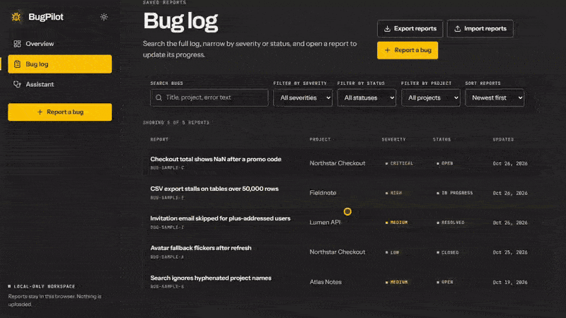

A 34-second walkthrough: open the bug log, open the checkout report, choose **Analyse with Assistant**, run **Analyze**, save the diagnosis with its evidence item left unticked, and finish on the saved bug with a **Diagnosis saved** toast and a **View bug** link.

Sharper version: [watch the MP4](docs/demo/bugpilot-demo.mp4).

BugPilot is a local-first bug tracker and debugging assistant that runs entirely in the browser. It is built for capturing a reproducible bug report, keeping a searchable triage log, recording a fix through manual states, and getting rule-based hints from pasted Python or JavaScript error text. There is no account, backend, cloud database, telemetry, or AI API: saved reports and the theme preference stay in this browser, and the assistant analyses pasted text in the page without sending it. Assistant text is stored only when you explicitly save a diagnosis to a report.

This repository contains a working MVP, not a hosted service: the live demo is a static build of this same code, with no server behind it. See [Known limits](#known-limits) for what is intentionally out of scope.

## What works today

- **Overview dashboard** with live counts for total reports, open reports, in-progress reports, resolved reports, and high/critical reports, plus the five most recent reports.
- **Bug log** with full-text search, severity/status/project filters, five sort orders, a live result count, and a clear-filters control.
- **Report workflow**: create, view, edit, and delete reports, with a permanent-delete confirmation dialog and copy controls for a report's error message and proposed fix.
- **JSON export and validated import** for bug reports, with a preview, merge or replace modes, and a backup of the previous raw log before any import write.
- **Validation**: title, project, language, and description are required; each field has a length limit; a fix status requires a proposed fix; `Verified` additionally requires verification notes.
- **Fix tracking**: `Proposed`, `Accepted`, `Rejected`, and `Verified` are manual states. BugPilot never verifies a fix automatically. A bug's workflow status (`Open`, `In Progress`, `Resolved`, `Closed`) is separate from its fix status.
- **Local persistence** in `localStorage`, including first-run sample reports and a recovery copy when stored JSON is unreadable. The original stored value is not overwritten when it cannot be read.
- **Debug Assistant** at `/assistant`, backed by a local rule engine with 16 Python rules, 14 JavaScript rules, and one language-neutral Git rule. It returns a category, confidence, evidence, debugging steps, a possible fix, verification steps, limitations, and alternatives. A report with an error message can open the Assistant with **Analyse with Assistant**; the report's error text, language, steps, and actual behavior are prefilled, and analysis still requires **Analyze**.
- **Saved diagnoses**: after a recognised analysis loaded from a report, the Assistant previews every field and writes one diagnosis to that report when confirmed. The bug detail shows the category, signature, confidence, selected evidence, and saved date, and can remove the diagnosis without touching the proposed fix, fix state, status, or verification notes.
- **Code analysis** at `/analyze`: upload folders, loose files, `.zip`, `.tar`, `.tar.gz`/`.tgz` archives or package archives, or paste a snippet, and get findings from 19 registered pattern/syntax rules, eleven sensitive-file-name rules, and a lazy TypeScript syntax check, with per-file coverage, skipped-file reasons, severity/file filters, and `report.md`/`report.json` downloads. Several uploads can be checked in one run under `upload-N/` prefixes; Jupyter notebooks are split into cells and every text-bearing stored output (stream text, display data, error messages and tracebacks) is scanned for credentials without ever being shown; Trojan Source bidi and zero-width characters are reported as escapes, never rendered; generated and vendored files are skipped by default with an override. An opt-in second pass loads WebAssembly grammars (tree-sitter, 16 languages) and the Ruff Python linter in the tab, and quotes every file's size before downloading any of it. Four deterministic fixers (credentials, JSON trailing commas, plain-`http://` URLs, mixed indentation) propose changes that are re-verified on in-memory copies; a lazy unified/side-by-side diff review follows, then an isolated clean export (`changes.patch`, `clean.zip`, `CHANGELOG.md`, and the report). Everything runs in the tab in web workers; uploaded text is never executed, uploaded, or persisted, and report exports contain no evidence quotes unless the user ticks the snippet box. A zip is read by seeking, so a project archive up to 2 GiB that is large only because of `node_modules`, `.git` and images is accepted and its uninteresting entries are never inflated; tar and tar.gz stay sequential and are capped at 400 MiB. Six separate budgets (archive bytes, inflated bytes, parsed index entries, analysed entries, per-file size, wall clock) replace one blunt cap, a **Large project mode** opt-in raises them on a machine that reports 8 GiB or more, a run that runs out of time, bytes or entries keeps what it found and labels the report **partial**, and the same upload can be continued with further passes until it is fully analysed. See [Code analysis](#code-analysis) and [Upload security model](#upload-security-model).
- **Light and dark themes**, seeded from the system preference on first visit and saved after the user toggles.
- **Accessibility and interaction details**: skip link, labelled controls, focus-visible styling, focus-trapped delete, import, remove-diagnosis, and save-diagnosis dialogs with focus return to their triggers, status announcements, a document title per route, auto-dismissing toast, a WCAG contrast test for the theme tokens, and axe-core checks over every page and dialog state. See [Accessibility](#accessibility).
- **Rotating footer joke**: one joke per page, changing every 60 seconds and after a reload or return to the page.

## Screenshots

Dashboard, light theme:

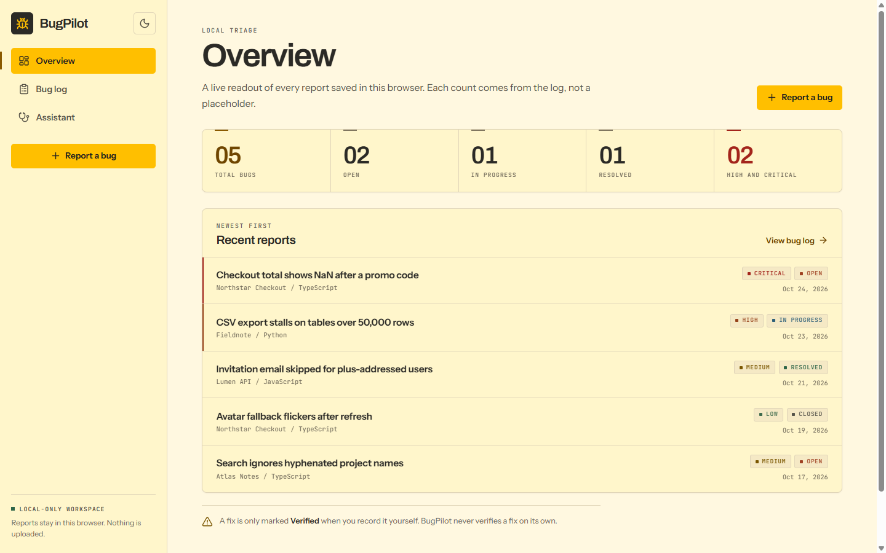

Dashboard, dark theme:

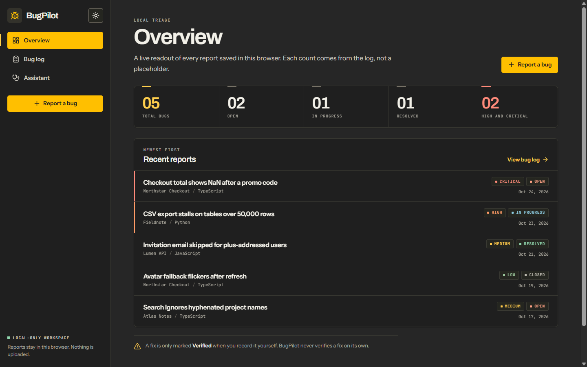

Bug log, dark theme:

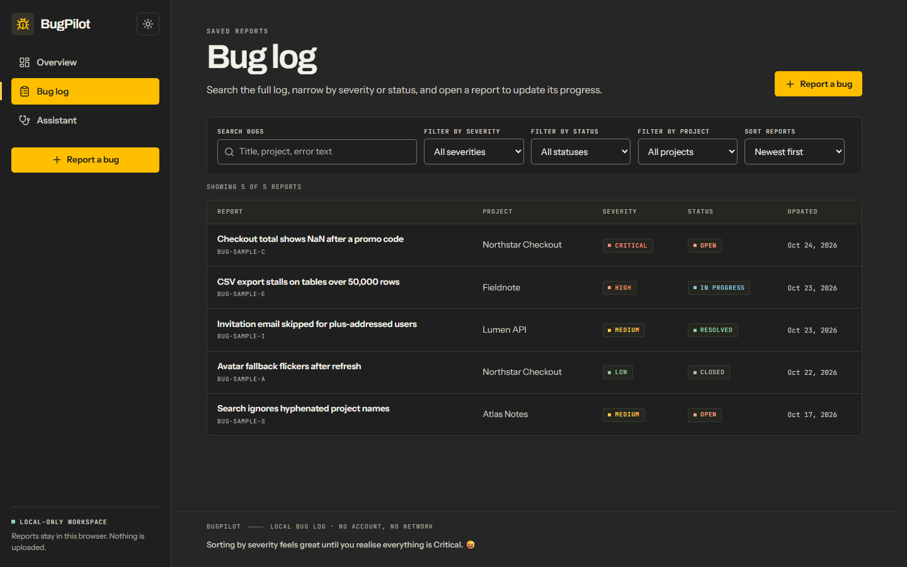

Bug detail, light theme:

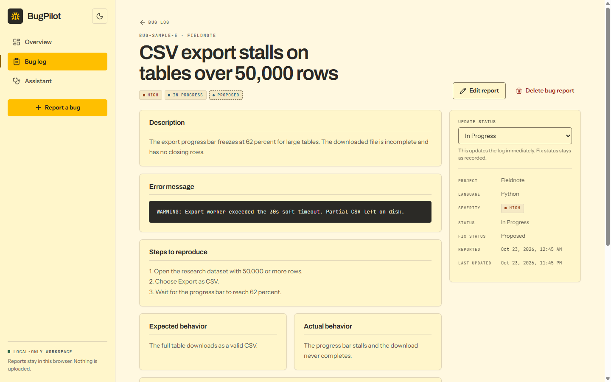

Saved diagnosis on a bug detail, light theme:

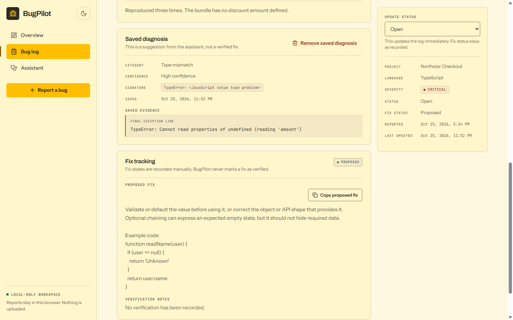

Debug Assistant with a Python result, light theme:

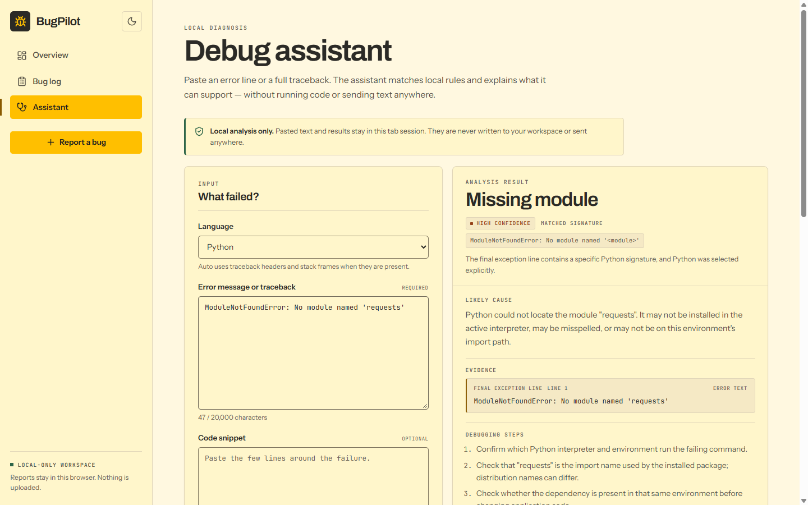

Debug Assistant with a Python result, dark theme:

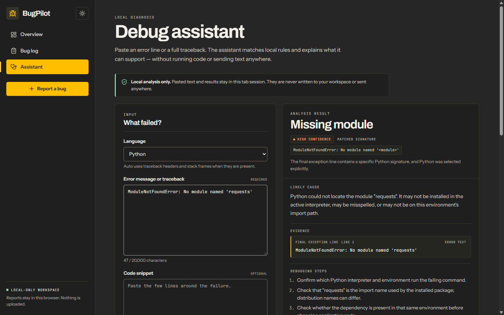

Save-diagnosis preview, light theme:

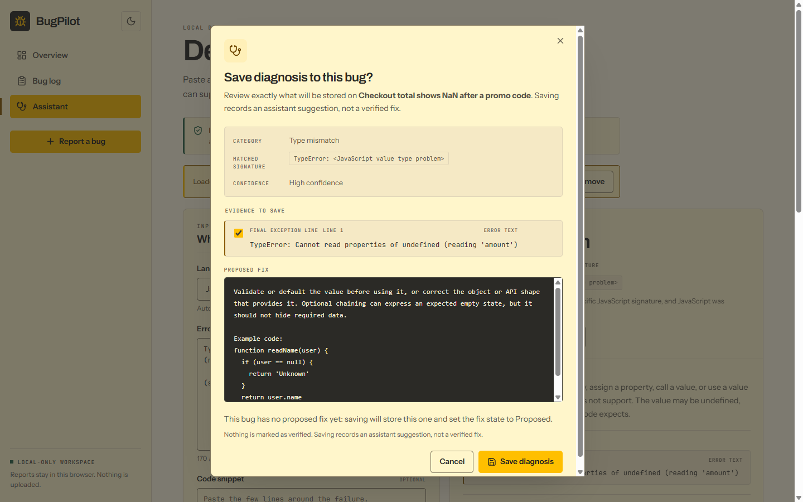

Dashboard at 390px, dark theme:

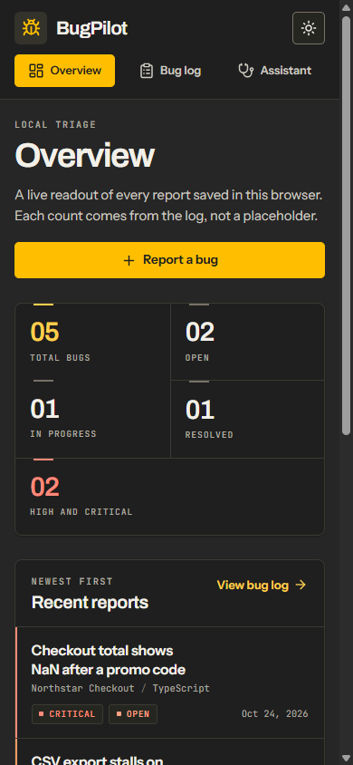

The screenshots show the five fictional sample reports created on a first run; the saved diagnosis was saved to one of those samples while checking the documented flow. They are not real user data.

## Engineering notes

### Why local-first

Developers paste real error messages and code into debugging tools, so BugPilot never sends them anywhere. There is no backend, account, or analytics. Reports live in the browser, the assistant's input is session-only, and a Content Security Policy restricts the page to its own origin.

### Rule-based, not a black box

The assistant is a set of small, separately testable rules. Each rule matches a documented exception signature, shows the evidence it matched, states its confidence and limits, and says plainly when it does not recognise an error. Every rule has positive, lookalike, and prose-mention tests, so naming an exception in a sentence without its exception line does not produce a confident diagnosis.

### A suggestion is never "verified"

A recommended fix is only a suggestion. A fix becomes Verified when the user records it themselves, and verification notes are required. Saving a diagnosis is a deliberate step with a preview of exactly what will be stored, and the user can untick evidence lines before saving.

### Quality gates

CI runs on every push to `main` and every pull request: lint fails on warnings, the Vitest suite includes the axe-core accessibility checks, and the production build must pass. A daily workflow also checks the live site's routes and security headers.

### How it was built

I built BugPilot with an AI coding assistant and planned its prompts with another AI model. I did not accept claims at face value: each phase required real test output and browser checks, and the finished build got a read-only live audit. That audit caught a 15 px sideways scroll at 320 px, caused by a `min-width: 320px` floor colliding with the classic scrollbar, and a route change that left the document title unchanged; both were fixed and re-audited.

### Known limits

- Tested in Chromium on Windows only; Firefox, Safari, and physical mobile devices are not covered.
- No screen-reader pass yet; NVDA, Narrator, JAWS, and VoiceOver remain untested. See [Accessibility](#accessibility) for the full list.
- The assistant recognises only the 31 documented rules: 16 Python, 14 JavaScript, and one language-neutral Git rule.
- Code analysis is static. JavaScript/TypeScript is parsed for syntax only, JSON for strict syntax only, and 16 further languages can be parsed by the opt-in WebAssembly grammars — which are parsers and a linter, not type checkers, and report nothing about Scala, TOML, XML, Markdown or plain text. Measured over the spike corpus, the whole pipeline found 34 of 174 seeded defects (19.5%), and 58 of the misses need type or data-flow analysis this app deliberately does not run. Automatic changes cover only the four fixers listed in [Automatic fix proposals](#automatic-fix-proposals); every engine finding and every Python finding is manual-only. It is not a security audit and does not prove a file is safe.

## Tech stack

| Layer | Choice |
| --- | --- |
| UI | React 19.3.1 and React DOM 19.3.1 |
| Language | TypeScript 6.0.3 |
| Build tool | Vite 8.3.5 |
| Routing | React Router DOM 7.18.4 |
| Icons | Lucide React 1.61.0 |
| Fonts | Fontsource variable packages for Archivo, Instrument Sans, and JetBrains Mono |
| Styling | Hand-written CSS with custom properties; no CSS framework |
| Tests | Vitest 5.0.5, Testing Library, jsdom 30.1.3, axe-core 4.14.0 (dev only) |
| Linting | oxlint 1.88.0 |
| Archives | fflate 0.8.3 (MIT), used by the streaming zip and gzip readers and the clean-export zip writer |
| Diffs | `diff` 9.0.0 (jsdiff, BSD-3-Clause), used only by the lazy review and clean-export chunks |
| Analysis engines | `web-tree-sitter` 0.27.1 and `tree-sitter-wasm` 2.0.4 (16 grammars), plus `@astral-sh/ruff-wasm-web` 0.17.3 — all MIT, all WebAssembly, all lazy and opt-in. See [Engine licences](docs/ENGINE-LICENCES.md) |
| Storage | Browser `localStorage` and `sessionStorage` only |

## Requirements

- **Node.js** `^20.19.0` or `>=22.12.0`. That range comes from Vite 8.3.5, which this project uses.
- **npm**, included with Node.js.
- A modern Chromium-based browser (Chrome or Edge). The app has been tested on Windows with Chromium; it has not been tested in Firefox, Safari, or on physical mobile devices.

The documentation and test run reported here used Node.js `v24.21.0` and npm `11.19.0` on Windows. No API keys, accounts, databases, or external services are needed.

## Install and run

```bash
npm install
npm run dev
```

Vite prints the local URL, normally `http://localhost:5173`. To use the fixed port used for the documentation checks:

```bash
npm run dev -- --port 5180 --strictPort
```

Then open `http://localhost:5180`. `--strictPort` makes the command fail instead of silently choosing another port.

`npm install` is only needed the first time, or after dependencies change. It reads the committed `package-lock.json` versions.

## Commands

| Command | What it does |
| --- | --- |
| `npm run dev` | Starts the Vite development server with hot module replacement. |
| `npm run dev -- --port 5180 --strictPort` | Starts the development server on the fixed port used in this documentation. |
| `npm test` | Runs the Vitest suite once. The project is configured to run test files serially on this Windows machine; see [Windows notes](#windows-notes). |
| `npm run lint` | Runs oxlint with `--deny-warnings`, so a warning fails the command the same way an error does. |
| `npm run build` | Runs the TypeScript project build, then creates the production bundle in `dist/`. |
| `npm run preview` | Serves an existing `dist/` build. Run `npm run build` first. |
| `npm run preview -- --port 4173 --strictPort` | Serves the production build on the fixed preview port used in this documentation. |

All commands above, except `npm install` (dependencies were already installed) and the bare `npm run preview` (verified through the same preview server with explicit port flags), were run while preparing this README.

### Continuous integration

`.github/workflows/ci.yml` runs on every push to `main` and on every pull request. One Ubuntu runner sets up Node 24 and then runs `npm ci`, `npm run lint`, `npm test`, and `npm run build` as four separately named steps, so a failed run names the exact stage that broke. The workflow requests `contents: read` permission only, cancels superseded runs of the same branch, times out after 20 minutes, and does not deploy anything.

## Production preview

```bash
npm run build
npm run preview -- --port 4173 --strictPort
```

Open `http://localhost:4173`. A preview server is a separate browser origin from the development server, so `localhost:4173` and `localhost:5180` have separate `localStorage` data and separate sample reports. Refresh a deep route such as `/bugs` to confirm the preview server serves the single-page app for client-side routes.

## Deployment

BugPilot is a static single-page app. A Vercel deployment uses `npm run build` as the build command and `dist` as the output directory. The committed `vercel.json` rewrites requests that do not match an existing file to `/index.html`, so direct visits to client-side routes such as `/bugs` and `/assistant` load the app instead of a server 404.

No environment variables or backend are required. Bug reports are stored in each visitor's own browser, so a deployed copy does not share data between visitors. The app is deployed on Vercel at [bugpilot-lac.vercel.app](https://bugpilot-lac.vercel.app).

### Content Security Policy

`vercel.json` carries **two** header rules. The main-document rule is the pre-engine policy
character-for-character, with only the engine directory carved out of its catch-all; a second,
scoped rule adds `'wasm-unsafe-eval'` for the files under `assets/engines/` and nothing else.

```text
source: /((?!assets/engines/).*)
default-src 'self'; script-src 'self'; style-src 'self'; img-src 'self' data:; font-src 'self' data:; connect-src 'self'; object-src 'none'; base-uri 'self'; form-action 'self'; frame-ancestors 'none'

source: /assets/engines/(.*)
default-src 'self'; script-src 'self' 'wasm-unsafe-eval'; style-src 'self'; img-src 'self' data:; font-src 'self' data:; connect-src 'self'; object-src 'none'; base-uri 'self'; form-action 'self'; frame-ancestors 'none'
```

Both rules send the same four other headers: `X-Content-Type-Options: nosniff`,
`Referrer-Policy: strict-origin-when-cross-origin`, `X-Frame-Options: DENY`,
`Permissions-Policy: camera=(), microphone=(), geolocation=()`.

**Why the allowance is scoped, not global.** WebAssembly needs `wasm-unsafe-eval` in
`script-src`; `'unsafe-eval'` was never considered and `blob:` was not added. The change was
kept out of the document policy because the page itself has no WebAssembly need — only the two
engine worker scripts and the `.wasm` files they load do — and because a global allowance would
have let any future injected script in the document compile WebAssembly, which is a strictly
larger attack surface than "the four engine files can". The scoping is done with a negative
lookahead in the main rule's `source`, so the two rules never both claim a path: a path under
`assets/engines/` matches only the engine rule, everything else only the main rule. That matters
because a browser **intersects** repeated `Content-Security-Policy` headers, so an overlapping
rule would have silently re-blocked WebAssembly. `scripts/check-live.mjs` therefore resolves
each rule against the path it probes and fails if a path is claimed by more than one rule.

`src/csp.test.ts` asserts both strings exactly, asserts the main policy is the pre-engine
string, asserts the only difference between the two is the `'wasm-unsafe-eval'` source, asserts
neither policy contains `'unsafe-inline'`, `'unsafe-eval'`, `blob:`, `data:` in `script-src` or
a wildcard source, and asserts that the two `source` patterns are mutually exclusive for a
sample of real built paths.

| Directive | Why it is set |
| --- | --- |
| `default-src 'self'` | Fallback for any fetch directive not listed below; only this origin is allowed. |
| `script-src 'self'` (main) / `'self' 'wasm-unsafe-eval'` (engine) | The build loads only same-origin module scripts: the main entry, the lazy Analyze-page, fix-review and clean-export chunks, and the analyzer and worker chunks. There are no inline scripts, inline event-handler attributes, `eval`, or `new Function`; neither `'unsafe-inline'` nor `'unsafe-eval'` is allowed anywhere. `'wasm-unsafe-eval'` appears only on the engine chunks and the WebAssembly they compile, and it grants exactly that: no `eval` of JavaScript. |
| `style-src 'self'` | The build loads one same-origin stylesheet. There are no `<style>` blocks and the app writes no inline styles at runtime. The light and dark `color-scheme` values live in `src/index.css` under `:root` and `:root[data-theme='dark']`; the theme code only sets `data-theme`, and a unit test asserts that toggling leaves no `style` attribute on `<html>`. |
| `img-src 'self' data:` | Allows the self-hosted favicon and inert data-URI images, and blocks every external image. No data-URI image is in the current build; `data:` is retained from the requested baseline. |
| `font-src 'self' data:` | Ten of the eleven `@font-face` files are self-hosted `.woff2` files. Vite inlines one Cyrillic-extended JetBrains Mono subset as `data:font/woff2` in the built CSS, so this allowance is required for that face. Rendering `Ѡ` (U+0460) confirmed the face loaded under this policy. |
| `connect-src 'self'` | The app makes no `fetch`, XHR, or WebSocket request for data, and nothing can send reports, assistant text, uploads, or anything else to another host. Loading the lazy Analyze page, its workers, the engine workers and the `.wasm` files fetches only same-origin static assets. |
| `object-src 'none'` | Blocks plugins, `<object>`, and `<embed>` content. |
| `base-uri 'self'` | Stops an injected `<base>` element from changing how relative URLs resolve. |
| `form-action 'self'` | Restricts form submissions to this origin. The app's forms are handled by React and never post to a server. |
| `frame-ancestors 'none'` | Prevents the app from being framed. `X-Frame-Options: DENY` is also kept for browsers that do not support this directive. |


No `'unsafe-inline'` is used for scripts or styles anywhere, and no `style-src-attr` exception is needed. `blob:` was not added: a real export download was exercised under this policy, produced and revoked its object URL, and downloaded the JSON without a violation. Two allowances exist beyond the requested baseline, both measured rather than guessed: `data:` in `font-src`, required by the built font above, and `'wasm-unsafe-eval'` in the `script-src` of the engine rule only.

**Browser coverage (2026-10-29).** The production build was served by a temporary stdlib-only Node server outside the repository with the exact `vercel.json` headers and SPA fallback. Fresh Chromium, Firefox, and Playwright WebKit contexts walked every route, the theme toggle, the Assistant (CORS triple, Python, JavaScript, and all eight bare JSON forms), the seeded checkout save flow, export, import, and toasts. Chromium and Firefox reported **0 CSP violations, 0 console errors, and 0 page errors**. Playwright WebKit reported no app-written inline style, but it emits one `style-src-attr` message per `<select>` element; the cause and the effect are recorded in the next paragraph. Playwright WebKit approximates Safari; physical Safari was not tested. Light and dark screenshots of Overview, Bug log, and the bug form were pixel-identical before and after `color-scheme` moved from JavaScript to CSS in all three engines.

**WebKit `<select>` `style-src-attr` refusals (re-verified 2026-10-31, live and on a temporary stdlib-only server).** WebKit reports exactly one `style-src-attr` violation for each `<select>` on the page: 4 on `/bugs` (`filter-severity`, `filter-status`, `filter-project`, `sort-reports`), 3 on `/bugs/new` (`severity`, `status`, `fixStatus`), 1 on a report detail (`quick-status`), 1 on `/assistant` (`assistant-language`), and 0 on `/`. Every event was `{ violatedDirective: 'style-src-attr', effectiveDirective: 'style-src-attr', blockedURI: 'inline', sample: '', disposition: 'enforce' }`, reported from `assets/index-CP3t6mAD.js` at `8:89104`. A temporary copy of the project outside the repository, built with `--sourcemap` from the same `node_modules` (minified line 8 byte-identical to the shipped file), maps that position to `ownerDocument.createElement("select")` inside `completeWork()` in `node_modules/react-dom/cjs/react-dom-client.production.js:8514` (react-dom 19.3.1) — **React DOM internals, not application code**. Application source has no inline style at all (`grep -rn "style=" src/` matches nothing), and hooks installed before load on `Element.prototype.setAttribute`, `setAttributeNS`, `removeAttribute`, `CSSStyleDeclaration.prototype.setProperty`, the `cssText` setter, the `Element.style` setter, plus a `MutationObserver` filtered to the `style` attribute, recorded **zero** style writes on every route, live and locally. Pages with no React reproduce the same one-per-`<select>` count, including `<select>` markup parsed straight from HTML — where the event's `sourceFile` is empty, so no script frame is on the stack — and a `<select>` created but never inserted; `<option>`, `<input>`, and `<textarea>` never trigger it. All of them fire during the first React mount, before any interaction: the theme toggle and opening a `<select>` add none. Per engine on the live site: WebKit equals the number of `<select>` elements, **Chromium 0, Firefox 0**. The refusal changes nothing visible — the same routes served with and without the CSP header produced **0 differing pixels** across 12 paired light/dark screenshots at 1280x900 and 390x844, and the `<select>` elements keep no `style` attribute and an empty `style.cssText` in both cases. The only computed-style differences were `html`/`body` height on the narrow viewport, which also varied between repeats of the *same* configuration, so it is run-to-run layout jitter, not the refusal. Conclusion: this is console and violation-report noise in WebKit only, with no user-visible effect, and it is not fixable from application code without replacing every `<select>` with a custom widget. `style-src` stays `'self'`; `'unsafe-inline'` was not added.

**How it was checked locally.** On 2026-10-25 the production build was served by a temporary stdlib-only Node server outside the repository. It read the headers from `vercel.json` at startup, applied all of them, and used the same SPA fallback. Fresh Chromium contexts at 1440x700 with real 15px scrollbars loaded every route directly and exercised first-run seeding, create/edit/delete, search/filter/sort, fix states, both themes, the Debug Assistant (Python, JavaScript, unrecognised, empty, over-limit, copy, checklist, clear), export, import preview/merge and the replace gate, toasts, the joke rotation, keyboard focus, and the then-existing delete and import dialogs: **216 assertions, 0 CSP violations, 0 console errors, 0 page errors**, with requests only to the local server. A throwaway page then confirmed that an inline script, an external image, and an external `fetch` were each blocked and reported as a violation (exactly three expected violations). `src/csp.test.ts` also reads this file during `npm test` and fails if the global rule loses the policy, the required directives change, or an unsafe source appears.

**What this does not prove.** `npm run dev` and `npm run preview` do **not** apply `vercel.json`; they serve no CSP. The policy reaches users only after a Vercel deployment, and the live response had not yet been inspected when this section was written. Re-run the header command in [Security headers](docs/MANUAL_TEST_CHECKLIST.md#17-security-headers) after deploying and confirm the policy string before treating the production site as protected. A local emulator proves the policy is compatible with the build, not that the host is sending it.

**Adding a new source later.** Add the narrowest origin or path to the specific directive it needs, not to `default-src`, and avoid broad `https:` entries. A new image host belongs in `img-src`; a new API belongs in `connect-src`; a new font belongs in `font-src`. Never add `'unsafe-inline'` to `script-src`; use a separate same-origin script, or a build-time hash if an inline script is unavoidable. If a style attribute becomes unavoidable, prefer `style-src-attr 'unsafe-inline'` over opening up `style-src`. Add `blob:` only if a feature is proven to need it, and only on the directive that needs it. Then rebuild, update `src/csp.test.ts` if an asserted directive changed, run `npm test`, and repeat the live header and console checks.

## Live site monitoring

`.github/workflows/live-check.yml` runs `scripts/check-live.mjs` once a day at 06:17 UTC, and it can be run by hand from the repository's **Actions** tab (**Live site check** → **Run workflow**). The optional `url` input sends the same checks to another address; leaving it empty uses [bugpilot-lac.vercel.app](https://bugpilot-lac.vercel.app).

The script is a dependency-free Node 24 ES module. It GETs `/`, `/bugs`, `/bugs/new`, `/assistant`, `/analyze` and a nonsense path; each must return HTTP 200 with an HTML body that contains the app root and script and no Vercel 404 marker. It compares the security headers with the values in `vercel.json` — resolving which header rule is supposed to describe each path, and failing if a path is claimed by more than one rule, because a browser intersects repeated `Content-Security-Policy` headers — fetches the script and stylesheet referenced by `/`, checks that every script, stylesheet, image and font URL is same-origin, reports each request time, and fails a request that stays above 8 seconds after retries. For the engines it GETs `/assets/engines/manifest.json`, checks its own headers against the engine rule, then fetches **every file the deployed manifest lists** and checks each one's headers, that the `.wasm` files are served as `application/wasm`, that the engine policy is the `'wasm-unsafe-eval'` one and the rest of the site is not, and that no policy anywhere gained `'unsafe-inline'`, `'unsafe-eval'` or `blob:`. Network errors are retried twice; redirects are reported and not followed.

Run it locally with:

```bash
node scripts/check-live.mjs
```

The first line of every run prints the Node version, the base URL actually used, whether it came from the `LIVE_URL` environment variable or from the built-in default, the short commit of the checkout when `git` can report one, and the UTC time — so a run can be identified without digging through the log.

Inside GitHub Actions (`GITHUB_ACTIONS=true`) every failure is also published where the Actions UI shows it without a login:

- Every failed check produces one `::error title=<check>::<observed value and every failing detail>` workflow command, so it appears as a red **annotation** on the run summary page and beside the failing step.
- Every early-exit guard produces one annotation titled `Live check guard`: an invalid `LIVE_URL`, a `vercel.json` that cannot be read or parsed, a configuration without the global `/(.*)` header block, and a configuration missing one of the required headers. These guards exit before any request is made, which previously left a red run with no visible reason.
- An unexpected exception is caught at the top level and annotated as `Live check crash` with the error name, message and stack.
- When `GITHUB_STEP_SUMMARY` is set, the same checks are appended as a markdown table (check, result, observed value, failing details) with the base URL, commit and pass/fail counts, so the whole result is readable on the run page.

Percent signs, carriage returns and line feeds are percent-encoded in the workflow commands as the format requires, and a message longer than 1800 characters is truncated with a `[truncated]` marker. Console output and exit codes are otherwise unchanged: `0` only when every check passed, `1` for any failed check, failed guard or crash.

Verified locally on 2026-10-31 by running the script with `GITHUB_ACTIONS=true` and a temporary `GITHUB_STEP_SUMMARY` file against the live site (0 annotations, summary marked PASS), a non-existent host (11 annotations, one per failed check), `LIVE_URL` set to `not a url` and a `VERCEL_JSON_PATH` pointing at a missing file (one guard annotation each, exit code 1 in all three failing cases).

A red run means at least one route, header, asset or timing check failed, and the reason now appears in the run page itself rather than only in the job log. It is a basic health check, not an uptime guarantee, and it does not exercise any interactive feature.

GitHub can delay or skip scheduled runs. Scheduled workflows in a public repository are disabled automatically after 60 days without repository activity; if that happens, re-enable the workflow in the Actions tab. Run history read from the public GitHub API on 2026-10-31: five runs, **#1** (2026-10-27, manual) **failed** and **#2–#5** (one manual, three scheduled) **succeeded**; the scheduled runs started around 12:58–13:05 UTC even though the cron reads 06:17, which is GitHub's own scheduling delay rather than a second timezone in the file. Run #1's only annotation was the generic `Process completed with exit code 1`, and its step finished in under a second — locally measured, the script's own retried network path takes about 17 s for an unreachable host, so that failure did not come from inside the request loop, and without an authenticated job log nothing more can be said about it. The annotations and step summary above exist so that the next red run explains itself in the Actions UI.

## Routes

| Route | Page |
| --- | --- |
| `/` | Overview dashboard with live stats and recent reports |
| `/bugs` | Bug log with search, filters, sorting, and report links |
| `/bugs/new` | New bug report form |
| `/bugs/:bugId` | Bug detail with quick status changes, edit, and delete |
| `/bugs/:bugId/edit` | Edit form for an existing report |
| `/assistant` | Local Debug Assistant. `?bugId=<id>` prefills it from a saved report; the query carries only the id. |
| `/analyze` | Local code analysis: folder, zip, or loose-file upload, findings, coverage, filters, report downloads, verified fix selection, diff review, and clean export. |
| `*` | Page-not-found screen with a link back to the overview |

Routes are declared in `src/App.tsx`.

## Export and import

The **Bug log** header has **Export reports** and **Import reports** actions. Both work entirely in the browser and handle bug reports only.

### Export

**Export reports** downloads a file named `bugpilot-export-YYYY-MM-DD.json`. The date is taken from `exportedAt` in UTC, so it always matches the date in the envelope. The file is pretty-printed JSON:

```json
{
  "app": "bugpilot",
  "schemaVersion": 1,
  "exportedAt": "2026-10-24T20:40:31.220Z",
  "bugs": [
    {
      "id": "sample-checkout-nan",
      "title": "Checkout total shows NaN after a promo code",
      "description": "…",
      "projectName": "Northstar Checkout",
      "language": "TypeScript",
      "errorMessage": "…",
      "stepsToReproduce": "…",
      "expectedBehavior": "…",
      "actualBehavior": "…",
      "severity": "Critical",
      "status": "Open",
      "notes": "…",
      "proposedFix": "",
      "fixStatus": null,
      "verificationNotes": "",
      "createdAt": "2026-10-24T18:35:07.721Z",
      "updatedAt": "2026-10-24T18:35:07.721Z"
    }
  ]
}
```

The array contains every saved report with all of its fields, including fix state, verification notes, a saved diagnosis and its composed fix, and original timestamps. Theme preference, unsaved assistant input or results, footer joke indices, and every other storage key are never exported. With an empty log, the app says there is nothing to export and does not download a file. The download is built with a `Blob` and an object URL, which is revoked after the click; nothing is uploaded.

### Saved diagnoses

A report may carry one optional `diagnosis` object, added after `updatedAt`. It is created from the Assistant and is displayed on the bug detail; it is not a form field.

#### Saving from the Assistant

- On a bug detail with a non-empty error message, **Analyse with Assistant** links to `/assistant?bugId=<id>`. The query carries only the id.
- The Assistant prefills the report's error text, maps `Python` to Python and `JavaScript`, `TypeScript`, `JS`, `TS`, or `Node` to JavaScript (anything else to Auto), and composes reproduction details from the report's steps and actual behavior as `Steps to reproduce:` then `Actual behavior:`, with each source field trimmed and capped at its form limit. It does not analyze until **Analyze** is clicked.
- A **Loaded from bug: <title>** chip identifies the context. Its **Remove** action clears the `bugId` query and the chip but keeps text already typed. An unknown id shows a non-blocking notice and leaves the Assistant unchanged. Opening the context writes nothing to storage.
- After a recognised result with a possible fix, **Save diagnosis to this bug** appears only while that bug context is loaded.
- The preview dialog is focus-trapped, starts on **Cancel**, closes on Escape, Cancel, the close button, or a backdrop click without writing, and returns focus to the trigger. It lists the category, matched signature (or **No specific signature**), confidence, every evidence item (checked by default and independently untickable), and the exact proposed fix. The scrollable fix preview is keyboard-focusable so it can be scrolled without a pointer.
- The composed fix is the explanation, a blank line, `Example code:`, then the example code. If that exceeds 20,000 characters, the example code is left out and the dialog says so; if the explanation alone exceeds the limit, Save is disabled with an explanation. The text is never silently truncated.
- With no existing fix, Save writes the composed fix and sets fix status to `Proposed`. With an existing fix, the fix and its recorded state are kept unless **Replace the existing proposed fix with this one** is ticked; ticking it replaces only the fix text, not the recorded state. Saving never marks a fix `Verified`, and it replaces an existing diagnosis with a new `savedAt`.
- Success shows **Diagnosis saved to this bug.** with a **View bug** link. A storage failure shows the dialog error and a persistent error toast, and writes nothing.

#### Stored shape

```json
"diagnosis": {
  "category": "missing-module",
  "matchedSignature": "ModuleNotFoundError: No module named '<module>'",
  "confidence": "high",
  "evidence": [
    {
      "label": "Final exception line",
      "quote": "ModuleNotFoundError: No module named 'pandas'"
    }
  ],
  "savedAt": "2026-10-25T12:00:00.000Z"
}
```

| Field | Rule |
| --- | --- |
| `category` | Text, 1–80 characters. It is not restricted to the diagnostic engine's current categories, so a future category does not invalidate existing saved data. |
| `ruleId` | Optional text, up to 80 characters. Imported files may carry it and it is preserved, but the current interface does not add it. |
| `matchedSignature` | Text up to 300 characters, or `null`. |
| `confidence` | `low`, `medium`, or `high`. |
| `evidence` | Up to 5 items. Each item is `{ label, quote }`, with `label` up to 80 characters and `quote` up to 500. Only evidence ticked in the preview is written; line numbers and source labels are not stored. |
| `savedAt` | A valid ISO timestamp. |

The current interface writes exactly `category`, `matchedSignature`, `confidence`, `evidence`, and `savedAt`. The composed fix goes into the report's ordinary `proposedFix`, outside the `diagnosis` object. The raw error text, code snippet, reproduction details, and unticked evidence are not stored. A ticked evidence quote can itself contain the final exception line, as in the example above.

The field is optional and additive. Both browser storage and the export envelope stay at `schemaVersion: 1`. A report without a diagnosis serialises exactly as before: there is no `diagnosis: null` key. Old export files without the field import unchanged. An older BugPilot build will import the report but drop the diagnosis, so diagnosis data is lossy across downgrades; the core report is never rejected for it.

Saved diagnoses are preserved through reload, ordinary edits, quick status changes, fix-state changes, export, and import. On the bug detail, **Remove saved diagnosis** opens a focus-trapped confirmation dialog; Escape, Cancel, the close button, or a backdrop click cancel without writing, and focus returns to the button. Confirming removes only the `diagnosis` field, keeps `proposedFix`, `fixStatus`, `verificationNotes`, and `status`, and shows **Saved diagnosis removed.** Removal cannot be undone.

### Import

The import dialog accepts a `.json` file up to **5 MB** and **5,000 reports**. It validates the envelope (`app` must be `bugpilot`; `schemaVersion` must be `1`) and every report with the same rules as the form:

- required id, title, description, project, language, severity, status, and valid `createdAt`/`updatedAt` timestamps;
- valid severity, status, and fix-status values;
- unique ids within the file and the same per-field length limits as the form;
- a proposed fix whenever a fix status is set, and verification notes when the fix status is `Verified`.

A newer `schemaVersion` is rejected with an explanation, as are a different `app`, a missing `bugs` array, and malformed JSON. Unknown fields are dropped. Invalid reports are listed with their positions and reasons; they are never repaired or silently accepted, and only the valid records in a mixed file can be imported. Prototype-related keys such as `__proto__`, `constructor`, and `prototype` are ignored. Import never uses `eval` or dynamic code, and imported text is rendered only as plain text.

Before writing, the dialog shows the filename; valid, invalid, and already-existing counts; and a preview of what will happen. The default **Add new reports only** mode keeps the current log and skips imported reports whose ids already exist. **Replace all reports** deletes the whole current log and becomes available only after a second, explicit acknowledgement; the confirm button is disabled when the file contains zero valid reports.

Immediately before any import write, the current raw stored value is copied to `bugpilot.bugs.preimport.v1`. If the backup write or the main write fails, the existing log is left unchanged and a persistent error toast explains the failure. This is a single recovery slot, not a version history: every import overwrites it, so export a file before a replace if you may need an independent copy.

A successful import preserves the imported timestamps, updates the dashboard and log immediately, reports added/skipped/replaced counts in a toast, and does not bring back the first-run sample notice. Cancel, Escape, the close button, or a backdrop click change nothing. The dialog traps focus while open and returns focus to **Import reports** when it closes.

## Architecture

### Source tree

```text
src/
├─ app/            Workspace context: loads state, exposes bug actions, and owns toast notifications
├─ components/     Shared layout, badges, delete/import/remove/save dialogs, toast, and footer joke
├─ content/        Static joke sets for each page key
├─ diagnostics/    Diagnostic types, matching engine, rule tests
│  └─ rules/       Python, JavaScript, and language-neutral diagnostic rules
├─ features/
│  ├─ analyzer/    Code analysis: archive reader, rules, pipeline, fixes, review, clean export, and UI
│  ├─ assistant/   Bug-to-Assistant prefill and save-diagnosis composition
│  ├─ bugs/        Bug types, samples, validation, storage, querying, saved diagnoses, export/import, and the workspace hook
│  ├─ footer/      Joke selection, 60-second rotation, and sessionStorage handling
│  └─ theme/       Theme resolution, persistence, and the WCAG contrast test
├─ lib/            Clipboard helper shared by the report detail copy buttons
├─ pages/          Route-level pages for the dashboard, log, form, detail, assistant, analyze, and 404
├─ test/           Vitest setup and shared test factories
├─ App.tsx         Route table and optional footer-joke interval configuration
├─ App.css         Amber & Charcoal theme, layout, and component styles
├─ index.css       Theme tokens, fonts, and global base styles
└─ main.tsx        React entry point
```

Test files live beside the module they test. For example, the Python rules live in `src/diagnostics/rules/python.ts` and are tested in `src/diagnostics/python-rules.test.ts`.

### How the main pieces are organised

**Bug storage.** `src/features/bugs/storage.ts` owns the `bugpilot.bugs.v1` key. The stored value is a JSON object with a `schemaVersion` and a `bugs` array. On load, every record is validated again; invalid records are skipped. If the whole value is unreadable JSON or has the wrong shape, the app shows a "Saved data needs attention" notice, leaves the original key untouched, and writes a best-effort copy to `bugpilot.bugs.recovery.v1`. When the key is absent, five fictional sample reports are created and saved. Saves write the complete array; there is no server copy.

**Validation.** `src/features/bugs/validation.ts` is the single source of truth for field rules. It checks the four required fields, enforces per-field character limits, requires a proposed fix whenever a fix status is set, and requires verification notes for `Verified`. The form uses these errors for inline messages and a summary; storage parsing also calls the same validation so malformed saved records are not displayed.

**Export and import.** `src/features/bugs/exportImport.ts` is a pure module with no React imports. It builds and serialises the export envelope, parses and validates an import file, counts existing ids, and applies a merge or replace while writing the backup key. It maps each allowed report field explicitly, so unknown or prototype-related keys cannot reach the log. `src/components/ImportBugDialog.tsx` owns only the dialog interaction and file reading; `src/pages/BugListPage.tsx` triggers the download and reports the result.

**Fix states.** Fix status is an optional field on a bug, not a derived value. `src/pages/BugFormPage.tsx` edits it; `src/pages/BugDetailPage.tsx` displays it and allows quick changes to the separate workflow status. Marking a fix `Verified` is always a manual action, and the selected fix status is never inferred from the fix text or from the assistant. `Accepted` means the proposed fix was accepted; `Verified` means the user also recorded how it was checked.

**Saved diagnoses.** `src/features/bugs/diagnosis.ts` validates and attaches or removes a diagnosis while leaving the report's fix fields alone. `src/features/assistant/prefill.ts` turns a report into Assistant fields without storing anything, and `src/features/assistant/savePreview.ts` composes the proposed fix and decides whether a save is possible. `src/components/SaveDiagnosisDialog.tsx` and `src/components/RemoveDiagnosisDialog.tsx` own only the dialog interaction; `src/pages/AssistantPage.tsx` calls the workspace's `attachDiagnosis`, and `src/pages/BugDetailPage.tsx` displays the saved fields and calls `removeDiagnosis`. The interface writes no `ruleId`.

**Copying report text.** The detail page shows **Copy error message** and **Copy proposed fix** only when the corresponding field has text. Each button copies that field unchanged through `src/lib/clipboard.ts` and reports success with `role="status"` or a manual-copy fallback with `role="alert"`. Copying does not write to storage, change the report, or mark a fix as verified.

**Themes.** `src/index.css` defines the light theme on `:root` and the dark overrides on `:root[data-theme='dark']`. `src/features/theme/theme.ts` resolves the initial theme from `bugpilot.theme.v1`, falling back to `prefers-color-scheme`. `src/features/theme/useTheme.ts` applies `data-theme` to the document root and saves later changes; `color-scheme` is not written by JavaScript, it is switched by the `:root` and `:root[data-theme='dark']` rules in `src/index.css`. `src/features/theme/contrast.test.ts` checks the text, badge, border, and focus-ring token pairs against WCAG AA contrast ratios.

**Footer jokes.** `src/content/footerJokes.ts` holds four jokes for each of six page keys. `src/features/footer/footerJoke.ts` maps a pathname to a page key, avoids choosing the same joke twice in a row when alternatives exist, and stores the last index in `sessionStorage` under `bugpilot.footerJoke.<pageKey>` (with an in-memory fallback when storage is blocked). `src/components/FooterJoke.tsx` rotates the joke every 60 seconds. `src/App.tsx` accepts an optional `VITE_FOOTER_JOKE_INTERVAL_MS` environment override for development, but the default is 60 seconds.

**Diagnostics.** `src/diagnostics/types.ts` defines the rule contract and result shape. `src/diagnostics/engine.ts` selects the final exception line, infers a language when needed, runs the registered rules, chooses the most specific match, and builds confidence, evidence, and fallback output. `src/diagnostics/rules/python.ts` and `src/diagnostics/rules/javascript.ts` contain the 30 language rules (16 Python and 14 JavaScript) and register them in the exported `pythonRules` and `javascriptRules` arrays. `src/diagnostics/rules/neutral.ts` holds the one language-neutral rule, `tool.git-error`, exported as `neutralRules`. `src/pages/AssistantPage.tsx` is only the UI: it holds pasted text in component state and calls `diagnose()` in the browser.

## How the diagnostic engine works

### Input

The assistant calls `diagnose()` with:

| Field | Required | Purpose |
| --- | --- | --- |
| `language` | Yes | `auto`, `python`, or `javascript`. `auto` infers a runtime from traceback or stack-frame clues. |
| `errorText` | Yes | The error line or full traceback. This is the only field used to select the exception line. |
| `codeSnippet` | No | Used only to add at most one line to the evidence list. A line is eligible only when a captured value appears in it as a whole identifier. The snippet never changes which rule matches and is never executed or parsed. |
| `reproductionDetails` | No | Used as additional language clues. When `language` is `auto`, those clues help select the runtime; they also feed the confidence level and reason, including conflict detection. They are not quoted as evidence and never match rules themselves. |

The engine looks for the last exception-shaped line in `errorText`, then falls back to the last non-empty line. A leading `Uncaught` or `Uncaught (in promise)` prefix is stripped before rule matching.

### Output

`DiagnosticResult` contains:

| Field | Meaning |
| --- | --- |
| `category` | One of the supported categories below, or `unrecognized`. |
| `matchedSignature` | The rule's human-readable signature, or `null` when nothing matched. |
| `likelyCause` | A plain-language explanation written by the matched rule. |
| `evidence` | The selected exception line with its line number, plus at most one line from the supplied code snippet when a captured value appears in it as a whole identifier. |
| `debuggingSteps` | Ordered next steps. |
| `possibleFix` | `{ explanation, whereItMayApply, exampleCode }`, or `null` for an unrecognised input. |
| `verificationSteps` | A checklist the user can tick in the current session. The checkboxes do not verify a fix. |
| `confidence` | `{ level: 'low' \| 'medium' \| 'high', reason }`. |
| `limitations` | What the rule and engine cannot see. Every result also states that the guidance is local and rule-based. |
| `alternativeExplanations` | Other plausible causes for the same signature. |

Supported categories are `missing-module`, `import-failure`, `undefined-name`, `type-mismatch`, `missing-attribute`, `missing-key`, `index-out-of-range`, `missing-file`, `permission-denied`, `syntax-error`, `indentation-error`, `division-by-zero`, `invalid-value`, `recursion-error`, `unicode-error`, `json-decode-error`, `port-in-use`, `network-request-failed`, `cors-blocked`, `react-error`, `typescript-error`, `npm-error`, and `git-error`.

### Supported Python rules

Each rule matches only the selected exception line. When a line is not an exact match, the rule returns `null` and the engine tries the other rules or the unrecognised fallback. The table lists what each rule deliberately leaves to another rule or to that fallback.

| Rule | Recognises | Deliberately does not claim |
| --- | --- | --- |
| `ModuleNotFoundError` | `No module named '<module>'` | `ImportError: cannot import name ...`, relative-import failures, or a bare module name in prose |
| `ImportError` | `cannot import name '<name>' from '<module>'`, `attempted relative import with no known parent package`, and other `ImportError` lines as generic | `ModuleNotFoundError` lines |
| `NameError` | `name '<name>' is not defined`, and other `NameError` lines as generic | JavaScript `ReferenceError`, `AttributeError`, or a prose mention of a name |
| `TypeError` | Python type shapes such as unsupported operands, failed concatenation, non-subscriptable or non-callable objects, positional-argument errors, `len()` failures, and failed comparisons; other Python `TypeError` lines as generic | JavaScript `TypeError` shapes such as reading properties of `undefined`, `is not a function`, and `is not iterable` |
| `AttributeError` | object and module `has no attribute` messages, and other `AttributeError` lines as generic | `TypeError` lines with similar wording, or `KeyError` |
| `KeyError` | a quoted key and other `KeyError` lines as generic | `IndexError`, missing attributes, or a key name in prose |
| `IndexError` | known list, string, tuple, and range index failures, and other `IndexError` lines as generic | `KeyError`, off-by-one advice without an `IndexError` line |
| `FileNotFoundError` | `No such file or directory` with a path, and other `FileNotFoundError` lines as generic | `PermissionError` lines |
| `PermissionError` | `Permission denied` with a path, and other `PermissionError` lines as generic | `FileNotFoundError` lines |
| `SyntaxError` | known Python parser messages such as `invalid syntax` and unclosed delimiters, and other Python `SyntaxError` lines as generic | JavaScript parser messages such as `Unexpected token` |
| `IndentationError` | known indentation messages such as `unexpected indent`, and other `IndentationError` lines as generic | `SyntaxError` lines with similar wording |
| `ZeroDivisionError` | `division by zero`, `integer division or modulo by zero`, `float division by zero`, `float modulo`, and `integer modulo by zero` | `ArithmeticError`, unknown `ZeroDivisionError` messages, and mentions in logs, comments, strings, or prose |
| `ValueError` | `invalid literal for int() with base N`, `could not convert string to float`, `not enough values to unpack`, `too many values to unpack`, `math domain error`, and `<value> is not in list`; every other `ValueError` line gets a lower-confidence generic result | `json.decoder.JSONDecodeError` and `requests.exceptions.JSONDecodeError` lines, and `UnicodeDecodeError` or `UnicodeEncodeError` lines, which have their own rules |
| `RecursionError` | `maximum recursion depth exceeded`, optionally followed by `while calling a Python object` or `in comparison` | `RuntimeError`, other `RecursionError` messages, and prose mentions |
| `UnicodeDecodeError` and `UnicodeEncodeError` | `'<codec>' codec can't decode` or `can't encode` a byte, bytes, character, or characters | `ValueError` or `TypeError` lines that contain the same words, and unknown codec-message shapes |
| `JSONDecodeError` | `JSONDecodeError`, `json.JSONDecodeError`, `json.decoder.JSONDecodeError`, and `requests.exceptions.JSONDecodeError` with `Expecting value`, `Expecting property name`, `Extra data`, `Unterminated string`, or `Invalid control character` | `ValueError` carrying the same words, unknown `JSONDecodeError` messages, and JavaScript `SyntaxError` |

### Supported JavaScript rules

These rules cover browser and Node.js runtime errors, TypeScript compiler output, and npm log lines. The five Node.js rules and the four browser, network, JSON, and React rules are registered after the three original rules, and the JSON and network rules supersede the generic `SyntaxError` and `TypeError` fallbacks only when they match the same final exception line. The two compiler and package-manager rules, `javascript.typescript-error` and `javascript.npm-error`, are registered after all of them, so nothing here changes an existing rule's id, category, or match. The `TypeError` rule also recognises the modern, legacy, and Firefox property, call, iteration, constant, and constructor shapes listed below. The engine also recognises `Error:` and `Error [CODE]:` lines as Node-style error lines when no other exception line is present.

| Rule | Recognises | Deliberately does not claim |
| --- | --- | --- |
| `ReferenceError` | `name is not defined`, `Cannot access <name> before initialization`, and other `ReferenceError` lines as generic | Python `NameError`, `AttributeError`, or a prose mention of a name |
| `TypeError` | JavaScript sub-signatures for modern and legacy property reads on `undefined` or `null`, modern property writes, `is not a function`, `is not iterable`, `Assignment to constant variable.`, `is not a constructor`, and Firefox `can't access property` wording (see [TypeError sub-signatures](#typeerror-sub-signatures)); other `TypeError` lines as generic | Python `TypeError` shapes such as unsupported operands or failed concatenation, and messages that only resemble a subtype, such as a property-read target other than `undefined` or `null` |
| `SyntaxError` | JavaScript parser messages such as `Unexpected token`, `Unexpected end of JSON input`, and `Cannot use import statement outside a module` | Python parser messages such as `invalid syntax`, and JSON parser messages, which the JSON rule claims before this fallback |
| Node module not found | `Error: Cannot find module '<package>'`, `Error: Cannot find module '<path>'` (with or without a `Require stack:` list), and `Error [ERR_MODULE_NOT_FOUND]: Cannot find package or module '<package or path>' imported from <path>` | Python `ModuleNotFoundError`, `ERR_REQUIRE_ESM`, unquoted module names, and prose mentions |
| Port in use | `Error: listen EADDRINUSE: address already in use <address>` for `:::PORT`, `0.0.0.0:PORT`, `127.0.0.1:PORT`, and `localhost:PORT` | `EADDRINUSE` in a log line, comment, or prose, and listen errors without the address |
| Node file error | `Error: ENOENT: no such file or directory` with `open`, `stat`, `scandir`, `mkdir`, or `readFile` and a quoted path, and `Error: spawn <command> ENOENT` | Other ENOENT operations such as `lstat`, Python `FileNotFoundError`, and bare `ENOENT` mentions |
| Permission error | `Error: EACCES: permission denied` with `open`, `mkdir`, or `scandir` and a quoted path, `Error: listen EACCES: permission denied <address>`, and `Error: EPERM: operation not permitted` | Python `PermissionError`, other error codes, and log or prose mentions |
| Call stack | `RangeError: Maximum call stack size exceeded` | Other `RangeError` messages such as `Invalid array length`, and log or prose mentions |
| JSON parse | V8 `Unexpected token < in JSON at position 0`, `Unexpected token '<', ... is not valid JSON`, `Unexpected token u in JSON at position 0`, `"undefined" is not valid JSON`, and `Unexpected end of JSON input`; Firefox `JSON.parse: unexpected character` and `JSON.parse: unexpected end of data`; Safari `JSON Parse error: Unrecognized token '<'` and `JSON Parse error: Unexpected EOF`; the same distinctive messages pasted without a `SyntaxError:` prefix, matched to the same signature but capped at **Medium** confidence | Python `JSONDecodeError`, ordinary `SyntaxError` lines without JSON wording, bare `Unexpected token }` (which stays unrecognised without the `SyntaxError:` class), and a JSON message inside a timestamped or prose line. This rule supersedes the generic `SyntaxError` fallback. |
| Network request failed | `TypeError: Failed to fetch`, `TypeError: NetworkError when attempting to fetch resource.`, `TypeError: fetch failed` (with `[cause]` codes `ECONNREFUSED`, `ENOTFOUND`, `ETIMEDOUT`, or `ECONNRESET` used when present), Chrome console `net::ERR_CONNECTION_REFUSED`, `net::ERR_NAME_NOT_RESOLVED`, `net::ERR_INTERNET_DISCONNECTED`, and `net::ERR_CERT_*`; Safari `TypeError: Load failed` as a generic, low-confidence match | Other `TypeError` lines, Python connection errors, `net::ERR_*` codes other than the listed families, and a message embedded in a timestamped or prose line. This rule supersedes the generic `TypeError` fallback. |
| CORS blocked | `Access to fetch at '<url>' from origin '<origin>' has been blocked by CORS policy:` for a missing `Access-Control-Allow-Origin` header, a failed preflight, an origin mismatch, or credentials combined with a wildcard origin; the `XMLHttpRequest` variant is also recognised | A CORS phrase embedded in a timestamped log line or prose, and messages without the exact console wording |
| React error | `Invalid hook call. Hooks can only be called inside of the body of a function component.`, `Too many re-renders. React limits the number of renders to prevent an infinite loop.`, `Maximum update depth exceeded.`, and `Objects are not valid as a React child (found: ...)`, with or without an `Error:` or `Uncaught Error:` prefix | `Warning: Invalid hook call...`, an object-child message without the `(found: ...)` detail, and other React errors |
| TypeScript compiler error | `error TS<code>: <message>` after an exact compiler location (`path.ext(line,col)` or `path.ext:line:col` with ` - ` or `: `) or on its own; the ten listed codes below get their own signature and advice, any other code gets a generic `error TS<code>: <message>` result, and the editor form `….ts(2322)` is recognised with a capped confidence | A `TS<code>` mention in prose, a comment, a string literal, or after a timestamp; a location prefix that is not a `.ts`, `.tsx`, `.mts`, `.cts`, `.js`, `.jsx`, `.mjs`, or `.cjs` path or that omits the column; `warning TS<code>`; and any cause the matched message does not state |
| NPM error | A line starting with exactly `npm error ` (npm 9+) or `npm ERR! ` (npm 6 to 8) carrying `code <X>`, an ERESOLVE peer-dependency line, a 404 or `notarget` line, a `Could not read package.json` line, a `network request to … failed` line, or a lifecycle line (`Failed at the <script> script.`, `errno <code>`); an unknown `code <X>` gets a low-confidence generic result that names the code | `yarn` and `pnpm` output, the same words in a sentence or after a timestamp, a bare `npm error` prefix with nothing recognised after it, and a bare `Error: ENOENT`, `Error: EACCES`, or `Error: listen EADDRINUSE` line, which stays with the Node.js rules |

#### TypeError sub-signatures

The `TypeError` rule keeps one id, category, and confidence logic. Within that rule, these message shapes get their own matched signature and their own cause, debugging steps, fix, and verification guidance. The example line is the exact matched signature.

| Message shape | Example line |
| --- | --- |
| Modern property read on `undefined` | `TypeError: Cannot read properties of undefined (reading 'amount')` |
| Modern property read on `null` | `TypeError: Cannot read properties of null (reading 'length')` |
| Legacy property read on `undefined` | `TypeError: Cannot read property 'amount' of undefined` |
| Legacy property read on `null` | `TypeError: Cannot read property 'length' of null` |
| Modern property write on `undefined` | `TypeError: Cannot set properties of undefined (setting 'value')` |
| Modern property write on `null` | `TypeError: Cannot set properties of null (setting 'checked')` |
| Calling a value that is not a function | `TypeError: items.map is not a function` |
| Iterating a value that is not iterable | `TypeError: items is not iterable` and `TypeError: object null is not iterable` |
| Assigning to a constant binding | `TypeError: Assignment to constant variable.` |
| Using `new` on a value that is not a constructor | `TypeError: Cart is not a constructor` |
| Firefox property read on `undefined` or `null` | `TypeError: can't access property "name", user is undefined` and `TypeError: can't access property "length", items is null` |

Every other `TypeError` line keeps the existing behaviour: `Cannot convert undefined or null to object` returns `TypeError: <JavaScript value type problem>`, and unrecognised wording returns `TypeError: <JavaScript type mismatch>`. A subtype is claimed only when the full anchored shape matches, so `Cannot read property 'name' of object` and `can't access property "name", user is defined` stay generic. Each sub-signature, plus lookalike and prose lines that must stay generic, is covered in `src/diagnostics/javascript-type-error-subtypes-coverage.test.ts`. These are sub-signatures of one rule, not separate rules, so the rule count and rule IDs are unchanged. A diagnosis saved before this change keeps its stored signature and is displayed and exported as saved; stored data is not migrated.

Distinctive browser JSON messages (`JSON.parse:`, `JSON Parse error:`, `in JSON at position`, `is not valid JSON`, and `Unexpected end of JSON input`) are also recognised when pasted alone without the `SyntaxError:` prefix. The matched signature is the same except that it includes the added `SyntaxError:` prefix, and the confidence is capped at **Medium** because the error class was not present. A bare generic `Unexpected token }` is not claimed by the JSON rule and stays unrecognised; the `SyntaxError: Unexpected token }` form remains a generic `SyntaxError`; timestamped or prose lines are not treated as final exception lines. The bare forms are covered in `src/diagnostics/javascript-json-parse-bare.test.ts` and in the regression corpus.

#### TypeScript compiler sub-signatures

`javascript.typescript-error` matches the `error TS<code>: <message>` part of a compiler line, in the six forms `tsc` and the editor produce: `src/App.tsx(12,5): error TS2322: …`, `src/App.tsx:12:5 - error TS2322: …`, `src/cart.ts:88:3: error TS2345: …`, the same with a Windows drive-letter path, a bare `error TS2322: …` with no location, and the editor form `…type 'number'.ts(2322)`. A location prefix is accepted only in those exact path forms — a `.ts`, `.tsx`, `.mts`, `.cts`, `.js`, `.jsx`, `.mjs`, or `.cjs` path followed by `(line,col)` or `:line:col`. A timestamp or any other prefix returns `null`, so `2026-10-31T10:00:00Z src/App.tsx(12,5): error TS2322: …` stays unrecognised. Ten codes get their own matched signature, cause, steps, fix, and verification guidance:

| Code | Matched signature | What the result says |
| --- | --- | --- |
| `TS2322` | `error TS2322: Type '<type>' is not assignable to type '<type>'.` | A value's type does not match what the target expects; make the two sides agree, and treat a cast as silencing the check rather than fixing it |
| `TS2339` | `error TS2339: Property '<name>' does not exist on type '<type>'.` | A misspelled name, a property that needs a check (optional chaining), a declared type narrower than the runtime value, or a missing declaration |
| `TS2345` | `error TS2345: Argument of type '<type>' is not assignable to parameter of type '<type>'.` | The call site and the parameter type disagree; the message does not say which argument |
| `TS2304` | `error TS2304: Cannot find name '<name>'.` | The name is not imported or declared here, or exists only under different compiler settings such as `lib` and `target` |
| `TS2307` | `error TS2307: Cannot find module '<module>' or its corresponding type declarations.` | The import target may be uninstalled, missing its `@types` package, unreachable through `paths` or `moduleResolution`, or written with an extension the resolver does not accept |
| `TS7006` | `error TS7006: Parameter '<name>' implicitly has an 'any' type.` | A parameter has no annotation and `noImplicitAny` is on, so annotate it or give the caller a typed value |
| `TS2532` | `error TS2532: Object is possibly '<value>'.` | A value that can be missing is used as though it were always present; narrow it with a check or use optional chaining, not a blanket non-null assertion |
| `TS18048` | `error TS18048: '<name>' is possibly '<value>'.` | The same narrowing advice, for the named variable |
| `TS2554` | `error TS2554: Expected <count> arguments, but got <count>.` | The argument count does not match the signature; the message does not say which parameter is missing or extra |
| `TS2769` | `error TS2769: No overload matches this call.` | No accepted call shape matched; the useful detail is in the indented continuation lines the compiler prints under this message |

Any other `error TS<code>: …` line gets a generic `error TS2551: <message>`-shaped result that names the code, quotes the message, says plainly that this engine has no specific rule for it, points at the TypeScript documentation for that code, and tells the reader to look at the indented lines that follow — it never claims a cause. Confidence is **High** for a listed code with a recognised location, **Medium** for a bare message or a generic code with a location, and **Low** for the editor `.ts(2322)` form and a bare generic code. When a paste carries several compiler errors, the first TypeScript error line is the primary diagnosis and the limitations say how many TypeScript error lines were found. Covered in `src/diagnostics/javascript-rules-batch-c1.test.ts` and in the regression corpus.

#### NPM error sub-signatures

`javascript.npm-error` matches only a line whose prefix is exactly `npm error ` (npm 9 and later) or `npm ERR! ` (npm 6 to 8); `yarn` and `pnpm` output is out of scope and stays unrecognised. Each recognised shape gets its own signature and advice, with both prefixes producing the same result:

| Shape | Matched signature | What the result says |
| --- | --- | --- |
| Peer-dependency conflict | `npm error code ERESOLVE`, `npm error ERESOLVE unable to resolve dependency tree`, `npm error Could not resolve dependency:`, `npm ERR! Conflicting peer dependency: <package>@<version>` | Read which package wants which version, check the tree with `npm ls <package>`, then upgrade, replace, or align the versions; `--legacy-peer-deps` and `--force` appear only as informed last-resort workarounds with their risks |
| Package not in the registry | `npm error code E404`, `npm error 404 Not Found - GET <url>`, `npm ERR! 404 '<package>' is not in this registry.` | Check the spelling and scope, and for a private package the registry URL and the auth token in `.npmrc` |
| Version does not exist | `npm error code ETARGET`, `npm error No matching version found for <package>@<version>.` | The requested version is not published; check the available versions and where the pin came from |
| Missing `package.json` | `npm error code ENOENT`, `npm error Could not read package.json` | npm was probably run in the wrong folder; check the working directory and run from the project root (`cd` and `dir` on Windows, PowerShell first), and use `npm init` only for a genuinely new project |
| Write not permitted | `npm error code EACCES`, `npm error code EPERM` | Fix folder ownership or use a Node version manager or a user-level prefix instead of `sudo npm install`; on Windows, name a locked file, another process, or a running dev server — disabling security tools is never suggested |
| Registry unreachable | `npm error code <network error code>` (`ENOTFOUND`, `ECONNRESET`, `ETIMEDOUT`, and related codes), `npm error network request to <url> failed, reason: <reason>` | Check the connection, any proxy, and the configured registry, then retry |
| Lifecycle trailer | `npm error code ELIFECYCLE`, `npm ERR! Failed at the <script> script.`, `npm ERR! errno <exit code>` | A script failed and the real error is printed above these lines; run the named script on its own. This is a clearly labelled **Low** or **Medium** result, and it loses to any specific error recognised earlier in the same paste |
| Unknown code | `npm error code <error code>` | Names the code, quotes the line, and stays **Low** confidence because the engine has no specific advice for it |

Windows PowerShell and Command Prompt commands are listed before the macOS and Linux ones in every fix. Covered in `src/diagnostics/javascript-rules-batch-c1.test.ts` and in the regression corpus.

### Supported language-neutral rules

A tool writes its own messages, and Git's carry no programming language. `tool.git-error` declares `language: 'any'`, so the engine consults it in Auto, Python, and JavaScript alike, and the result is worded without naming a runtime. The neutral scan runs only when no Python or JavaScript rule claimed any line in the paste and the language could not be resolved, so a Git line never displaces a language diagnosis and the 30 language rules behave exactly as before. The category is `git-error`, labelled **Git error**. One rule carries the whole batch — 22 anchored patterns covering the 21 distinct shapes grouped into the 17 named rows in the table below (one identity message is matched twice), plus the generic `fatal:` fallback row — so the registered rule count is 31: 16 Python, 14 JavaScript, and this one language-neutral rule.

Each sub-signature matches a trimmed line that begins with exactly the prefix Git writes — `fatal:`, `error:`, `warning:`, `remote:`, `! [rejected]`, `CONFLICT (`. The same words after a timestamp, a log level, or inside a sentence do not match, and a terminal prompt or command echo matches no sub-signature at all: such a line can be the one the engine selects, but it is never what the result is built from, because the diagnosis comes from the line the rule actually recognised. Because Git repeats the outcome last, the recognised line with the highest specificity wins, and between two equally specific lines the one nearer the bottom of the paste wins. `hint:` advice lines and the `To <url>` line a push prints before its refusal are treated as trailers, so they cannot hide the `! [rejected]` or `error:` line above them.

| Sub-signature | Matched signature | What the result says |
| --- | --- | --- |
| No repository here | `fatal: not a git repository (or any of the parent directories): .git` | The command ran in a folder with no `.git` in it or above it; move into the repository or clone one, and confirm with `git rev-parse --show-toplevel`. The fix says plainly that cloning writes a new folder and needs an unused target, and nothing in it changes an existing repository |
| Remote name taken | `error: remote origin already exists.` | The name is already configured and nothing changed; read `git remote -v`, then `git remote set-url` or remove and re-add. Git prints this as `error:`, not `fatal:`, and the signature keeps the real prefix |
| Push refused | `! [rejected] <ref> -> <ref> (fetch first)`, `! [rejected] <ref> -> <ref> (non-fast-forward)` | The remote holds commits you do not have. Fetch, compare both sides, integrate with `git pull --rebase`, then push again. Overwriting the remote appears only as a labelled last resort that can destroy other people's work, named as `--force-with-lease`; the bare `--force` form is never suggested |
| Push summary | `error: failed to push some refs to '<url>'` | A summary, not a cause: read the lines above it. **Low** confidence, and it loses to any specific line in the same paste |
| Unrelated histories | `fatal: refusing to merge unrelated histories` | The two histories share no ancestor, so Git asks before combining them. `--allow-unrelated-histories` is presented as a deliberate choice, with conflicts expected |
| Merge conflict | `CONFLICT (<type>): Merge conflict in <file>` | Both sides changed the same region; Git wrote `<<<<<<<`, `=======`, and `>>>>>>>` markers and stopped. Resolve, remove the markers, `git add`, `git commit`. `git merge --abort` is offered as the reversible exit and says plainly that it discards the edits already made while resolving |
| Merge summary | `Automatic merge failed; fix conflicts and then commit the result.` | Points at the `CONFLICT` lines above it for the file names. **Low** confidence on its own |
| Work would be overwritten | `error: Your local changes to the following files would be overwritten by checkout:`, `… by merge:` | Git aborted, so nothing changed yet. Commit the edits or `git stash push`, switch, then `git stash pop`. The result never suggests discarding the work to clear the message |
| No author identity | `fatal: unable to auto-detect email address (got '<value>')`, `Author identity unknown`, and the generic `*** Please tell me who you are.` | No commit was written. Set `git config --global user.email` and `user.name`, or the same without `--global` for one repository; existing commits keep the identity they were made with, and rewriting a shared branch is not offered as the fix |
| Password no longer accepted | `remote: Support for password authentication was removed on August 13, 2021.` | Use a personal access token with a credential helper, or an SSH key. A token is a secret: never paste one into a file, a commit, an issue, a chat, or a screenshot, and do not embed one in a remote URL |
| Credential refused | `fatal: Authentication failed for '<url>'` | The credential was missing, expired, or not accepted. Local commits are safe; use a token or Git Credential Manager over HTTPS, or an SSH key, and never paste a token anywhere |
| Account lacks access | `remote: Permission to <owner>/<repo>.git denied to <user>.`, `error: The requested URL returned error: 403`, `Permission denied (publickey).` | Authentication succeeded (or the key was unknown) but the account cannot write here. Switch to the account that can, or ask for access; a bare uppercase `ERROR: Permission to …` line from another tool is not claimed |
| Branch does not exist locally | `error: src refspec <branch> does not match any` | The ref named does not exist, usually because nothing is committed yet or the branch has another name. List branches, make the first commit, then `git push -u origin <branch>` |
| Doubtful folder ownership | `fatal: detected dubious ownership in repository at '<path>'` | The check exists to stop you running Git in a folder someone else placed. It shows `git config --global --add safe.directory <path>` for a folder you own, says plainly that it must not be used for untrusted, downloaded, or mounted folders, and warns that `*` disables the check for every folder |
| Index lock held | `fatal: Unable to create '<path>': File exists.` | Another Git process is working, or an interrupted one left the flag. Close the other Git processes and retry first; delete the lock only when no Git process is running, with the plain warning that removing it mid-write can damage the index. `del` (Windows) is listed before `rm` (macOS and Linux) |
| Line-ending notice | `warning: in the working copy of '<file>', LF will be replaced by CRLF the next time Git touches it`, and the older `warning: LF will be replaced by CRLF in <file>.` | Nothing is broken: Git normalises line endings and the staged change is still your change. Do nothing, or set `core.autocrlf`, or commit a `.gitattributes` with `* text=auto`, which is the choice that applies to every clone |
| Remote unreachable | `fatal: unable to access '<url>': <network detail>` (`Could not resolve host`, `Failed to connect to … port …`, `Connection timed out`) | Nothing was sent. Check connectivity, DNS, and any VPN or proxy, and retry; a proxy is configured only with the undo command shown next to it |
| Any other `fatal:` line | `fatal: <message Git reported>` | **Low** confidence. It quotes the line, says plainly that no sub-signature covers that wording, and tells the reader to read the `remote:` and `hint:` lines and run `git status`. The fix panel opens by saying no fix is offered and lists only those read-only commands, so nothing is claimed as the cause |

Windows PowerShell and Command Prompt commands come first in every fix, with the macOS and Linux form after. Covered in `src/diagnostics/neutral-rules.test.ts` (engine mechanism) and `src/diagnostics/git-rule.test.ts` (sub-signatures, multi-line terminal output, and lookalikes), and recorded in the regression corpus.

### Matching, confidence, and evidence

- Rules use anchored regular expressions against the selected exception line. A rule returns `null` when the line is not an exact match, and returns a `signature`, a `specificity` of `specific` or `generic`, and any captured values.
- The engine evaluates rules for both languages. An explicit language wins when a rule in that language matches. With `auto`, weighted traceback and stack-frame clues choose the runtime; a more specific signature can override a weak clue, and conflicting evidence lowers confidence. Three JavaScript clues were added for the compiler and package-manager rules — an `error TS<code>:` message, an editor `….ts(2322)` marker on its own line, and a line starting with `npm error` or `npm ERR!` — and each only counts toward JavaScript; no Python or JavaScript detection result changed, which the corpus and `src/diagnostics/javascript-rules-batch-c1.test.ts` both pin.
- A rule whose `language` is `any` is language-neutral. Neutral rules are never part of language detection and are consulted only after the Python and JavaScript rule groups have both come up empty, so they cannot take a line a language rule claims and cannot change an Auto, Python, or JavaScript result. The Git rule therefore produces the same category, signature, evidence, and confidence in all three modes, which `src/diagnostics/neutral-rules.test.ts` pins for every mode.
- Confidence is `high` for a specific signature with an explicit language or supporting trace evidence, `medium` for a generic signature with those clues or a specific signature without them, and `low` when the evidence conflicts or no rule matched. The exact reason is always shown next to the badge.
- A language-neutral match is judged on its signature alone: **High** when a specific sub-signature matched, **Low** for the generic fallback. Python or JavaScript clues cannot raise it and a selected language cannot lower it, so the reason text names the line the failing command wrote rather than a runtime.
- For a matched result, evidence includes the selected exception line and its line number. If a code snippet is supplied, the first line containing a captured value (at least three characters, excluding free-text `detail` and `reason` fields) as a whole identifier is added as a second evidence item. Identifier characters are letters, digits, `_`, and `$`; every other character and the start or end of the line is a boundary. For example, a captured `total` is quoted from `total = 0` or `print(total)`, but not from `subtotal = 10` or `total_count = 1`. At most one snippet line is added. An unrecognised result has no evidence because no rule matched.
- A rule can declare `supersedes: ['<rule id>']`. When both it and the declared rule match the same final exception line in the same language, the declared rule is removed before the match is chosen. The JSON rule supersedes `javascript.syntax-error`, and the network rule supersedes `javascript.type-error`; no other rule declares a relation, so unrelated matches are unaffected. Precedence is applied before the specificity comparison below.
- If two matching rules have the same specificity, the earlier rule in the relevant rule array wins. New rules should therefore be specific enough to beat an existing generic fallback, or be placed deliberately.
- A match can set a `confidenceCeiling`. The ceiling can only lower the computed level, never raise it, and the reason says so. Safari `TypeError: Load failed` is capped at low because its wording does not identify what failed; the other browser and Node network messages keep the normal confidence rules.

#### Context lines, React trailers, and compiler summaries

- A rule can declare `contextSymptoms`: generic final lines that the rule can explain from another line in the paste. When the selected final line matches one of those symptoms, the engine also applies that rule to the other lines and lets a specific match represent the diagnosis. The evidence then shows the final exception line and the matched context line with its own line number. The CORS rule explains `TypeError: Failed to fetch`, `Uncaught (in promise) TypeError: Failed to fetch`, and bare `net::ERR_FAILED` console lines. The React rule explains a null-property `TypeError` that names a hook such as `useState`, `useEffect`, or `useContext`. A context match never replaces a rule that matched the final line itself unless the final line is one of the rule's declared symptoms, and the `supersedes` precedence above is unchanged.
- A rule can also declare `firstMatchWins: true`, which makes that context scan read the paste from the top instead of from the bottom, so the first line the rule recognises is the one that represents the diagnosis. Only `javascript.typescript-error` and `javascript.npm-error` declare it: `tsc` and npm print their errors in the order they found them, so the first one is the one to fix. The two new rules declare the compiler summaries and npm trailer lines as context symptoms for exactly this reason.
- When choosing the final exception line, the engine skips React's component trailer: the `The above error occurred in the <X> component:` line, the `Consider adding an error boundary to your tree to customize error handling behavior.` line, and the indented component or stack frame lines that belong to them. A render error above the trailer stays the primary line.
- It also skips the `SUMMARY_TRAILERS` lines, which carry no exception of their own: `tsc`'s `Found 1 error in src/App.tsx:5` and `Found 2 errors in 2 files.` summaries, the `Errors  Files` table header and its `     1  src/App.tsx:12` rows, npm's empty `npm error` / `npm ERR!` separator lines, the `npm error> <script>` echo, `A complete log of this run can be found in:` with the `_logs/…-debug-0.log` path it names, `command failed`, and `This is probably not a problem with npm…`. Without these skips a paste whose last line is a summary would select a line no rule matches. Git's two summary forms join that list: each `hint:` advice line, and the `To <url>` (or `git@host:path`) line a push prints before its refusal, so a paste that ends in advice still reports the `! [rejected]` or `error:` line above it. Five batch C2 corpus cases (`case-0255`, `case-0271`, `case-0272`, `case-0279`, `case-0281`) carry those lines and pin the behaviour; a line like `To add an exception for this directory, call:` is not skipped, because the push pattern only matches a line that names a remote. No case recorded before batch C2 contains either form, so no earlier result changed.
- `npm error code ELIFECYCLE` and `npm ERR! Failed at the <script> script.` are deliberately **not** in that skip list, because pasted on their own they are still the only thing the user has. A paste that ends with them and contains an earlier recognised error resolves to the earlier error through the normal scoring instead: a specific TypeScript or Node.js match found on a context line outscores a generic lifecycle match, whose own confidence ceiling is already capped. That is why `tsc` output followed by `npm error code ELIFECYCLE` and `npm error Failed at the build script.` reports the first TypeScript error.
- The exact React `Invalid hook call. Hooks can only be called inside of the body of a function component.` sentence may also match when the line starts with `Warning:`. Any other prefix, including a timestamp, does not match, and the confidence for a warning-prefixed match is capped at medium.
- The network rule's browser wording names the first `net::ERR_*` code found in the paste when one is present, so a plain connection failure reports its specific browser code instead of a generic cause. The category and signature still come from the matched final line.

### Unrecognised input and limits

- Empty error text is rejected by the form before analysis.
- Input longer than **20,000 characters** is not analysed. The assistant shows the current character count and an over-limit error, and the engine itself also refuses oversized input instead of truncating it.
- If no readable exception line exists, no supported signature matches, or `auto` cannot resolve a signature shared by both languages, the result is `unrecognized` with `matchedSignature: null`, no possible fix, low confidence, general debugging and verification steps, and an explicit limitation. The assistant does not invent a cause.
- Malformed direct calls to `diagnose()` are handled without throwing and return an unrecognised result.

## How to add a new diagnostic rule

The rule contract is `DiagnosticRule` in `src/diagnostics/types.ts`. A rule belongs to one language (`python` or `javascript`) or, when it describes a tool that has no language, to `any`, and to exactly one supported category.

1. **Pick the language, category, and exact signature.** Reuse a category already in `SupportedDiagnosticCategory` (`src/diagnostics/types.ts`) whenever the existing label and presentation wording fits — that is what the batches above do, and it needs no other file. A genuinely new category is two edits: the union in `src/diagnostics/types.ts` and one entry in `DIAGNOSTIC_CATEGORY_LABELS` in `src/diagnostics/labels.ts`. Nothing else has to change, because `src/pages/AssistantPage.tsx`, `src/components/SaveDiagnosisDialog.tsx`, and `src/pages/BugDetailPage.tsx` all render the label through `diagnosticCategoryLabel()`.
2. **Add the rule to the correct file.** Python rules go in `src/diagnostics/rules/python.ts`; JavaScript rules go in `src/diagnostics/rules/javascript.ts`; a rule that declares `language: 'any'` goes in `src/diagnostics/rules/neutral.ts`.
3. **Implement `match(line)`.** Anchor the expression so prose mentions and lookalike lines do not match. Return `null` when the line is not a match. When it matches, return a stable `signature`, the correct `specificity`, and only the captures the explanation needs. If the new rule claims lines that an existing generic rule also matches, declare `supersedes` on the new rule and add a precedence test. If the wording cannot justify normal confidence, set a `confidenceCeiling` on the match. If the rule should explain a generic final line from another line in the paste, declare `contextSymptoms` with the generic final lines it explains; the CORS and React rules show the pattern.
4. **Implement `explain(match, context)`.** Return `likelyCause`, `debuggingSteps`, a complete `possibleFix` (`explanation`, `whereItMayApply`, `exampleCode`), `verificationSteps`, `limitations`, and `alternativeExplanations`. Keep the example code illustrative; the app never runs it.
5. **Register the rule.** Add the exported rule object to the `pythonRules`, `javascriptRules`, or `neutralRules` array at the bottom of its file. Those arrays are what the engine reads, and the order is not free: when two matching rules have the same specificity the earlier one wins (see [Matching, confidence, and evidence](#matching-confidence-and-evidence)), and existing tests pin the batch windows by position. Appending at the bottom is the safe place — do not insert a JavaScript rule inside indexes 8 to 11 or before index 12, because those slices are asserted. Step 7 lists exactly which assertions a new rule moves.
6. **Add tests beside the existing rule tests.** For Python, extend `src/diagnostics/python-rules.test.ts`; for JavaScript, extend `src/diagnostics/javascript-rules.test.ts`, or add a focused batch test file such as `src/diagnostics/javascript-rules-batch-b1.test.ts`. A `language: 'any'` rule goes in `src/diagnostics/git-rule.test.ts` (or a sibling file) and `src/diagnostics/neutral-rules.test.ts`, which is where the mode-independence of a neutral result is pinned. Add at least:
   - a direct match test: `expect(rule.match(line)).not.toBeNull()`;
   - an engine test: `diagnose({ language: 'python', errorText: line })` returns the expected category, a non-null signature, a possible fix, and non-low confidence;
   - a **false-positive test** for a nearby but different signature and for the same words inside a prose sentence, both of which must return `null`;
   - a check that the final text is not treated as a different language when the language is explicit.

   Nothing has to be added to `src/diagnostics/registry.test.ts` for a new rule: it already checks every registered rule generically — a unique id (line 105), a label for its category (line 111), and a readable detail-page label (line 117).
7. **Update the assertions that pin the rule counts and positions.** These describe the arrays, not your rule, so a correct new rule still breaks them. Appending one JavaScript rule fails four assertions in three files: `src/diagnostics/registry.test.ts:183` (the batch C1 ids must be exactly `javascriptRules.slice(12)`), `src/diagnostics/javascript-rules-batch-c1.test.ts:1270` and `:1274` (the same slice plus `toHaveLength(14)`), and `src/diagnostics/git-rule.test.ts:425` (`javascriptRules` has 14 entries). A Python rule changes only `src/diagnostics/git-rule.test.ts:424`; a `language: 'any'` rule also changes `src/diagnostics/git-rule.test.ts:426`, `src/diagnostics/neutral-rules.test.ts:39`, and the full id list at `src/diagnostics/registry.test.ts:205`. `src/diagnostics/registry.test.ts:161` (`javascriptRules.slice(8, 12)`) only needs touching if you inserted inside that window. Widen the slice expectations to include your id and raise each length by one. Then record the new rule's paste in `src/diagnostics/regression-corpus.json` with a matching entry in `src/diagnostics/regression-corpus.baseline.json`: `src/diagnostics/regression-corpus.test.ts` fails if the two files disagree on the case list, and it compares every recorded paste's category, signature, confidence, and rule id — so a change there is a real behaviour change to review, not a value to overwrite.
8. **Run the focused tests, then the full checks.**

```bash
npm test -- src/diagnostics/javascript-rules.test.ts src/diagnostics/registry.test.ts
npm test -- src/diagnostics/regression-corpus.test.ts
npm test
npm run lint
npm run build
```

**If a category label is missing.** `DIAGNOSTIC_CATEGORY_LABELS` is typed `Record<DiagnosticCategory, string>`, so a new category without a label is caught by `npm run build` with a precise message naming the key (`error TS2741: Property '"…"' is missing in type … but required in type 'Record<DiagnosticCategory, string>'` at `src/diagnostics/labels.ts:3`). Under `npm test` the registry catches it too, but read the output carefully: for a category no batch table names, the only failure is `registry.test.ts:113` with the bare `AssertionError: expected undefined to be truthy`, which names neither the rule nor the category. The readable-label test does **not** catch it — `diagnosticCategoryLabel()` title-cases any unknown key, so the interface would show a guessed badge (`npm-error` rendering as `Npm error`) rather than an error. Verified in a throwaway copy of the repository: removing one label produced `registry.test.ts:113` plus the named `labels <rule id> with <language> on the detail page` failure at `:213` (`expected undefined to be 'Git error'`), and 24 of the 26 registry tests still passed.

### Example rule (illustrative only)

This rule is **not** part of the current app. It shows the shape of a complete, specific Python rule that would extend the existing generic `SyntaxError` fallback.

```ts
import type { DiagnosticRule, RuleMatch, RuleNarrative } from '../types'

const F_STRING_ERROR = /^SyntaxError:\s+f-string: expecting '([^']+)'/

export const pythonFStringSyntaxErrorRule: DiagnosticRule = {
  id: 'python.f-string-syntax-error',
  language: 'python',
  category: 'syntax-error',
  match(line: string): RuleMatch | null {
    const matched = F_STRING_ERROR.exec(line)
    if (!matched) {
      return null
    }

    return {
      signature: "SyntaxError: f-string: expecting '<token>'",
      specificity: 'specific',
      captures: { token: matched[1] },
    }
  },
  explain(match: RuleMatch): RuleNarrative {
    const token = match.captures.token

    return {
      likelyCause: `Python reached the end of an f-string before finding ${token}, so the string or expression is incomplete.`,
      debuggingSteps: [
        'Find the f-string on the line Python reports.',
        `Check that braces are balanced and that ${token} closes the expression.`,
        'Check nested quotes, because an early quote can end the string unexpectedly.',
      ],
      possibleFix: {
        explanation:
          'Complete the f-string expression, or move the expression into a named value before formatting it.',
        whereItMayApply:
          'Apply this to the reported f-string only; do not rewrite unrelated string formatting.',
        exampleCode: 'name = "Ada"\nprint(f"Hello, {name}")',
      },
      verificationSteps: [
        'Run the same file again with the same Python interpreter.',
        'Check that the syntax error is gone and the formatted value is correct.',
      ],
      limitations: [
        'The error can point at the opening brace rather than the missing token.',
        'This engine cannot parse the surrounding Python file.',
      ],
      alternativeExplanations: [
        'A nested quote ended the string early.',
        'A copy-paste left out part of the expression.',
      ],
    }
  },
}
```

After adding a rule like this to the `pythonRules` array, a false-positive test must prove that nearby input such as `SyntaxError: invalid syntax` and a prose sentence containing `f-string: expecting '}'` do **not** match. The generic Python `SyntaxError` rule may still handle the first line through the engine; the new rule must not claim it.

## Code analysis

`/analyze` is a local static-review page, separate from the Assistant. Upload folders, loose files, `.zip`, `.tar`, `.tar.gz`/`.tgz` or package archives, add several uploads to one run, or paste a snippet; BugPilot reads them in the tab, runs its own pattern rules and sensitive-file-name rules, splits Jupyter notebooks into cells, and asks the TypeScript parser for syntax diagnostics. Nothing is executed, uploaded, or persisted. Four deterministic fixers can propose text changes; each proposal is re-verified on an in-memory copy before it is offered, shown in a diff review, and only then available in a clean export. The page states its limits before any upload and prints the checks that were **not** performed for each language that was analysed.

A zip is read by **seeking**, not by unpacking: the reader locates the end of the central directory in a bounded window, reads the index, and classifies every entry — folders, `node_modules` and other vendored trees, images and other binary files, files over the per-file ceiling — before it inflates a single byte. The entries it does not want are never touched, which is why an archive that is hundreds of megabytes because of dependencies and media is still cheap to check, while a project of the same size written as tar gets a lower ceiling: a tar has no index to seek into, so every byte has to be walked to find out what it is. The ceilings are separate for the same reason — archive bytes, inflated bytes, parsed index entries, analysed entries, per-file size and wall clock are six different budgets, and exceeding one no longer refuses a project for a reason that has nothing to do with it. When the clock or a budget runs out the run keeps what it had already read and labels the report **partial**, naming the files it did not reach, and the same upload can be continued with another pass that skips the names already processed. See [Limits, applied before analysis](#limits-applied-before-analysis) and [Partial reports](#partial-reports).

After that first pass the page can offer a **second, opt-in pass** that reads the real grammar of each file with tree-sitter WebAssembly, and lints Python with Ruff WebAssembly. Nothing heavy loads until the user presses **Run deep analysis** in the gate, which lists every file, its size, and the total first. See [Code analysis engines](#code-analysis-engines).

`/analyze` is a lazy route. The archive and rules workers, the TypeScript worker, the bundled TypeScript compiler, the jsdiff-backed review view, the clean-export builder, the engine worker and every `.wasm` engine load as separate chunks only when the page needs them, so the main entry stays the small app shell.

### What runs, per language

| Language (detected by extension, file name, shebang, or content sniff) | Syntax tier | Pattern tier |
| --- | --- | --- |
| JavaScript, JSX, TypeScript, TSX | TypeScript compiler parser (`ts.transpileModule`): syntax errors and warnings only. No tree-sitter grammar is loaded for these two — a second parser would only duplicate findings | Generic and secret rules |
| JSON | Strict `JSON.parse`, except where the file is a JSON-config dialect (see [Dialects that are tolerated](#dialects-that-are-tolerated-and-what-that-hides)); the first syntax error with line and column | Generic and secret rules |
| Python | tree-sitter Python grammar (deep pass) **and** Ruff | Generic and secret rules, 5 AST queries, 21 Ruff rules |
| Java, C#, PHP, Ruby, Go, C, C++ | tree-sitter grammar for that language (deep pass) | Generic and secret rules plus the AST queries listed below |
| Kotlin, Rust, Swift, Shell, HTML, CSS | tree-sitter grammar for that language (deep pass) | Generic and secret rules only — no AST query is written for these grammars, so the grammar's own `ERROR`/`MISSING` nodes are the whole engine claim |
| SQL, YAML | tree-sitter parses them, but their **syntax verdict is not trusted** — the grammar's own report is recorded as coverage only | Generic and secret rules |
| Template markup — `.ejs`, `.erb`, `.hbs`, `.mustache`, `.twig`, and any `.html` whose first 64 KiB contain `<%` | Not available; **no syntax engine runs on these files**. The bundled HTML and JavaScript grammars cannot read `<% %>` directives, so the file is recorded as un-checked and the reason is printed, instead of being reported on | Generic and secret rules, including every credential shape |
| Scala, TOML, XML, Markdown, plain text | Not available; no permissive grammar is shipped, the coverage panel says so | The applicable generic rules and all eight secret rules |
| Unrecognised file type | Not available | The applicable generic rules and all eight secret rules |

- The TypeScript check is deliberately transpile-only: `transpileModule` never builds a program, resolves imports, reads `tsconfig.json`, or checks types. Unresolved names and type errors are not reported. The deep engines are grammar parsers and a linter, not type checkers either.
- Content sniffing runs only when the name identifies nothing: XML, HTML, and complete JSON documents are recognised by their first bytes. A known extension is never overridden.
- Text is decoded as UTF-8 (a BOM is removed), UTF-16 LE/BE, or Latin-1 as a fallback. Binary content is skipped.
- Each rule call is isolated in a `try/catch`. A rule that throws adds a note for that file and the remaining rules still run. One file gets at most 1.5 s of rule time and 200 findings; the TypeScript check gets 5 s per file; the deep engines get 3 s per file, 120 s for the whole upload, and 100 hits per file. When a cap stops work, the coverage notes say so.

### Code analysis engines

Two WebAssembly engines run the optional deep pass. Both are read-only detectors: they add findings and coverage notes, and they never change a file.

| Engine | Package and version | Role | Languages | What it cannot do |
| --- | --- | --- | --- | --- |
| tree-sitter | `web-tree-sitter` 0.27.1 + `tree-sitter-wasm` 2.0.4 (16 grammars) | Parses a file into a real syntax tree. Reports `ERROR`/`MISSING` nodes as syntax findings, and answers five saved-pattern queries for AST-level findings | 16 (see the table above) | It is a parser, not a compiler: no types, no imports, no data flow, no idea whether the code would run. A construct the grammar does not support looks exactly like a mistake. |
| Ruff | `@astral-sh/ruff-wasm-web` 0.17.3 | Lints Python with 21 hand-picked rules and reports its own parse failure | Python | The WASM build exposes **no fixes** in every settings combination measured in the spike, so Python findings are detector-only. It reads one file at a time, so it sees no cross-file names. |

JavaScript, TypeScript and JSON keep their slice-A engines (the TypeScript parser and `JSON.parse`); no tree-sitter grammar is loaded for them.

**Licences.** Every engine binary is a build-time copy from `node_modules`; nothing is fetched from a registry at run time. All 18 shipped `.wasm` binaries are MIT (16 grammar modules plus the tree-sitter runtime and the Ruff linter; the two JavaScript chunks published beside them are BugPilot's own code) — verified per grammar against its own upstream `LICENSE`, because the `tree-sitter-wasm` pack ships only its own root licence. [docs/ENGINE-LICENCES.md](docs/ENGINE-LICENCES.md) holds the table, the upstream pins, the `.scm` Apache-2.0 exclusion (BugPilot ships no query files from the pack), and the commands to re-verify.

**Supply chain.** The three packages were installed once with `npm install --ignore-scripts`, so no lifecycle script ran, and they are the only dependencies this slice added. At build time the plugin in `vite.config.ts` (`bugpilot:engine-manifest`) walks `dist/assets/engines/` with `node:fs`, gzip-measures each file with `node:zlib`, and writes `assets/engines/manifest.json` — `readdirSync`, `statSync`, `readFileSync`, `gzipSync` and `writeFileSync` are the only operations it performs, with no child process, no network call and no eval. `src/csp.test.ts` asserts the two policy strings and that only the engine path carries `wasm-unsafe-eval`, and `scripts/check-live.mjs` fetches that manifest from a deployment and then fetches every file it lists, so a new or renamed engine asset is visible in both gates instead of being silently served under the loosened policy. The app never loads a `.wasm` URL that the build did not publish: every engine address comes from a `?url` import in `src/features/analyzer/engines/assets.ts`, so it is a hashed same-origin path baked into the bundle.

#### How the engines load

Nothing engine-shaped is fetched until an upload actually contains a language a grammar owns:

1. The page classifies the upload. If no language has a deep engine, the gate is never shown.
2. If some do, `EngineGate` reads `assets/engines/manifest.json` (3,638 bytes raw, 747 gzipped, always same-origin) and lists **each file with its build-measured compressed size** plus a total, and only then offers **Run deep analysis** / **Cancel, keep the pattern-rule report**. Cancel keeps the first-pass report untouched.
3. On Run, a **feature probe** compiles and instantiates an 8-byte WebAssembly module (magic number and version, no sections) inside the engine worker. Only the engine worker scripts are served with `'wasm-unsafe-eval'`, so the probe runs where the permission either exists or does not.
4. The engine worker then loads the tree-sitter runtime, and one grammar per language that is actually present — lazily, so a Python upload never pays for the 5.3 MB C# grammar. Ruff loads only when a Python file exists.
5. Each file is parsed under the budgets below. A grammar that fails to load, a file that exceeds the budget, and an engine that throws are all recorded as coverage notes; the run finishes and the other files keep their findings.

If the probe fails, the exact sentence **"Deep analysis engines are unavailable in this browser or blocked by its security policy; basic checks still ran"** is shown as an alert, the gate is not offered again for that upload, and every non-WebAssembly check from the first pass stays on screen. The reason codes are `available`, `no-webassembly`, `blocked-by-policy` and `worker-error`; a unit test simulates a browser with no `WebAssembly` at all and a `compile` that rejects, and a component test renders the blocked state.

**Two failures, two honest messages.** Measured live under a policy with `'wasm-unsafe-eval'` removed from the engine paths, the alert above appeared, every engine file's coverage row read `Syntax — not run: WebAssembly was refused by this browser or its security policy, so no deep engine ran on this file.`, and no `.wasm` file was requested after the probe failed. Measured live under the normal policy with `/assets/engines/*` refused at the network layer, there is no alert blaming a security policy; the per-file row reads `Syntax — not run: The deep-engine worker could not start (Failed to fetch dynamically imported module: <the engine client URL>).` and names what actually failed. Both runs kept the first pass intact: 7 pattern-rule findings before and after, `Results for 16 files`, no engine finding claimed in `report.json`, and a `Clear results` path back to a fresh attempt. Manual checklist section 14 reproduces both.

#### What each engine can report

| Rule id | Tier | Severity / confidence | Engine | Languages | Finds |
| --- | --- | --- | --- | --- | --- |
| `tree-sitter/syntax-error` | syntax | High / medium (high when only one region) | tree-sitter | 16 grammars, SQL and YAML excluded from reporting, and an unknown CSS at-rule set aside with a note (see [Dialects that are tolerated](#dialects-that-are-tolerated-and-what-that-hides)) | An `ERROR` node: the grammar could not fit the text into any rule. Position and span come from the tree; the cause does not. |
| `tree-sitter/missing-node` | syntax | High / high | tree-sitter | as above | A `MISSING` node: the grammar names the token it expected and where it wanted it. |
| `bugpilot/ast/empty-catch` | pattern | Medium / high | tree-sitter query | JS-family excluded; Java, C#, PHP, Ruby, Python, Go, C, C++ | A handler whose body is genuinely empty — not one whose body is a comment. |
| `bugpilot/ast/python-bare-except` | pattern | Medium / high | tree-sitter query | Python | `except:` with no exception expression. |
| `bugpilot/ast/unreachable-code` | pattern | Low / medium | tree-sitter query | Java, C, C++, Go, PHP, Ruby, C# | A statement after an unconditional `return`/`break`/`continue`/`raise`/`exit` in the same block. |
| `bugpilot/ast/assignment-in-condition` | pattern | High / medium | tree-sitter query | Java, C, C++, PHP, Ruby, C#, Go | An assignment used as the controlling expression of `if`/`while`/`for`. |
| `bugpilot/ast/sql-built-by-concatenation` | pattern | High / low | tree-sitter query | PHP, Python, Ruby, Java, C#, Go, JS-family | Query text assembled by string concatenation or interpolation. Shape only — no data flow, so a constant string is reported too. |
| `ruff/<CODE>` | pattern | Per rule, from a table of 21 | Ruff | Python | The 21 selected rules; the Ruff code stays in the message, e.g. `(F401)`. |
| `ruff/syntax-error` | syntax | High / high | Ruff | Python | Ruff's own parse failure for the file. |

Every AST finding carries its confidence reason, an evidence quote that is redacted when credential-shaped, a manual-only fix, and per-file limits. Nothing in the engine path claims a cause the parse tree does not show: the explanation says the position came from the tree and the reason is not in it. Findings on the same line as a pattern-rule match are superseded by the engine finding instead of doubled.

**Broken trees are distrusted.** When a file contains an `ERROR` or `MISSING` node, the parser's tree around and below it may be shifted, and a shifted tree turns a rule's good question into a guess. An AST finding whose anchor sits inside a top-level declaration that contains an error node is therefore suppressed; syntax findings and AST matches in declarations the parser kept intact still report. The syntax finding also carries a second location when BugPilot's own delimiter scan finds the opener still unclosed at the error — **The block that is missing its closer opened at line N** (MISSING) or **The block that could not be closed opened at line N** (ERROR) — kept out when it equals the finding line, with a limitation stating that this "opened at" line is a scan hint, not a grammar claim. Before slice D1, one broken C file could raise pattern-tree findings on every function a damaged tree displaced; now the same upload reports its one syntax error and stays silent on the intact functions.

Ruff's 21 rules are `F401 F811 F821 F841 E711 E712 E722 B006 B007 B008 S105 S106 S107 S110 S301 S307 S324 S602 S605 S607 S608`, each with a BugPilot-written description, severity and confidence. Because the WASM build offers no fix, **no Python finding can reach the clean export**: the fix text is manual-only, the risk class is `manual-only`, and the example code is empty by construction (asserted in tests).

#### Sizes, measured at build time

`npm run build` writes `dist/assets/engines/manifest.json` with the raw and gzip size of every engine file; the gate quotes those numbers, and `scripts/check-live.mjs` reads the same file against a deployment. Total published: 20 files, 36,777,211 bytes raw, 6,300,829 bytes gzipped. A single-language upload pays only for that grammar:

| Grammar | Compressed | What an upload of only that language downloads |
| --- | --- | --- |
| html | 6.9 KiB | 126 KiB |
| css | 21 KiB | 140 KiB |
| yaml | 35 KiB | 154 KiB |
| go | 40 KiB | 159 KiB |
| java | 52 KiB | 171 KiB |
| python | 67 KiB | 3.7 MiB (adds Ruff) |
| c | 73 KiB | 192 KiB |
| php | 107 KiB | 226 KiB |
| rust | 117 KiB | 236 KiB |
| ruby | 163 KiB | 282 KiB |
| bash (shell) | 181 KiB | 299 KiB |
| cpp | 278 KiB | 397 KiB |
| swift | 296 KiB | 415 KiB |
| c_sharp | 312 KiB | 431 KiB |
| sql | 319 KiB | 438 KiB |
| kotlin | 320 KiB | 439 KiB |

The shared part of every plan is 119 KiB: the engine client (0.9 KiB), the engine worker (36 KiB) and the tree-sitter runtime (82 KiB). Ruff is 3.6 MiB compressed / 9.6 MiB raw on its own, which is why the gate quotes it before anything loads. Every download is capped at 12 MiB per file and aborts past that ceiling.

**Bundle cost.** Measured against a build of the previous commit in a throwaway git worktree, same `node_modules`: the main entry chunk is **unchanged at 592,164 bytes raw / 172,273 bytes gzipped** (only the embedded lazy-chunk hash differs, at the same length). The lazily loaded `AnalyzePage` chunk grew from 29,999 to 34,365 gzipped bytes (+4,366 B, the gate UI and the coverage rows) and the engine worker chunk is new at 37,255 gzipped bytes (133,831 raw) under `assets/engines/`. The 3 kB budget was written for the main bundle, which it does not affect; the Analyze-page growth is stated rather than hidden.

#### Budgets

| Cap | Value | What happens at the cap |
| --- | --- | --- |
| Deep pass time, one file | 3 s | The file is recorded as not finished and the note says the budget stopped it; remaining files continue |
| Deep pass time, whole upload | 120 s | The run stops and the coverage panel lists the files never reached |
| One file | 2 MiB | Skipped by the reader before the engines, as in the first pass |
| One engine download | 12 MiB and a 30 s ceiling | Refused; the language is recorded as unavailable |
| Engine findings, one file | 100 hits, 12 syntax regions | Extra regions are dropped with "N more syntax error region(s) … not listed" |
| Grammars per upload | one load per language, cached per worker | A second file in the same language does not re-download it |

There is no measured heap-size ceiling: memory is bounded indirectly, by the 2 MiB file cap, the 12 MiB asset cap, the hit caps, and one grammar per language. That is a limit of this build, not a claim of protection.

#### Measured accuracy

The deep pass was run over the spike's 53-file / 174-defect corpus (`analyzer-spike/s4`, read-only, nothing copied into this repository) with the shipped pipeline — the real rule worker, the real TypeScript worker, the real engine worker — under the spike's own matching definition. Numbers, with the spike's five-analyzer union for comparison:

| Measure | BugPilot (this build) | Spike union (5 analyzers) |
| --- | --- | --- |
| Seeded defects found | **34 / 174 = 19.5%** | 40 / 174 = 23% |
| Found on the rule name alone (not line proximity) | 25 / 174 = 14.4% | — |
| Precision over 57 findings | 70.2% (40 matched) | — |
| False positives | 17, **all** of them `bugpilot/generic/todo-marker`, an intentional style finding | the spike flagged findings on clean files |
| Findings on the 13 clean files | **0** | >0 |
| Tier 1 (syntax) | 6 / 10 = 60% | — |
| Tier 2 (lint) | 24 / 93 = 26% | — |
| Tier 3 (type / data flow) | 4 / 71 = 6% | — |
| Cold whole-corpus run | 17.75 s for 67 KiB, 15 `.wasm` reads, heap 27.0 → 32.8 MB | — |

Per language (found / seeded, BugPilot vs spike union): Python 12/25 vs 18, PHP 4/8, JavaScript 3/12 vs 8, C 2/9, C# 2/10, Java 2/12, Ruby 2/11, Shell 2/12, TypeScript 2/16 vs 10, Go 1/10, HTML 1/10, YAML 1/9, C++ 0/9, Rust 0/9, SQL 0/12.

Why BugPilot scores below the spike union: the spike's extra hits came from ESLint (banned here by the app's own CSP), from `tsc` **program** modes (type and module errors, which BugPilot deliberately does not report), and from Biome (rejected in the spike). Rules were not tuned to the corpus; the only changes made while measuring were genuine defect fixes. What is still missed, by reason: 69 defects where an in-scope rule existed but did not fire, 58 needing type or data-flow analysis, 9 needing cross-file or runtime information, 3 where a grammar parsed the file and reported nothing, and 1 in SQL, where the grammar's verdict is deliberately not trusted.

Timings for synthetic mixed-language projects (same Node harness, engine grammars already warm): 1 MiB across 8 files ran in 3.81 s and produced 17 findings (heap 45.8 → 36.6 MB); 5 MiB across 40 files ran in 9.48 s, analysed 40/40 files, and produced 80 findings (heap 74.7 → 74.6 MB). A cold browser start additionally pays the network cost of the `.wasm` files in the table above; the harness pre-loaded the tree-sitter runtime from disk because Node has no CSP, so 15 of those reads were grammars and Ruff — in the browser the runtime is a 16th fetch.

### Rules

There are 19 registered pattern/syntax rules plus one TypeScript syntax rule id synthesised by the worker, and eleven sensitive-file-name rule ids produced outside the registry. The opt-in deep pass adds 29 ids — 2 tree-sitter syntax ids, 5 tree-sitter query ids, and 22 Ruff ids (`ruff/syntax-error` plus one `ruff/<CODE>` for each of the 21 selected rules) — listed in [What each engine can report](#what-each-engine-can-report) rather than here, because they never run until the user approves the engine download.

| Rule id | Tier | Severity | Languages | Finds |
| --- | --- | --- | --- | --- |
| `bugpilot/generic/merge-conflict-markers` | pattern | High | every text language | Git conflict markers (`<<<<<<<`, `=======`, `>>>>>>>`) left in a file |
| `bugpilot/generic/todo-marker` | pattern | Low | every text language | `TODO`, `FIXME`, `HACK` |
| `bugpilot/generic/mixed-indentation` | pattern | Low | every text language | leading tabs and spaces in the same file |
| `bugpilot/generic/mixed-line-endings` | pattern | Low (note) | every text language | a file mixing CRLF and bare-LF line endings, reported as a note outside the headline severity counts |
| `bugpilot/generic/long-line` | pattern | Low | every text language | lines over 1,000 characters |
| `bugpilot/generic/large-file` | pattern | Low | every text language | files over 4,000 lines or 512 KiB |
| `bugpilot/generic/empty-catch` | pattern | Low | JS/JSX/TS/TSX, Java, Kotlin, C#, PHP, Python, Ruby, Go | literally empty `catch`/`except`/`rescue`/error-check blocks |
| `bugpilot/generic/insecure-http-url` | pattern | Low | every text language | literal `http://` URLs that are not local or documentation hosts |
| `bugpilot/generic/bidi-control-character` | pattern | High (Low in prose-like `.md`, `.markdown`, `.txt`, `.htm`/`.html`) | every text language | the Trojan Source controls U+202A-202E and U+2066-2069; right-to-left letters and the RLM/LRM marks U+200E/U+200F are never flagged |
| `bugpilot/generic/zero-width-character` | pattern | Medium | every text language except markdown/text | U+200B-200D, U+2060 and a mid-file U+FEFF inside an identifier or string, outside comments, prose and emoji sequences |
| `bugpilot/syntax/json` | syntax | High | JSON | the first strict JSON syntax error |
| `bugpilot/typescript/syntax` | syntax | High (parser warnings: Medium) | JS/JSX/TS/TSX | TypeScript parser errors and warnings, syntax only |

The bidi and zero-width findings never show the raw character: the message and the evidence quote name the code point as an escape (`\u2066`, `\u200B`), the same escape shown for hostile file names, so a spoofed line cannot reorder text anywhere in the page or the exports.

The eight secret rules are `bugpilot/secret/aws-access-key`, `github-token`, `slack-token`, `stripe-live-key`, `private-key-block`, `jwt`, `connection-string`, and `credential-assignment`. All are `pattern` tier and `Critical`, and all run on every text language. Evidence quotes are redacted to two leading and two trailing characters. Placeholder values and low-entropy literals are filtered; an assignment's confidence moves from medium to high only when its literal is long enough and has enough entropy. `credential-assignment` reads four shapes: a plain quoted assignment, a typed declaration such as `KEY: String = "…"` (Kotlin, Swift, Scala, Rust, Python-annotated), a Dockerfile `ENV`/`ARG` line, and a PHP or Ruby `=>` association whose key is quoted (`'api_key' => "…"`). A name that ends in a location word — `_FILE`, `_PATH` — is treated as a location rather than a secret.

Eleven sensitive-file-name rules (`bugpilot/sensitive/*`) report a credential store by its name: dotenv files, private-key file names, keystores, Terraform state, `.npmrc`, `.pypirc`, `wp-config.php`, and generic credential files. They are produced by a dedicated name scan, not the rule registry, because they must also fire for a file the reader skipped or a generated-file rule set aside — a vendored folder can still hold a live key. They never quote the file, and they carry a manual-only "remove, ignore, rotate" direction.

Every rule has positive tests, lookalike tests that must not match, and prose-style negative tests that mention the pattern in a sentence without it being code, plus a registry test that checks ids, metadata, and empty-file quietness. Test fixtures never contain a literal credential-shaped string; fake secrets are assembled at runtime from fragments.

### Automatic fix proposals

A finding gets a checkbox only when BugPilot can compute a complete, deterministic text edit from the finding and the file text. Everything else keeps its manual-only suggested direction and explanation. The four fixers are:

| Fixer | Finding rule(s) | What changes | Risk class | What it warns about |
| --- | --- | --- | --- | --- |
| Credential to environment lookup | all eight `bugpilot/secret/*` rules | the quoted credential literal becomes the language's environment lookup, named from the assignment's own variable (`process.env.API_KEY`, `os.environ["API_KEY"]`, `ENV["API_KEY"]`, `getenv('API_KEY')`, `System.getenv("API_KEY")`, `Environment.GetEnvironmentVariable("API_KEY")`, `os.Getenv("API_KEY")`, `"$API_KEY"`); Python gets `import os` and Go gets `import "os"` when missing | `needs-review` | rotate the credential, the environment variable must exist at run time, added imports may move, JSX attributes become braced expressions |
| `http://` to `https://` | `bugpilot/generic/insecure-http-url` | changes the flagged non-local URL's scheme to `https://` | `needs-review` | the host must actually serve HTTPS with a valid certificate |
| Mixed indentation | `bugpilot/generic/mixed-indentation` | rewrites the minority leading whitespace to the dominant tab or space style | `needs-review` | alignment can move; Python and YAML get extra warnings because indentation defines blocks or structure |

Every candidate is applied to a copy of its file and re-analysed by the real worker pipeline. It is kept only when its own finding disappears, no finding of equal or higher severity appears, and JSON/JS/TS source still parses. Anything else is dropped with a plain reason and the finding stays manual-only. Overlapping candidates keep the higher-priority change and drop the other with the reason shown next to the finding. Applying all selected changes twice produces the same text; tests cover the no-op, placeholder, false-positive, overlap, verification-failure and idempotence cases for each fixer. Every secret fix carries this sentence verbatim: *Rotate this credential: removing it from the code does not revoke it.* No fix is ever applied to the uploaded text or to a file on disk.

The selection panel shows each proposal with its description, risk class and behaviour warning. Safe changes are ticked by default; `needs-review` changes are unticked; manual-only findings have no checkbox. The summary reads **N changes selected in M files**, and **Review changes** stays disabled with an explanation until at least one change is selected. The selection lives in component memory and is dropped on Clear or when the page unmounts.

### Review view

The review is BugPilot's own renderer over jsdiff, loaded lazily with the analyzer UI. Diffs are computed in a dedicated worker, so a several-thousand-row diff does not block the page; environments without workers fall back to computing in place. It offers a unified diff and a side-by-side view; below 720 px the side-by-side control is disabled with an explanation and the unified diff is shown. Each file is a collapsible section with its causing findings, line numbers, and changed rows marked by `+`/`-` glyphs, visually hidden *added*/*removed* text, and a 4 px non-tint left border. The marker tokens were checked at 3:1 or better against both the tinted and raised surfaces in both themes, and a token test enforces it. **Previous change** and **Next change** move and focus the matching row, and the same controls work from the keyboard. A live region announces only the number of changed rows currently shown. Diffs paginate at 250 rows per file, which keeps a several-thousand-row diff responsive when the theme changes or a page is flipped. There are no inline style attributes anywhere in the view, so the CSP needs no exception. Removed lines that contain a masked credential are rendered as first character, ellipsis, last character, with no reveal control.

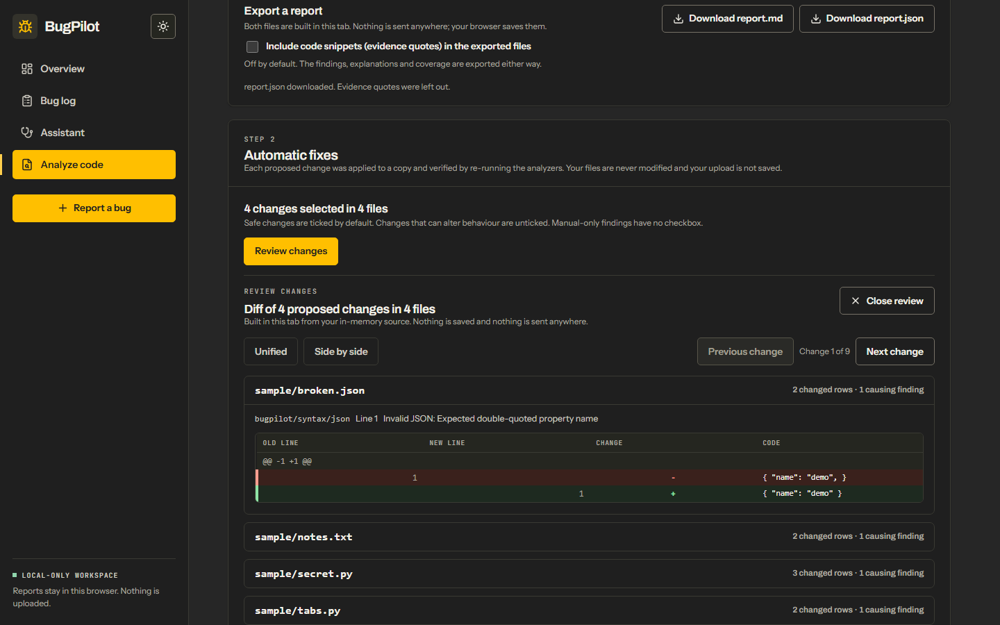

### Clean export

When changes are selected and reviewed, the clean-export panel can build four optional outputs, all in the tab:

| Output | Contents |
| --- | --- |
| `changes.patch` | One unified diff per changed file with `a/` and `b/` paths, in the form `git apply` accepts. |
| `clean.zip` | Every analysed text file at its original relative path with the selected changes applied, plus `MANIFEST.md`. It is not a full copy of the project: binaries, skipped and oversized files, and ignored folders are absent. The manifest recommends the patch instead. |
| `CHANGELOG.md` | One entry per applied change: finding id, rule id, file, line range, risk class, description, behaviour warnings, and the rotate warning. It never reproduces a credential value. |
| `report.md` / `report.json` | The normal report plus an **Included fixes** section. Evidence quotes are always excluded from this export. |

Before any file is offered, the builder re-runs the verification on the selected changes, applies `changes.patch` to the original texts in memory and proves the result equals the clean files byte for byte, applies the reverse patch and proves the originals are restored, and re-parses changed JSON. Any failure blocks the whole export with a specific message and offers the report-only download instead. The patch can contain the original lines of a removed credential — the panel warns prominently before download — while the changelog, report and manifest never reproduce a secret.

Exactly one exported function authorises the export: `authorizeCleanExport()` in `features/analyzer/cleanExport/gate.ts`, called only by the UI entry point. In this build it always allows the export, because everything runs in the tab. **This client-side gate is advisory and bypassable** by editing the loaded JavaScript or calling the builder directly; it is not a security or billing boundary. A future daily-credit system would check a server-issued signed token inside that one function; no server, account or credit logic exists now. An architecture test asserts that only the UI entry imports the gate and that the builder imports no React, UI or page code.

### Upload security model

Uploaded bytes are treated as hostile input. The defence is layered, and every layer is enforced before the next one sees the data.

1. **Intake.** Each upload is screened on its announced names before a byte is read: traversal (`..`), absolute paths, Windows drive letters, backslash separators, NUL bytes, names over 1,024 characters, duplicate names, and archives nested in a folder are refused for that upload only. Several folders and loose-file sets can be added to one run; when more than one upload is present each gets an `upload-N/` prefix, an untrusted upload is set aside with a reason, and the others are still read. An archive has to be picked on its own. A pasted snippet is capped at 1 MiB of UTF-8, keeps only the last segment of its virtual name (80 characters), and enters the same reader as a picked file.
2. **Format detection.** The format is decided from the bytes, never from the name. Zip local headers and end-of-directory records are searched only in bounded windows at each end (to allow self-extracting stubs); a non-empty tar is accepted only when its first header carries `ustar` **and** its checksum adds up (an empty tar is just zero blocks); gzip is two magic bytes. A name that disagrees with the contents is reported, not obeyed. Supported: `.zip` and the zip-based package families (`.whl`, `.jar`, `.war`, `.aar`, `.apk`, `.nupkg`, `.vsix`), `.tar`, and a single gzip stream (`.gz`, `.tgz`). A `.7z`, `.rar`, `.bz2`, `.xz` or `.zst` signature is refused as soon as the bytes are read, with the family named when the file entered the container reader; a picked `.7z` or `.rar` is refused as an archive before it is opened. No decoder ships. A gzip stream is opened exactly one layer: what comes out must be a tar or one text file; an archive inside an archive is skipped with a reason, never opened.
3. **Readers.** The zip reader is **random access**: it never holds the whole archive. It reads a bounded window at the end of the file (65,535 bytes plus the 22-byte record — exactly the space a comment can occupy), scans backwards for the end-of-central-directory signature and accepts one only when its declared comment length lands exactly on the end of the file, so trailing garbage and a lying comment are both rejected. It then reads the central directory as one bounded slice (a directory over 64 MiB is refused before it is parsed), walks every record with strict bounds checks, and counts entries on the records it actually walked — so a header that claims 4 billion entries stops at the cap instead of allocating anything. Only then does it read the compressed bytes of the entries it decided to analyse, through `Blob.slice`, so the entries it skips are never touched. Each analysed entry's local header is re-checked against its central record (flags, method, CRC, both sizes, name bytes) and its offsets must lie inside the archive and before the index. **Overlapping and aliased entries are refused:** no entry's compressed range may reach into another entry's range or into the central directory, and no range may start before its own local header. Without that check a small archive can list thousands of entries that all point at the same deflated stream — the classic overlapping-entries zip bomb — and multiply the work by the entry count while every individual entry looks legal. The tar reader re-validates every header it walks (checksum, octal fields, base-256 sizes, bounded PAX/GNU long names); the gzip reader checks the header, enforces the ratio ceilings while inflating, verifies the CRC and refuses a second member. All three share one refusal vocabulary with plain-language messages. Hostile shapes refuse the whole archive: traversal, absolute paths, drive letters, NUL bytes, duplicate names, overlapping entries, damaged indexes, truncated bodies, multi-member gzip, inconsistent sizes, and multi-disk archives. Non-hostile anomalies skip one entry with a reason and the run keeps going: encrypted entries, nested archives, symbolic links, unsupported compression, checksum mismatches, and a declared expansion ratio over 60:1. A backslash inside an archive entry name is normalized to a separator before those rules run — what Explorer and 7-Zip do when extracting, and what PowerShell Compress-Archive's output needs — so a `..\` escape still refuses as traversal while the tool's output reads; a dropped loose file whose name contains a backslash is still refused outright. ZIP64 records — an index past 65,535 entries, offsets past 4 GiB, or sizes declared in the Zip64 extra field — and entries that defer their sizes to a trailing data descriptor are read as ordinary zips, not refused. A zip entry that is a symbolic link is skipped with a reason, never followed; tar links, devices and volume records are skipped as special entries. **Classification happens before inflation:** folders, files in ignored trees, binary and media extensions, empty entries and files over the per-file ceiling are decided from the index alone and are skipped with a reason, never silently dropped, and none of them is ever inflated. That is what makes a large project zip whose bytes are mostly `node_modules`, `.git` objects and images cheap to check. tar and tar.gz cannot do this — there is no index to seek into, so every byte has to be walked to learn what it is — which is why they stay sequential streaming readers, skip uninteresting entries without retaining anything, and get a lower archive ceiling than zip; the page says so in the limits list.
4. **Bounded work.** Reading is streaming and counted on records actually walked and bytes really produced, not on what an archive declares. The ceilings are in the table below, split into archive bytes, inflated bytes, parsed index entries, analysed entries, per-file size and wall clock, so one blunt cap no longer refuses a legitimate project for the wrong reason. The 300 s wall clock per pass (600 s in large project mode) stops an upload that would otherwise keep the tab busy; the declared expansion ratio skips a lying entry before it is unpacked, and the actual expansion ratio stops a lying stream at the point it breaches. The index walk itself is capped at 250,000 records before a byte is inflated, one pass analyses at most 20,000 files (40,000 in large project mode) — skipped entries never count toward that cap — and the report stores at most 200,000 findings, naming what a rule matched past it. `navigator.deviceMemory` at 2 GiB or less halves the memory ceilings (zip archive, tar archive, inflated, single file, parsed entries, analysed entries); the ratio and time limits are unchanged, because a slow machine needs the same protection, not a shorter fuse. Ticking **Large project mode** on a machine reporting 8 GiB or more raises them to the second column instead. Uploaded text is held in memory only. The analysed text is kept in full for the review below 32 MiB; above that only the files a finding points at are kept. The deep pass reads the upload again from its original handles rather than holding a second copy of a large upload, through the same random-access reader, so it skips what the first pass skipped; when a handle has gone stale, text kept under the 32 MiB rule stands in for it. When the wall clock or a budget runs out — or the user presses Cancel — the run does not throw the work away: it returns a **partial** result, and the page offers **Continue analysis**, which re-reads the same upload skipping the names already processed, until a pass finishes or the user stops — see [Partial reports](#partial-reports).
5. **No execution, ever.** Uploaded code is never evaluated, compiled, imported or run. The only readers are pattern/text rules, `JSON.parse`, the TypeScript parser, the opt-in tree-sitter grammars and Ruff. Notebooks are parsed as JSON; each code cell becomes its own virtual file and each stored output is seen only by the credential rules. Every text-bearing output form is scanned — stream text (a string or an array of strings), `execute_result` and `display_data` entries (`text/plain`, `text/html`, `text/markdown`, `application/json`, `application/javascript`), and error outputs (`ename`, `evalue`, and the traceback lines, ANSI escapes included) — and a match reports the message *A credential-shaped value appears in this cell's stored output.* with no evidence quote: stored output is never shown, exported or retained. Nothing is previewed or rendered as HTML.
6. **Output safety.** The Markdown report and `CHANGELOG.md` escape Markdown and HTML, and every on-screen name, message and quote marks control, bidi and zero-width characters as `\uXXXX` so a hostile file name cannot reorder text or hide a finding. Code evidence keeps its tabs and newlines but marks every other control character, and is fenced with a backtick run longer than any run inside it. Long file names are shortened to 72 characters on screen; the full name is the tooltip, and the report exports keep it. `report.json` stays valid JSON with the original names. `changes.patch` keeps original paths so `git apply` can find the files, but the clean export is blocked before any file is offered when a path contains a line break, a control or invisible character, a backslash, an absolute path or drive letter, a `..` segment, or a path segment starting with `-`. The patch itself quotes the original lines, including a removed credential; the changelog, manifest and reports never reproduce one.
7. **No network, no storage.** The page makes no request that carries uploaded text, and writes nothing to `localStorage`, `sessionStorage` or IndexedDB. Exports are browser downloads the user chooses. The clean-export gate is client-side and advisory only, as stated above.

#### Dialects that are tolerated, and what that hides

Four file shapes are valid in practice but not to the grammar BugPilot ships. In each case the report says what it did and why, in the Notes channel for that file — never a silent skip. A tolerance is a decision *not* to claim a finding, so each row also names what a real defect now costs.

| Dialect | What is accepted | How it is admitted | What the reader loses |
| --- | --- | --- | --- |
| JSONC — JSON with comments (`tsconfig.json`, `devcontainer.json`, many `.json` configs) | `//` and `/* */` comments outside strings, and one comma before a closing `}` or `]` | **Both halves required.** The `.json` name offers the candidate and the content proves that the tolerant read is what rescues the parse. Never name alone; never content alone. | A genuine `package.json` that carries a comment or a trailing comma is **not** reported, even though every strict consumer (`fetch` plus `JSON.parse`, most bundlers) rejects it — the note on the file says so. `{"a": 1,,}` is still reported: the strip is single-pass, so anything that is not one of the two accepted deviations survives. Removing a trailing comma alone is no longer offered as a fix: a document whose only deviation is a comma before a closer is tolerated by the rule, so there was never a finding for a fixer to attach to. **Measured basis for the trade:** on the pinned holdout the JSON syntax rule scored 5 false positives and 0 true positives (0 % precision) — the 5 were `package.json`-family files whose only deviation was a tolerated trailing comma — and no genuine JSON syntax defect exists anywhere in BugPilot's own corpus. Measured: outside the holdout all 549 `.json` files parse as strict JSON, and the only strict-invalid `.json` files anywhere are 6 JSONC config files inside the holdout (`tsconfig.json`, `tsconfig.build.json`, `devcontainer.json`, `launch.json`) — exactly the shape this row's tolerance exists to rescue, not a credential, transport or dependency entry. So this row deliberately trades a rule that measured zero true positives for silence on files a JSONC-aware tool reads correctly, and no comma fixer is offered, because a document whose only deviation is a trailing comma never reaches a finding. It is *not* "JSONC support added": a standards-only consumer still rejects these files, and the note on the file says so. |
| Template markup — `.ejs`, `.erb`, `.hbs`, `.mustache`, `.twig`, and a `.html` file whose first 64 KiB contain `<%` | The file is analysed as **text only**: the pattern rules and all eight credential rules run, and the syntax tier reports *not run* with the reason printed | **By extension alone**, plus the `<%` sniff that promotes an `.html`-named template. This is the one dialect admitted on its name, because no content test can prove a template is well-formed and the grammar that would judge it is not shipped. | Syntax errors, unbalanced tags and broken partials inside template files. Nothing else: a credential on the face of an `.ejs`, or assigned inside `<% const api_key = "…" %>`, is still found and still quoted. |
| CSS dialect at-rules — `@source`, `@variant`, `@custom-variant`, `@utility` and any other `@name` | A syntax failure in which **every** line the error covers opens with an at-rule the CSS standards track does not define is set aside, and the note names the at-rules it ignored | **By not knowing the name.** The rule keys on the standard list — `@media`, `@keyframes`, `@import`, `@supports`, `@layer`, `@container` and the rest — not on a table of framework names, so it cannot be widened into a per-project whitelist and it still covers the at-rule invented next year. | A typo inside a dialect prelude goes unreported. Unbalanced braces, broken selectors and truncated files are **still** reported, in the same file and on the line after a dialect line, and a missing `}`/`)`/`]` closer is never tolerated even on a dialect line. A standards-only CSS parser still rejects these lines. |
| Macro-heavy C and C++ | **Nothing is tolerated yet.** The bundled C grammar cannot parse preprocessor-macro call syntax (`CJSON_CDECL(…)`, `UNITY_TEST_CASE(…)`), so it emits `ERROR`/`MISSING` nodes on files that compile cleanly | Not implemented — see the paragraph below | The findings are still claimed, which is why macro-dense C remains a known false-positive source in the precision tables rather than a fixed one. |

**That last row is an open decision, not a shipped behaviour.** AN-P1 Part 3 measured three degraded-parse thresholds — 0.10, 0.20 and 0.35 of the file inside `ERROR`/`MISSING` bytes — on the pinned corpora before choosing any of them, and the measurement says the metric cannot separate the two populations: 30 of the 37 macro-heavy clean files score exactly 0.000, because their findings are zero-width `MISSING` nodes that consumed no bytes at all, while the seeded real defect in `src/c/SettlementBatch.c` scores 0.0203 — *higher* than 36 of the 37 clean files. Any threshold low enough to clear the clean files therefore suppresses a genuine missing brace, and no positive threshold clears the zero-width majority whatever it is set to. The trade the brief asked to choose between does not exist at any of the three candidates, so no threshold was picked and nothing was suppressed. Until that is settled, treat a High-severity `tree-sitter` syntax finding on macro-dense C as unproven: compile the file with the real compiler before acting on it.

### Limits, applied before analysis

The ceilings are separate on purpose: bytes read from disk, bytes actually inflated, and bytes of text actually analysed are three different costs, and a project that is large only because of `node_modules` or images should not pay for the ones it never analyses. Zip gets the high ceiling because the reader seeks and can classify every entry from the index before inflating anything; tar and tar.gz are walked start to end, so their ceiling is lower. The page prints the effective numbers, per format, before anything is chosen.

The tight budgets are the number of entries one pass analyses and the findings store, not a byte ceiling on collected text. One pass reads up to its work budget for as long as its clock allows; analysis is capped at 20,000 files per pass (40,000 in large project mode); the report stores at most 200,000 findings and names what any rule matched past the cap. Results cross from the workers to the page in batches of at most 500 entries with a yield to the main thread between batches, so no single task on the page's thread grows with the size of the upload, and files whose only findings are notes are grouped separately and excluded from the headline severity counts while staying in the exports. **Large project mode** raises the archive and inflated-work ceilings, the analysed-entry cap and the clock — a bigger run takes more passes through the same steady pipeline, not a busier tab. What the longest main-thread task actually measures on this build is in [Measurements](#measurements).

| Cap | Default tier | Large project mode |
| --- | --- | --- |
| Zip archive bytes (`ARCHIVE BYTES` for a zip) | 2 GiB | 8 GiB |
| tar / tar.gz archive bytes | 400 MiB | 1 GiB |
| Inflated work budget — bytes really produced per pass, including entries later skipped as binary | 600 MiB | 1 GiB |
| Index records parsed per pass — the walk ceiling, enforced before any byte is inflated | 250,000 | unchanged |
| Files analysed per pass — skipped entries never count toward it | 20,000 | 40,000 |
| One file | 2 MiB; a larger file is skipped with a reason, not fatal | unchanged |
| One entry name | 1,024 bytes inside an archive; 1,024 characters for a picked file name | unchanged |
| Central directory | 64 MiB, refused before it is parsed | unchanged |
| Declared expansion ratio | 60 : 1, the entry is skipped before inflating | unchanged |
| Actual expansion ratio while inflating | 300 : 1, refused at that point | unchanged |
| Wall clock for one pass | 300 s | 600 s |
| Findings stored in the report | 200,000; past the cap a rule's matches are counted and named, not dropped silently | unchanged |
| Loose files or folder-drop sources collected | 20,000 plus one sentinel, so an over-limit drop is refused rather than silently truncated | 40,000 plus one sentinel |
| Retained analysed text | 32 MiB; above it only files with findings are kept for the review | unchanged |
| Pasted snippet | 1 MiB of UTF-8, measured before analysis | unchanged |
| Rule time / findings per file | 1.5 s / 200 | unchanged |
| TypeScript syntax check per file | 5 s | unchanged |
| Deep engine pass | 3 s per file, 120 s per upload, 100 findings per file, 12 syntax regions per file, 12 MiB and 30 s per engine download — see [Budgets](#budgets) | unchanged |

**Large project mode** is a checkbox next to the limits list. It is offered only when `navigator.deviceMemory` reports 8 GiB or more (the API is missing in Firefox and Safari, and an absent report keeps the default tier), and it is never applied on its own: the box has to be ticked, and the page warns in plain language that the run will take longer and use more memory. On a device reporting 2 GiB or less, the zip, tar, inflated, single-file, parsed-entry and analysed-entry ceilings are halved, and large project mode is not offered; the ratio and wall-clock ceilings are untouched, because a slow machine needs the same protection, not a shorter fuse.

The reader itself is described in the [upload security model](#upload-security-model); it reads zip by seeking, tar and one gzip layer sequentially, and refuses every other archive family by name.

### Measurements

Every number in the primary table below is from **this build** (`npm run build`, then `npm run preview -- --port 4173 --strictPort`, served at `http://localhost:4173`) driven by the harness at `analyzer-spike/c2-baseline/measure-part6.cjs`, which lives outside the repository. Environment: headless Chrome 156.0.8078.4 on Windows, a quiet 2-core machine (`hardwareConcurrency` 2, so the default analysis pool is `min(cores − 1, 4)` = **1 worker**; `navigator.deviceMemory` reported 4 GiB). One fresh browser context per shape, no shared state. The stress fixtures are generated by `analyzer-spike/c2-baseline/gen-part6.cjs`: a 60,000-entry zip and a 70,000-entry zip64 (one note per file, to stress the index, the findings store and resume), a 1.5 GiB sparse NTFS zip whose only entry is binary, and the realistic 25 MiB project zip from `generate.mjs` (about half text across 18 languages, plus fake `node_modules`, `.git`-like objects, binary and media, and lockfiles). **Nothing was uploaded**: the page read the bytes in the tab, and every request the page attempted outside its own origin was recorded and blocked (none were recorded).

What each column measures, exactly:

| column | how it is measured |
| --- | --- |
| wall | from `setInputFiles` (the instant the file is chosen) until the page's status line settles. Covers reading, classification, the rules pass and building the report. A continuation pass keeps the earlier partial report on screen while it runs, so its settle signal is the **Cancel** button leaving the page, not a status-text change. |
| longest task | `PerformanceObserver({ type: 'longtask' })` **inside the page**, so it counts only the page's main thread. Worker time is not a task and does not appear here; the readers, the rules and the engine pass all run in workers. |
| tasks >100 ms | how many of those observed long tasks exceeded the 100 ms hard line this slice was given (the target was 50 ms). |
| page heap | CDP `Performance.getMetrics` → `JSHeapUsedSize` for the page frame only, sampled every 1.5 s. Workers are excluded by definition. A dash means the run was too fast to sample, or the sampler's final write was lost (noted where it happened). |
| process tree | sum of `WorkingSetSize` over the browser root process and every descendant (renderer, GPU, utility, each worker), sampled every 1.5 s. Idle tree before a run was about 225 MiB. This is the number the memory criteria are judged against. |
| cancel | in-page `button.click()` on **Cancel** to the last of the page's live `Worker` objects reporting `terminate()`, measured through a `Worker` wrapper installed before the run. The mid-analysis probe waits until the rules-phase progress bar shows `filesDone > 0`, so the click lands while the pool is analysing, not while the index is still being read. |

Default tier, built `dist` on 4173, one worker (the 2-core default):

| input | on disk | wall | longest task | >100 ms | analysed | findings + notes | page heap | process tree | result |
| --- | --- | --- | --- | --- | --- | --- | --- | --- | --- |
| 25 MiB project zip, run 1 | 9.1 MiB | 90.6 s | 202 ms | 4 | 208 files | 13 + 20,013 notes | — | 367 MiB | complete |
| 25 MiB project zip, run 2 | 9.1 MiB | 103.5 s | 225 ms | 10 | 208 files | 14 + 20,013 notes | — | 367 MiB | complete |
| 60,000-entry zip, first pass | 11.6 MiB | 484.9 s | 694 ms | 14 | 20,000 (cap) | 0 + 20,000 notes | — | 383 MiB | partial, 40,000 not reached |
| 70,000-entry zip64, first pass | 12.9 MiB | 449.2 s | 1,293 ms | 12 | 20,000 (cap) | 0 + 20,000 notes | — | 467 MiB | partial, 50,000 not reached |
| 60,000-entry zip, 3-pass union | 11.6 MiB | 222.7 + 393.5 + 397.5 s | 1,305 ms | 39 in pass 2 | 60,000 | 0 + 60,000 notes | — | 559 MiB | complete, resume verified below |
| 1.5 GiB sparse NTFS zip (one binary entry) | 1.5 GiB sparse | 1.3 s | **83 ms** | 0 | 0 | 0 | 4 MiB | too fast to sample | complete, binary skipped without inflation |
| 70,000-entry zip, mid-analysis cancel | 12.9 MiB | 6.8 s to the click | 244 ms | 1 | 101 at the click | — | 4 MiB | 355 MiB | cancelled, **1,280 ms**, 0 workers left open |

The cancel row is the acceptance probe: the click landed when the rules-phase bar read **101 of 70,000** files, so the pool was actively analysing; from the click to the last `Worker.terminate()` was 1,280 ms (one worker, the 2-core default), and **0** workers were still open when the run settled. The cancelled partial reads "0 findings in 0 analysed files" because the in-flight batch had not drained to the page before the worker was terminated — the progress counter had advanced, the committed result had not.

**The export is a separate, user-initiated main-thread cost.** Clicking **Download report.json** runs `JSON.stringify` of the whole report on the page thread (`src/features/analyzer/export/reportFiles.ts:216`). The 25 MiB report (28 MB, 20,026 findings) cost **1,206 ms**; the 60,000-finding union report (125 MB) cost **7,966 ms**. This is not part of the analysis wall above; it is the single largest task measured, and it grows with the exported report size.

**Worker-pool sweep (1 / 2 / 4 workers).** The pool size is `min(hardwareConcurrency − 1, 4)`, at least 1; on this 2-core machine the default is 1. Forcing 2 or 4 through the `?bugpilotWorkers=` debug parameter was measured on the four PART 4 targets. These sweep runs used the **dev server on 5180 at the PART 4 build, before the final blob-window read cache and progress-throttle fixes landed**, so their long-task and memory figures are *not* the shipped build's (the primary table above is); they are reported for the worker-count effect on wall clock only:

| target | 1 worker | 2 workers | 4 workers | reading |
| --- | --- | --- | --- | --- |
| 100 MiB tar.gz, first pass | — | 162.3 s | 284.9 s | **no gain — worse at 4.** A single gzip stream is inflated sequentially; extra workers cannot parallelise it and oversubscribing 2 cores slows it. |
| 100 MiB zip, first pass | — | 127.7 s | 139.1 s | flat to slightly worse at 4; the zip read is one worker, the rules are CPU-bound on 2 cores. |
| 250 MiB folder, first pass | — | 385.8 s | 276.3 s | folder intake parallelises, so 4 helps here. |
| 65 MiB zip, deep pass | 229.3 s | 200.8 s | 194.8 s | modest gain; the engine pass is one file at a time per worker. |

The honest non-improvement: on a 2-core machine more workers than cores does not speed the CPU-bound sequential formats and can hurt them, which is why the shipped default caps the pool at `cores − 1`. The C2 baseline for the 100 MiB tar.gz was 163.3 s and for the 65 MiB deep pass 186.8 s; the pool did not beat those on this hardware, and that is reported rather than claimed as a win.

**Resume completeness, verified on the union.** The 60,000-entry zip stopped partial at the 20,000-file cap, then **Continue analysis** was pressed twice. The merged `report.json` (sha256 `2ba2a2d45078748425d8f812f57c5441579390c89a13c27e079c57eed1ec11b5`, 125,198,832 bytes) was parsed and checked: **60,000 analysed coverage rows, 60,000 unique files** (`mod-0` … `mod-59999`, **0 missing**), **60,000 findings with 60,000 unique ids and 0 duplicates**, no partial marker and no truncation. The three-chunk union covers every file exactly once; the stable-id merge deduplicates a re-run pass. The first pass alone took 222.7 s; each continuation re-reads the zip index and skips the names already processed (a zip seeks past them; a tar.gz would re-inflate them on the way, which the page states).

**Determinism, verified on the 25 MiB project.** Two runs exported 20,026 and 20,027 findings; the **20,026 common findings appear in identical order** in both exports. The one extra is a designed artifact, not a sort instability: a file sitting on the 5 s TypeScript-per-file boundary sometimes finishes its syntax check and sometimes does not, so it yields a finding in one run and not the other. The order of everything both runs produced is byte-stable.

The same shapes on the **previous build** (slice C2, `f1de5d6`), measured before this slice changed anything, are the reason for it. The C2 failures were not the byte caps alone: a 25 MiB accepted upload rendered 20,031 findings and 3,035 coverage rows at once and froze the page for over a minute, so the deep gate could not be clicked.

| shape | slice C2 | this slice (built dist) |
| --- | --- | --- |
| 25 MiB zip | 255.0 s, longest task 10.2 s, tree 1,146 MiB, page frozen over 60 s, deep pass not measurable | 90.6 s, longest analysis task 202 ms, tree 367 MiB, responsive throughout; findings paginated and notes grouped |
| 100 / 250 MiB zip and tar.gz | refused in 1–2 s at the old 25 MiB archive cap | accepted under the 2 GiB zip / 400 MiB tar ceilings; a pass stops partial at the analysed-entry cap and names the rest, with Continue analysis |
| 250 MiB folder | refused at the old 150 MiB total after a 10.1 s enumeration task | folder intake is batched and yielding and skips ignored trees before descending; the 250 MiB folder completes (pool sweep, 276–386 s depending on worker count) |
| 70,000-entry / zip64 / data-descriptor zips | not read (zip64 refused; descriptor sizes mishandled) | read as ordinary zips; the 70,000-entry zip64 stops partial at the cap and resumes |

**The deep pass above the retention ceiling.** A 65 MiB project (528 analysable files, ~35.8 MiB of text — over the 32 MiB full-retention ceiling) was measured in the pool sweep: first pass complete in 72.7–86.5 s, deep pass complete in 194.8–229.3 s over the **same 528 files** (nothing dropped by the re-read), 13,056 findings after the deep pass. The deep pass reads the upload again from its original handles through the same random-access reader rather than holding a second copy. These figures are from the dev-server sweep before the final read/progress fixes; the built-dist responsiveness is in the primary table. The deep-pass offer is still gated on a completed first pass; a partial upload reaches it by continuing to completion first.

What each ceiling refuses or truncates, as observed: over-cap archive bytes and every hostile archive are refused with the reason and the number in the message; `hostile-overlap.zip` (thousands of entries pointing at one deflated stream) is refused before anything is inflated; a 401 MiB tar is refused at the 400 MiB tar ceiling; a zip padded past 2 GiB is refused at the zip ceiling; multi-disk, traversal, absolute-path, duplicate-name, damaged-index and truncated-archive inputs all still refuse, and a real `.7z`/`.rar`/`.bz2`/`.xz`/`.zst` is refused with its family named. Encrypted, nested-archive, symbolic-link, unsupported-compression and bad-CRC entries are skipped per entry with a reason while the rest of the archive is read. The analysed-entry and findings-store budgets **truncate** rather than refuse, and the run is labelled partial with Continue analysis offered. zip64, data descriptors, comments, trailing garbage, SFX prefixes, UTF-8/CP437 names and Info-ZIP unicode extras are read, not refused (see the [upload security model](#upload-security-model)).

Verdict against the criteria this slice was given:

| criterion | verdict | what was measured |
| --- | --- | --- |
| no main-thread task over 100 ms (target 50 ms) everywhere | **FAIL — residual at report finalization and export** | the analysis itself is off-thread and the page stays interactive, but building and merging the report on the page thread (sort, merge union, coverage build) still costs 202–225 ms at the realistic 25 MiB project (4–10 tasks over 100 ms) and 694–1,305 ms at the 20,000–60,000-finding stress shapes. A measured micro-benchmark attributes only ~142 ms of the 60,000-finding case to the `localeCompare` sort itself; the rest is the merge and coverage pipeline, which was not isolated further by this slice. The user-initiated `report.json` download then `JSON.stringify`s the whole report on the page thread: 1,206 ms for 28 MB, 7,966 ms for 125 MB. The 1.5 GiB sparse zip is the one shape under 100 ms (83 ms). C2 was 1.2–10.2 s *during* analysis; that failure mode is gone, but the strict 100 ms line is not met. |
| cancel stops every worker within 2 s | **PASS** | mid-analysis on the 70,000-entry zip, clicked at 101/70,000 files: 1,280 ms to the last `Worker.terminate()`, 0 workers left open, no crash. |
| peak page + workers memory under 1 GiB (default) / 2 GiB (opt-in) | **PASS** | process tree 355–559 MiB across every built-dist run (25 MiB 367, 60k 383, 70k 467, union 559, cancel 355); page heap 4 MiB on the fast shapes. C2 exceeded 1 GiB at 5 and 25 MiB. |
| no crash and no unresponsive page at or below the caps | **PASS** | no built-dist run crashed and every status line settled; the 25 MiB zip that froze C2 for over a minute finished in 90.6 s with the page answering throughout, and a mid-analysis cancel returned control in 1.28 s. |
| resume completeness (union == uninterrupted) | **PASS** | the 3-pass 60,000-file union exported 60,000 unique analysed files (0 missing), 60,000 unique finding ids (0 duplicates), no partial marker, no truncation. |
| deterministic order | **PASS (with one documented artifact)** | 20,026 common findings in identical order across two 25 MiB runs; the single extra finding is a file on the 5 s TypeScript boundary, not a sort instability. |
| every cap trip refuses or truncates with a plain-language message | **PASS** | refusals name the cap and the bytes; a budget stop says which budget and lists the files it did not reach; the page labels the run partial and offers Continue analysis. |

The follow-up this evidence points at — **not done in this slice, and not claimed as fixed** — is to move report finalization (the sort, the merge union and the coverage build) and the export `JSON.stringify` off the page thread into a worker, the same boundary the readers and rules already use. A shared-`Intl.Collator` replacement for the sort comparator was tried and **rejected on measurement**: warm, V8's argument-less `localeCompare` is ~2.7× faster than a shared collator on a 60,000-finding sort (142 ms vs 385 ms) with an identical order, so the comparator is not the bottleneck. Those finalization and export costs, not a smaller byte budget, are what keep the rows above 100 ms. Because the main-thread criterion is not fully met and the residual is app code rather than an engine or harness artifact, this slice's conditional push gate is **not** satisfied; the work is committed locally and the gap is recorded here rather than papered over.

### Partial reports

A big upload that runs out of time, bytes or entries is not a failed upload. When the wall clock, the inflated-work budget, the parsed-index cap or the analysed-entry cap stops a read, the reader keeps every file it had already produced and returns a **partial** result, and the page says so in four places:

- the heading reads **Partial results for** *n* **files** and a banner above the findings states the reason and the counts, in plain language, with `role="alert"`;
- the coverage panel lists every file, and the ones that were never reached carry a **not reached** reason naming the budget that stopped them, so the split between "checked and clean", "skipped on purpose" and "never got to it" is explicit;
- the status line and `report.json` / `report.md` both say the run was partial, and the report is never presented as complete;
- downloads still work from a partial report, and they carry the label: `report.md` opens with a **PARTIAL REPORT** blockquote with the same counts, `CHANGELOG.md` and `MANIFEST.md` in a clean export open with a **PARTIAL EXPORT** line saying the zip is not a complete copy of the analysed set.

The deep pass behaves the same way: files the engines did not reach are recorded as not reached, with the reason.

**What a cancel does.** Pressing **Cancel** aborts the reader, the analysis pool and any engine pass, and the run settles as a **partial** report covering whatever had already been committed to the page before the click — a budget stop and a cancel share the same partial vocabulary, and downloads and Continue analysis stay available. The keep is only ever as full as the handover that already happened: the mid-analysis probe on the 70,000-entry zip clicked when the rules-phase bar read 101 of 70,000 files, and the page settled at **Partial analysis. 0 findings in 0 analysed files** because the in-flight batch of findings had not drained to the page before the worker was terminated (the progress counter had advanced; the committed result had not). From the click to the last `Worker.terminate()` was **1,280 ms** with one worker (the 2-core default) and **0** workers left open — see [Measurements](#measurements). Cancelling during the read keeps what the reader had inflated; cancelling during the rules keeps what the batches had already handed over.

### Live verification of this build

Every row below was run against the built `dist` on two servers: `npm run preview` on 4173, and a temporary stdlib-only Node server on 4188 that sends the exact `vercel.json` header rules with the SPA fallback — the emulating server is the one used for every header row, because `vite preview` applies no `vercel.json` headers at all. The harnesses live outside the repository in `analyzer-spike/real-files` (`c3-live.cjs`, `axe-live.cjs`, `browser-smoke.cjs`, `app-flows.cjs`) and drive the page's own controls; none of them reads a file into an upload or sends anything anywhere. Four recorded passes over this build: **run 1** on the pre-fix build (116 PASS / 8 FAIL — one FAIL was a real bug, below; seven were harness expectation errors, each corrected and re-run), **run 2** on the fixed build (129 PASS / 1 FAIL — that FAIL was the harness expecting a two-archive pick to be accepted, which the app refuses by design), **run 3** re-running the corrected multi-source assertions (54/54), and **run 4** re-running the partial-export rows with the fixed download-marker checks plus the app-flow smoke (71/71 and 13/13). Evidence: `analyzer-spike/c2-baseline/final-c3*/`.

| check | result | evidence |
| --- | --- | --- |
| Response headers on 4188 (page CSP, engine CSP with `wasm-unsafe-eval` and otherwise identical, nosniff, frame denial, referrer, permissions) | **PASS** — each rule matches the `vercel.json` source; on 4173 `vite preview` sends **no page CSP at all** (documented since C2) | `final-c3-run2/live-checks.tsv`, `final-c3-run4/live-checks.tsv` |
| 10 hostile archives (traversal zip + tar, nested archive, ratio bomb, gzip bomb, joined gzip streams, damaged stream, truncated archive, over-ceiling 401 MiB tar, multi-disk, NUL-byte name) | **PASS** — each refused with its own plain-language reason before or without inflation, page responsive, 0 cross-origin requests, 0 console errors. The planted overlap zip trips the NUL-byte-name check while parsing the planted second header — the same bounded refusal by another door, as in C2 | `final-c3-run2/live-checks.tsv` |
| A real `.7z` and a real `.rar` renamed to `.zip` | **PASS** — refused in their own words ("its contents are a .7z archive", "… a .rar archive") and the refusal advises re-archiving to zip or tar.gz | `final-c3-run2/live-checks.tsv` |
| Bidirectional-override and zero-width names | **PASS** — never raw on screen (`rawSpoof=false`), all four hostile names visible escaped, the only zero-width joiner in the document is the footer emoji | `final-c3-run2/live-checks.tsv` |
| The user's failing shape: a data-descriptor zip with a `.venv` inside and spaces and parentheses in the folder name | **PASS** — accepted and analysed ("Analysis complete. 0 findings in 2 analysed files, plus 1 note"), the folder name kept literally, `.venv` skipped with a reason; `report.md` and `report.json` downloaded by mouse, Enter and Space | `final-c3-run2/live-checks.tsv` |
| A zip written by the real PowerShell `Compress-Archive`, and a Python `zipfile` written to a pipe (non-seekable, bit-3 descriptors) | **PASS** — both accepted and analysed. The Compress-Archive shape is what run 1 caught being refused for `\` separators; archive names are now normalised to `/` before the safety rules run (see the [upload security model](#upload-security-model)) | `final-c3-run2/live-checks.tsv` |
| A small stored zip through the full download matrix | **PASS** — `report.md` and `report.json` by mouse, Enter and Space; storage byte-identical; 0 foreign requests, 0 non-GET, 0 CSP violations, 0 console errors | `final-c3-run2/live-checks.tsv` |
| 20,001-entry zip: partial, exports, resume | **PASS** — first pass settles at "Partial analysis. 0 findings in 20000 analysed files" with the cap banner and **not reached** reasons; the partial `report.md` opens with the **PARTIAL REPORT** blockquote and `report.json` parses with the partial object; downloads work from the partial; **Continue analysis** merged the rest into "Analysis complete. 0 findings in 20001 analysed files." with no duplicate findings | `final-c3-run2/live-checks.tsv`, `final-c3-run4/live-checks.tsv` |
| 70,000-entry zip64 | **PASS** — accepted past the ZIP32 entry limit, first pass partial at the 20,000-file cap, one **Continue** advanced the status line to 40,000 (the full three-pass union was sha-verified in [Measurements](#measurements)) | `final-c3-run2/live-checks.tsv` |
| tar.gz (5 MiB project) | **PASS** — accepted and analysed (9 findings in 48 analysed files, plus 4,003 notes) | `final-c3-run2/live-checks.tsv` |
| Mid-analysis **Cancel** | **PASS** — clicked while the progress bar showed files in flight; the page settled as a partial with the Cancel button gone; every worker reported `terminate()` (1,078 ms live, 1,280 ms in [Measurements](#measurements), both under the 2 s line) | `final-c3-run2/live-checks.tsv` |
| Multi-source, all three doors | **PASS** — two archives in one pick refused with a plain reason ("is itself an archive") and nothing kept; a loose-file set (notebook + minified bundle + `.env`) read together in one run; an archive added via **Add another upload** left out of the run with the one-archive-per-run message while the loose files still analysed (the manual-checklist row) | `final-c3-run3/live-checks.tsv` |
| Notebook, sensitive `.env`, generated files | **PASS** — the notebook analysed with its syntax note; the `.env` completed with the secret value **never echoed**; the minified bundle skipped by default and analysed when **Include generated and vendored files** is ticked | `final-c3-run2/live-checks.tsv`, `final-c3-run4/live-checks.tsv` |
| Large project mode gating on stubbed `navigator.deviceMemory` | **PASS** — the toggle exists only at 8 GiB and above; opting in raises the stated ceilings to "Zip up to 8 GiB; tar and tar.gz up to 1 GiB" and the budget to "within 600 seconds" with a plain warning; a 2 GiB report halves its figures ("Zip up to 1 GiB; tar and tar.gz up to 200 MiB") | `final-c3-run2/live-checks.tsv` |
| Viewport overflow and unchanged app flows | **PASS** — no horizontal overflow at 1440 light or 320 dark; the 13-row app-flow smoke (overview, seeded bug log, report detail, new-report form, a save that writes only to the profile, Assistant traceback match, keyboard-only travel through `/analyze`, focus ring) passed with 0 foreign requests, 0 non-GET, 0 CSP violations, 0 console errors | `final-c3-run2/live-checks.tsv`, `final-c3-run4/app-flows.tsv` |
| Privacy aggregates across every flow above | **PASS** — `localStorage`/`sessionStorage` byte-identical before and after (including `bugpilot.bugs.v1`), IndexedDB untouched, 0 cross-origin requests, 0 non-GET, 0 CSP violations, 0 console errors | `final-c3-run2/live-checks.tsv` |
| axe-core with the real headers, `color-contrast` enabled | **15/15 PASS** — light 1440 (wcag2a 24 rule groups, wcag2aa, color-contrast, overflow, 0 CSP, 0 console) and dark 320 (same, plus the theme toggle) | `final-c3/axe-live.tsv` |
| Firefox and Playwright WebKit smoke of the data-descriptor zip and the non-seekable zip | **4/4 PASS, 0 console errors in both engines** — both completed "Analysis complete" with coverage and 0 cross-origin requests | `final-c3-run2/browser-smoke.tsv` |

Run 1 → run 2 is the slice's live-found defect list, kept honest: the one real bug was the PowerShell `Compress-Archive` refusal (`A file name inside the archive uses backslashes as separators`), fixed by normalising entry-name separators at the zip and tar decode sites; the other seven FAILs were the harness's own wrong expectations — the overlap pattern too narrow, a ratio-bomb fixture misused as an accepted shape (correctly refused), two Continue waits that matched the limits panel's permanent "Continue analysis" text instead of the status line, the two-archive expectation above, and an Assistant row asserting guessed wording. Each was corrected in the harness and re-verified; none hid an application defect except the backslash one.

The WebKit smoke rows above complete with **0 console errors** because the small fixtures render no `<select>` controls; where a report does render them, WebKit still emits its engine-level `style-src-attr` message per `<select>` — React DOM internals, not application code, with no user-visible effect and 0 differing pixels — documented with the full A/B in [Accessibility and browser coverage](#accessibility). Chromium and Firefox report none. The C2-era finding-count difference between WebKit and the other engines on the 25 MiB project was not re-measured in this slice and remains recorded there as an unattributed engine difference.

### Report, coverage, and export

After a run, the page shows findings grouped by file with severity, confidence and its reason, tier, rule id, location, redacted evidence, explanation, either a verified proposed change with its risk class and warnings or a manual-only suggested direction, verification steps, and per-finding limits. Severity and file filters apply to the on-screen list and are counted in a live status line.

The coverage panel lists every uploaded entry: analysed or skipped, its detected language and source, encoding, size, finding count, and each tier's status (`ran`, `not run` with a reason, or `not available` with a reason). The **No findings does not mean no bugs** panel prints the per-language list of checks that were not performed.

**Download report.md** and **Download report.json** are built in the tab from the in-memory report and handed to the browser. Both files are named `bugpilot-analysis-<timestamp>.md` or `.json`. Evidence quotes are excluded by default; ticking **Include code snippets (evidence quotes) in the exported files** is the only way to include them, and the exports say which choice was used. Findings, explanations, and coverage are exported either way. These report-only downloads remain available whether or not any fix is selected. The report contains no clean version of the user's code, only the quoted lines that triggered a finding.

**Clear results** aborts any run, empties the report state, and returns focus to the upload heading. Leaving the route unmounts the page and aborts the workers.

### Privacy

- Files are read in this tab by same-origin web workers. **No uploaded code is executed**: the only parsers are BugPilot's regex/text rules, `JSON.parse` (also used to split a notebook into cells), the TypeScript parser, and — after the user approves the gate — the tree-sitter and Ruff WebAssembly grammars. Fixes are computed by string edits and never run. Uploaded text is never previewed or rendered as HTML.
- The WebAssembly engines are BugPilot's own build output, served from this origin. They are compiled and run by the browser inside the engine worker, which is why only `assets/engines/` carries `'wasm-unsafe-eval'`. They receive the file text and return diagnostics; they cannot open a socket, and they are given no host object.
- Uploaded text is never sent to a server, never written to `localStorage` or `sessionStorage`, never written to IndexedDB, and never added to the bug log or a saved diagnosis. The page tests spy on `fetch`, `XMLHttpRequest`, `navigator.sendBeacon`, `WebSocket`, and `indexedDB.open` across upload, paste, multiple sources, fix selection, the diff review, the clean-export build and downloads, Clear, and a route change, and compare the full `localStorage`/`sessionStorage` contents before and after; all of those checks must stay quiet and byte-identical. Loading the page and its workers fetches only same-origin static JavaScript chunks and, in the approved deep pass only, same-origin static `.wasm` files — none of which contain uploaded text. A component test asserts that the only `fetch` call an engine-gate interaction makes is `/assets/engines/manifest.json`, and that no request carries the file's content.
- The in-memory report keeps the redacted evidence quotes needed for the on-screen findings. The analysed text is also retained in memory as `sources` so fixes can be computed and re-verified: in full below 32 MiB, and above that only the files a finding points at, with the deep pass reading the rest again from the original handles. It is never written to storage and is dropped on Clear or when the page unmounts. Nothing survives a reload.
- Exports are the only way data leaves the page, and they are browser downloads chosen by the user. The report-only files contain no source file contents other than evidence quotes, and only when the snippet box was ticked. The clean export is different by design: `clean.zip` contains the analysed text files with fixes applied, and `changes.patch` quotes the original lines, including any original credential value that was removed. Both are built only after the user ticks the outputs and presses **Build clean export**; the changelog, report and manifest never reproduce a credential value.
- There is no execution of uploaded code, no package installation, no network fetch of a user URL, and no AI provider. The only binaries the page runs are its own WebAssembly engines, and they run only after the user approves their download.

### Deliberate non-goals

- No syntax parser for any language other than JavaScript/TypeScript (via the TypeScript parser), JSON (via `JSON.parse`) and the 16 opt-in tree-sitter grammars. There is no XML, TOML, Scala, Markdown or plain-text parser, and no parser runs at all unless the user approves the engine download.
- No type checking, module resolution, project-wide analysis, data-flow, or taint analysis — in the first pass or in the deep pass. The engines read one file at a time and report only what a syntax tree or a single-file lint rule can show.
- No Python automatic fixes. Ruff's WASM build exposes no fix in any settings combination measured, so every Python finding is detector-only and cannot enter the clean export.
- No general auto-fixing or formatting: only the four fixers above. No refactoring, dependency upgrades, renames, logic rewrites, or semantic changes beyond replacing a credential literal with an environment lookup. No automatic apply to the user's project, no commit, and no write outside the browser download.
- No server-side gate or credit accounting; the gate is client-side and bypassable, as stated above.
- No code execution, tests, builds, or package installation.
- No archives inside archives, encrypted archives, password prompts, multi-disk zips, or reading `.7z`, `.rar`, `.bz2`, `.xz` or `.zst` files. `.zip` (and zip-based packages) including ZIP64 indexes and data-descriptor entries, `.tar`, `.tar.gz`/`.tgz` and one gzip layer are read; a gzip is never opened further than the tar or text it contains, and every refused family is named in the refusal.
- Secret detection is best-effort pattern matching. A clean run is not a security audit and does not prove that a file contains no secret.
- No persistence of an analysis; only the bug log and its saved diagnoses persist.

### Analyzer source tree

```text
src/features/analyzer/
├─ archive/        Signature-based format detection, random-access zip reader over a seekable byte
│                  source, strict tar and streaming gzip readers, named budgets with two tiers,
│                  shared bounds/refusal vocabulary and partial-stop results, Jupyter notebook
│                  splitting, path checks, decoding, language classification, loose-file intake,
│                  worker and client
├─ analysis/       Finding model, rule engine, coverage, report model, sensitive-file scan, generated-file
│                  split, session orchestration, workers, clients, and fix verification
│  └─ typescript/  Classic worker and client for the syntax-only TypeScript check
├─ cleanExport/    The one authorisation gate and the in-memory builder for patch, zip, changelog and report
├─ engines/        WebAssembly feature probe, engine worker + client + protocol, per-language grammar registry,
│                  lazy grammar/Ruff loading with byte ceilings and budgets, tree-sitter syntax findings,
│                  AST queries, the 21-rule Ruff mapping, credential redaction for engine quotes, and the
│                  download plan that reads the build's engine manifest
├─ export/         Export filtering and the Markdown/JSON writers and download helpers
├─ fixes/          Fix candidates, the four fixers, overlap resolution, and text-edit helpers
├─ review/         jsdiff-backed unified/side-by-side model, line mapping and credential masking, plus the diff worker and its client
├─ rules/          Generic, secret, sensitive-file-name, and JSON syntax rules plus shared text helpers
├─ sanitize/       Control/bidi/zero-width marking, Markdown/HTML escaping, safe truncation, and patch-path checks
├─ ui/             AnalyzeResults, EngineGate, FixReview, CleanExportPanel, and their download helpers
├─ upload/         File, folder-picker, drag-and-drop and pasted-text collection, plus multi-upload namespacing
├─ languages.ts    Labels, TypeScript-family detection, tier availability, and per-language not-checked lists
└─ types.ts        Finding, coverage, and report types
```

`src/pages/AnalyzePage.tsx` owns the page state, upload inputs, paste tab, multiple uploads, progress, cancellation, and report downloads. The worker entry points are `src/features/analyzer/archive/worker.ts`, `src/features/analyzer/analysis/worker.ts`, `src/features/analyzer/analysis/typescript/tsWorkerEntry.ts`, `src/features/analyzer/engines/engineWorkerEntry.ts`, and `src/features/analyzer/review/diffEntry.ts`. `FixReview` and `CleanExportPanel` are lazy imports from `AnalyzeResults`, so jsdiff and fflate stay out of the main entry. Only `engineWorkerEntry*` and `engineClient*` chunks and every `.wasm` file are emitted into `assets/engines/` — the two roots are named in `vite.config.ts`, so engine glue they share stays under the main policy and the `'wasm-unsafe-eval'` allowance cannot creep outward by accident.

Inside `src/features/analyzer/archive/`, `limits.ts` holds the named budgets — archive bytes, tar archive bytes, inflated work, analysable text, per-file size, entry count, name length, central-directory size, the two ratios, and the wall clock — and the two tiers, `source.ts` is the seekable byte source (`Blob.slice` for a real file, a copied buffer for tests) that lets the reader work without holding an archive, `guard.ts` is the random-access zip reader, `crc32.ts` the checksum it verifies each analysed entry against, `tar.ts` and `gzip.ts` are the sequential readers, `bounds.ts` is the shared run: budgets, breathing between chunks, progress, skips and the partial-stop results, `classify.ts` and `paths.ts` decide what a file is, `container.ts` detects the format and applies the ceiling for that format, `reasons.ts` is the one refusal-and-skip vocabulary, `workerClient.ts` and `workerProtocol.ts` carry the source and the progress messages across the worker boundary, and `readLooseFiles.ts` applies the same budgets to picked files and folders.

### How to add a rule

1. Add an `AnalyzerRule` object in `src/features/analyzer/rules/generic.ts`, `secrets.ts`, or a new module. Use a namespaced id (`bugpilot/<group>/<name>`), a tier, severity, title, description, the language list, and a synchronous `check(file)`.
2. Return `RuleHit` objects with a range, message, explanation, confidence and reason, evidence, optional fix text with a `riskClass` (`safe`, `needs-review`, or `manual-only`) and `riskReason`, verification steps, and limitations. Return `[]` when nothing matches.
3. Register the rule in `ANALYZER_RULES` in `src/features/analyzer/rules/registry.ts`. Rules run in registry order within the per-file time budget, so put the most valuable checks first.
4. Add tests beside the rule module: a positive case, a lookalike that must not match, and a prose sentence that mentions the pattern without being code. Keep the registry test passing.
5. Never write a literal credential-shaped value in a test or fixture. Build every fake secret at runtime from fragments so the repository cannot trip push protection or a secret scanner.
6. Run `npx vitest run src/features/analyzer` while developing, then the full `npm test`, `npm run lint`, and `npm run build`.

## Privacy and safety

- **Everything is local.** The app has no backend, login, cloud database, analytics, telemetry, service worker, or external AI call. Fonts and icons are bundled by the build; the app does not need a network request after the page and assets load.
- **Saved browser data.** `localStorage` uses these keys:
  - `bugpilot.bugs.v1` — the saved bug reports.
  - `bugpilot.bugs.recovery.v1` — a best-effort copy of raw stored text when the app cannot read it. It is not an automatic backup of healthy data.
  - `bugpilot.bugs.preimport.v1` — the complete raw bug value captured immediately before the most recent successful import write. It is overwritten by the next import and can contain the same report text as the main key.
  - `bugpilot.theme.v1` — the selected light or dark theme.
- **Session-only data.** Footer joke indices use `sessionStorage` keys named `bugpilot.footerJoke.<pageKey>`. They store an index, not page content.
- **Assistant text is session-only unless you save a diagnosis.** Pasted error text, code snippets, reproduction details, verification checkmarks, and unsaved results are held in React component state for the current tab session. Opening the Assistant from a bug, analyzing, copying code, and ticking checklist items write nothing; refreshing or closing the tab discards the text, and nothing is sent anywhere.
- **What saving a diagnosis stores.** Only an explicit **Save diagnosis** confirmation writes data: the structured fields `category`, `matchedSignature`, `confidence`, the evidence items you tick (`label` and `quote`), and `savedAt`, plus the composed proposed fix in the report's normal `proposedFix` field. It never stores the whole pasted error text, code snippet, reproduction details, or unticked evidence. A ticked evidence quote can itself contain the final exception line, so untick that item if you do not want that line saved. No assistant text is written to any other storage key.
- **No code execution.** BugPilot never executes submitted code, runs shell commands, installs packages, or modifies files on the user's computer. The diagnostic engine only pattern-matches text, and code analysis follows the same rule: uploaded files are read as text and parsed for patterns or syntax, never run.
- **Code analysis stays in the tab.** Uploaded files and archives are decoded by the page's own workers, held in memory for the run only — including the text used to compute and re-verify fixes — and dropped when the report is cleared, the route changes, or the tab is closed. The report keeps findings, line ranges, and short evidence quotes; full source texts stay only in memory. Analysis, fix selection, the diff review, and the clean-export build write no `localStorage`, `sessionStorage`, or IndexedDB entry and make no `fetch`, XHR, beacon, or WebSocket call; the only network activity is the browser's normal same-origin load of the page's static JavaScript chunks, including the lazy analyzer, review, export and worker files. The TypeScript check parses one file at a time with the bundled compiler and does not resolve modules or read `node_modules`.
- **Secrets are redacted and snippets are opt-in.** Secret rules show a shortened, redacted value rather than the full credential. Both report downloads are built in the tab from the in-memory report, and code snippets — including any evidence quote — are left out of `report.md` and `report.json` unless the user ticks the snippet box. Analysis, exports, Clear, and route changes leave saved reports and their diagnoses untouched.
- **Proposed changes are verified, not guaranteed.** A checkbox means the change made its finding disappear in a re-run on an in-memory copy without adding an equal or higher finding; it is not proof the change is correct. BugPilot never writes a change to your files. Review the diff, run your own tests, and rotate any credential separately — the rotate warning is shown on every secret fix.
- **Local does not mean encrypted.** Anyone with access to the browser profile can read the saved reports. Use a device and browser profile you trust, and do not treat this as secure storage for secrets.
- **Deletion is permanent.** Deleting a report removes it from the browser's stored array immediately; there is no undo. Export a JSON file first if you may need a copy. An import copies the previous raw log to `bugpilot.bugs.preimport.v1`, but that single slot is overwritten by the next import.
- **Imported text is treated as text.** Import never executes code, fetches URLs, or interprets markup. Every imported field is validated and displayed through the same React text rendering as a manually entered report.

## Accessibility

BugPilot is checked at three levels: automated tests in the repository, a live audit against the production build, and a manual pass that only a human or a screen reader can do. None of the three is a conformance statement.

### Automated

| Check | Where | Runs | Notes |
| --- | --- | --- | --- |
| axe-core rule engine | `src/App.accessibility.test.tsx` + `src/test/axe.ts` | `npm test` | Renders every route and state through the real router and layout: overview (first run), bug log (seeded and empty), bug detail (with no copy buttons and with both copy buttons), a bug detail with a saved diagnosis, new form, the new form with its error summary after an empty submit, edit form, assistant (empty, loaded from a bug, Python result, validation error), not-found, delete dialog open, remove-diagnosis dialog open, save-diagnosis dialog open for a bug with and without an existing fix, import dialog open with a preview, and a visible toast. Each asserts an empty violations array. |
| axe-core, Analyze page | `src/pages/AnalyzePage.test.tsx`, `src/pages/AnalyzeFixes.test.tsx`, `src/pages/CleanExportPanel.test.tsx` | `npm test` | Renders `AnalyzePage` directly, not through the real router, and asserts an empty violations array in the empty upload state, after a completed run with findings, coverage, filters, and the export control, and in the fix-selection panel, unified and side-by-side review, empty selection, pagination, and clean-export states. Uses the same helper, so `color-contrast` is off here too; the review marker tokens are checked by the dedicated contrast test. |
| Theme token contrast | `src/features/theme/contrast.test.ts` | `npm test` | Computes WCAG AA ratios for text, badge, border, and focus-ring token pairs in both themes. This is where contrast is covered, because axe cannot measure it under jsdom. |
| Route announcement | `src/components/AppLayout.announcement.test.tsx` | `npm test` | Drives the real router and the app layout: silent on first load, announces the page entered by clicking a nav link and a bug detail page's own report title, announces on history back and forward, stays quiet when only the query string changes (including the Assistant's `bugId` link) or when the same route re-renders (theme toggle), and leaves focus on the control that caused the navigation. |
| Lint | `npm run lint` (`oxlint --deny-warnings`) | `npm test` is separate | `react-refresh/only-export-components` and the other oxlint rules fail the run on a warning, so component files cannot quietly re-absorb non-component exports. |

axe-core 4.14.0 is a `devDependency` only. The only modules that import `src/test/axe.ts` are test files (`src/App.accessibility.test.tsx` and `src/pages/AnalyzePage.test.tsx`), and the built bundle contains no `axe-core` string — confirmed by `grep -c "axe-core" dist/assets/index-*.js`, which returns 0. The `color-contrast` rule is switched off in the helper because jsdom performs no layout and paints nothing, so axe cannot resolve a real background for an element — the rule is not weakening a check, it is disabling one that cannot run there. Layout-dependent rules (`target-size`, reflow, zoom) are in the same position.

### Audited live

On 2026-10-25 the built app (`npm run build`, then `npm run preview -- --port 4173 --strictPort`) was audited in Chromium through Playwright with axe-core 4.14.0 injected from `node_modules` — not from a CDN — and with `color-contrast` **enabled**. Each state ran in a fresh, isolated browser context with real visible scrollbars, in light and dark theme, at 1440x900, 390x844 and 320x568: **84 runs across 14 states, 0 violations.** The same build was walked through with the keyboard only, measured for horizontal page scroll at 320 CSS px and at a 200% zoom equivalent (720x450 CSS px at device scale factor 2), and inspected for landmarks, heading order, form labels and error associations, document language, per-route titles, and `prefers-reduced-motion`.

Later the same day, after the reflow and announcement changes, the whole matrix was run again against a rebuilt `dist`: **84 axe runs over 14 states x 2 themes x 3 viewports with 0 violations** (35 to 50 rules passing on each run), and the sideways-scroll check widened to six widths — 320x568, 360x640, 390x844, 768x1024, 1024x768, 1440x900 — giving **168 measurements, every one with `scrollWidth` at or under `document.documentElement.clientWidth` and `window.scrollX` still `0` after `scrollTo(9999, 0)`.**

Confirmed in that audit:

- **Keyboard**: the skip link is the first stop and lands on `<main>`; tab order follows the visual order on every page; focus is visible on every stop; no focus trap outside the app's dialogs; `Escape` closes each dialog and returns focus to its trigger; every action (create, edit, delete, status change, filter, export, import, theme toggle, assistant run) is reachable without a mouse.
- **Structure**: one `h1` per page with no skipped heading levels; every form control has a label, and inline errors are linked to their control; `lang="en"` on `<html>`; `<meta name="viewport">` does not block zoom.
- **Motion**: `prefers-reduced-motion: reduce` collapses all animations and transitions (`src/index.css`), verified by emulation.
- **Title**: `document.title` now changes per route — `<page label> · BugPilot`, with a bug detail page titled after its own report. Before this pass the tab kept the static `index.html` title on every route, which the manual WCAG 2.4.2 check flagged. axe did not report it: its `page-title` rule only requires a non-empty title.
- **Reflow (1.4.10)**: fixed on the second pass. `html` and `body` each carried `min-width: 320px`, which pinned the layout box to 320 px while the 15 px classic scrollbar left a `clientWidth` of 305 px — a guaranteed 15 px of sideways page scroll on every route at a 320 CSS px viewport. Both floors are removed (`src/index.css`); nothing else in the stylesheet changed. Wide content still scrolls where it is supposed to: at 320x568 the bug-log table measures 720 px inside a 271 px `.table-wrap` that keeps `overflow-x: auto`, and the page itself does not move. Screenshots of Overview and the bug log at 1440x900, light and dark, are byte-for-byte identical to the frames captured from the pre-fix build (matching SHA-256), so the wide layout did not shift.
- **Route announcements**: fixed on the second pass. `src/components/AppLayout.tsx` renders one visually hidden region — `role="status"`, `aria-live="polite"`, `aria-atomic="true"`, labelled *Current page* — that receives the same `getRouteTitle()` string the tab title uses whenever the path changes. It is empty on the first render, so nothing is announced on load; it does not fire when only the query string changes or when the same route re-renders (theme toggle, filter, dialog), and no focus is moved by the announcement. In the live build the region measured a 1x1 clipped box on every step, announced `Bug log · BugPilot` after clicking **Bug log**, kept focus on the nav link that was clicked, and stayed unchanged across an export, a filter change and a theme toggle.

### Manual, and not covered

- **No screen reader testing.** NVDA and Narrator were not used; nothing here proves how the app sounds. JAWS, NVDA, and VoiceOver all remain untested. That includes the route-change live region added in this pass: its text, timing and silence-on-first-load are verified in jsdom and in the live DOM, but no assistive technology has been shown to speak it.
- **Chromium on Windows only.** No Firefox, Safari, iOS, or Android device was used, and the small viewports were emulated rather than physical.
- **No braille, magnification, switch, or voice-control testing**, and no usability testing with disabled users.

### Known limits

Automated tools surface only a slice of the issues a real user meets: axe reports on the DOM it is given, so it cannot judge reading order in a screenshot, whether a focus ring is *perceptible* to a particular user, whether the labels describe what they say they do, or anything about how a page sounds. Add to that the jsdom gaps above. **Full WCAG conformance is not claimed** — no formal audit against WCAG 2.1 AA or 2.2 has been completed, and the open items below are listed rather than fixed.

### Open items

These were observed in the live audit and deliberately left in place, each because the fix is a global style change or a behaviour change beyond the scope of a pass. The two items the previous round recorded as pending — the 320 px reflow floor and the missing route announcement — are fixed and are listed under **Confirmed in that audit** instead.

| Area | Observation | Severity | Proposed fix |
| --- | --- | --- | --- |
| `banner` landmark | The brand and theme toggle sit in the sidebar `<aside>`; there is no `<header>`/`banner`. | Minor | Wrap the sidebar header in a `<header>` inside a `banner` region, or leave it — every other required landmark (`main`, `navigation`, `contentinfo`, `complementary`) is present exactly once. |
| axe `incomplete` | `color-contrast` answers "cannot determine" instead of pass or fail on four states and nowhere else: the first-run overview (1 node at 1440x900, 3 at 390x844, 4 at 320x568), the delete dialog (1 at every width), the import preview (2 at 1440x900, 1 at 390x844), and the empty-log toast (1 at 320x568) — 18 of the 84 re-audit runs, none of them a violation. The first audit traced the same shape to `.recent-meta span:nth-child(3)` (background painted by a pseudo-element), `.import-stats li:nth-child(3)` and `.import-outcome` (overlapping text), `#delete-dialog-description` (dialog background sampling), and one toast sample. | Unknown — not violations, not passes either | Screenshot each at rest and check the ratios by hand; `.recent-meta` could take a real background instead of a `::before` one. |
| toast contrast timing | Mid-animation samples of the toast measured 2.14:1 and a danger button 4.08:1 while fading; at rest both are clean, because the tokens are only correct over their intended background. | Not a violation once settled | Leave the fade, or raise the toast tokens so the ratio holds at partial opacity; would need a token change and a contrast-test update. |

- The diagnostic engine is strict and rule-based. It recognises the documented signatures and categories only; it is not a general log parser or an AI model.
- It analyses the final exception line, with optional code-snippet evidence and language clues from reproduction details. It cannot inspect the source tree, installed packages, virtual environments, `PATH`, environment variables, browser globals, or the rest of the stack.
- Node.js errors are covered by five Node.js rules: module resolution, `EADDRINUSE`, `ENOENT` file and spawn failures, `EACCES`/`EPERM`, and `RangeError` call-stack overflow. The engine still cannot inspect `PATH`, environment variables, the filesystem, or running processes, so these results are guidance from the error text only.
- Compiler and package-manager output is covered by the TypeScript and npm rules, which read only the pasted `error TS<code>` line or `npm error` / `npm ERR!` log line. The engine cannot run `tsc`, open `tsconfig.json`, inspect `node_modules`, or reach the npm registry, so it never claims that a type, a setting, or a package version is wrong — only what the matched line says.
- Unrecognised input is reported plainly with general steps; no cause or fix is guessed.
- Error text is capped at 20,000 characters.
- Reports live in one browser origin. Clearing site data, using a different browser profile, or switching between the dev and preview ports hides the reports saved under the other origin. JSON export and import move reports between origins, but there is no automatic backup, sync, or multi-user support.
- Import accepts only BugPilot schema version 1 exports, up to 5 MB and 5,000 reports. It imports reports only; a saved diagnosis travels with its report, but theme, unsaved assistant text, and footer state are not transferable. A file with newer schema version is rejected rather than guessed at.
- The pre-import backup is a single key overwritten by each import. It is a safety copy for the immediately preceding log, not a version history.
- Fixes are never verified automatically, and the app does not run the user's code to verify anything.
- There is no backend, authentication, cloud storage, or external AI provider. The only hosting is the static deployment under [Deployment](#deployment): no server-side code runs, and nothing leaves the browser.
- Browser testing has been done on Chromium on Windows only. Firefox, Safari, and physical mobile devices are not covered.
- Automated tests run in jsdom; they do not replace the manual browser checks in [docs/MANUAL_TEST_CHECKLIST.md](docs/MANUAL_TEST_CHECKLIST.md).
- Accessibility is tested and audited as far as this tooling reaches, and no WCAG conformance is claimed. Open items and the parts that were never tested are listed in [Accessibility](#accessibility).

## Windows notes

The Vitest configuration in `vite.config.ts` is tuned for this Windows machine:

```ts
test: {
  environment: 'jsdom',
  setupFiles: './src/test/setup.ts',
  restoreMocks: true,
  testTimeout: 60000,
  fileParallelism: false,
  pool: 'threads',
}
```

Forked worker processes intermittently missed the startup timeout on this machine. Using the threads pool keeps per-file isolation without spawning processes, and `fileParallelism: false` runs test files one at a time. The higher `testTimeout` gives the UI tests room on a busy machine; it does not change application behavior.

To revert to Vitest's defaults, remove `fileParallelism: false`, `pool: 'threads'`, and `testTimeout: 60000` from the `test` block (the default pool is `forks`). Re-run `npm test` and confirm that the suite still passes on the target machine before keeping the change. Do not disable tests or weaken assertions to work around a startup timeout.

## Future work (not implemented)

None of the following exists in the current app:

- Automatic backup/restore, version history, or sync between browsers. The current app exports and imports reports manually only.
- Additional diagnostic rules beyond those documented above, for example other browser console messages or framework-specific errors.
- Integration with test-runner or CI output.
- An optional external AI provider. Any such provider would need to be opt-in, clearly disclosed, and reviewed for the project's no-transmission constraint; no provider is configured now.
- Deeper code analysis: full-program TypeScript type checking across files, syntax engines for languages other than the TypeScript family and JSON, additional archive formats, stored or shareable analysis reports, and automatic fixes beyond the four deterministic fixers described above. The current analyzer never executes uploaded code and never edits a file on disk.
- Authentication, multi-user use, or a database.
- A committed Playwright or cross-browser end-to-end suite.

## Manual test checklist

Use [docs/MANUAL_TEST_CHECKLIST.md](docs/MANUAL_TEST_CHECKLIST.md) for a copy-paste, check-box pass through setup, first-run seeding, dashboard, bug CRUD, search/filter/sort, fix states, themes, the Debug Assistant, the saved-diagnosis save and remove flow, export and import, the joke footer, toast behavior, code analysis (mixed-folder and zip upload, hostile-archive refusals, filters, both report downloads, fix selection and defaults, unified and side-by-side review, clean patch/zip/changelog/report downloads, `git apply` round trip, guard-failure case, Clear, and DevTools privacy), the deep analysis engines (the size gate and its Cancel, a per-language mixed folder, the blocked-WebAssembly message, and the still-refused `WebAssembly.compile` in the page itself), keyboard navigation, the accessibility walkthrough (keyboard-only, 320 px reflow, 200% zoom, screen reader), responsive layouts, corrupted storage, the production preview, and the two security-header policies on app routes and on `assets/engines/`.

## License

BugPilot is released under the MIT License. See [LICENSE](LICENSE) for the full text.
